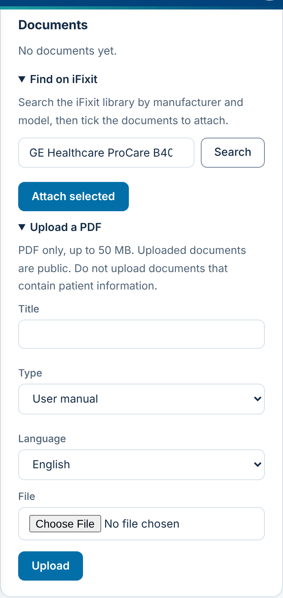
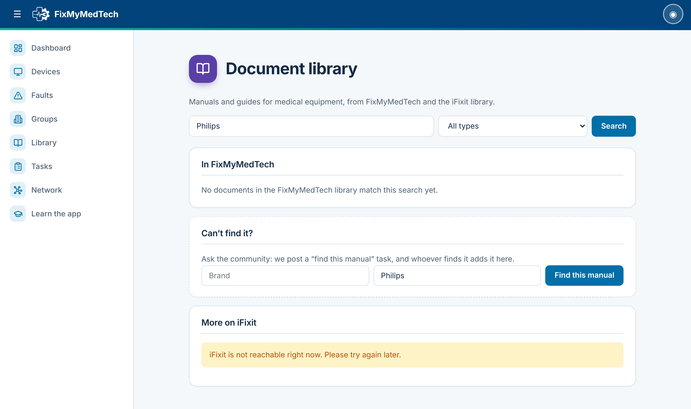

# Adjuntar un manual y buscar en la biblioteca

**En la aplicación:** Equipamiento → **Dispositivos** → **⋯** junto al dispositivo → **Editar** → **Documentos**. La búsqueda está en Equipamiento → **Biblioteca**.

**Para quién es:** ingenieros y administradores de clínica que cuidan un dispositivo; cualquiera que busque un manual.

**Qué necesitas antes:** para adjuntar, debes tener permiso para editar el dispositivo (el administrador de su clínica, la persona que lo registró o el administrador de la organización que lo mantiene). Para buscar en la biblioteca, nada: está abierta a todos, incluso sin iniciar sesión.

## Adjuntar un manual a un dispositivo

1. Ve a **Dispositivos**. En la fila del dispositivo, toca **⋯** y luego **Editar**.
2. Baja hasta la tarjeta **Documentos**. Elige cómo añadir un manual:
    - **Buscar en iFixit.** La búsqueda parte del fabricante y el modelo del dispositivo. Toca **Buscar**, marca los manuales que quieras y toca **Adjuntar seleccionados**.
    - **Subir un PDF.** Rellena el **Título**, el **Tipo** y el **Idioma**, elige el **Archivo** (solo PDF, hasta 50 MB) y toca **Subir**.
3. Los documentos aparecen ahora en la página del dispositivo (casilla **Manuales**) y en su página QR pública.

!!! warning "Los documentos subidos son públicos"
    Cualquiera que escanee el dispositivo puede abrirlos. No subas nunca un documento con información de pacientes.

También puedes adjuntar manuales de iFixit al registrar el dispositivo (paso 6 de 6).

<figure markdown>
{ .phone loading=lazy }
<figcaption>La tarjeta Documentos, en la página de edición del dispositivo.</figcaption>
</figure>

## Buscar en la biblioteca

1. Abre **Biblioteca**.
2. Escribe un dispositivo, un fabricante o un modelo y toca **Buscar**. Filtra por tipo si quieres: **Manual de usuario**, **Manual de servicio**, **Guía rápida**, **Diagrama / esquema**, **Guía general**.
3. Los resultados muestran primero lo que está **En FixMyMedTech** (con cuántos dispositivos usan cada documento) y después **Más en iFixit**.

Sin búsqueda, la biblioteca agrupa los documentos de FixMyMedTech por marca y luego por modelo. La página de un dispositivo también lista los manuales de la biblioteca de la misma marca y modelo, aunque no estén adjuntos a él.

{ .shot loading=lazy }

??? note "Ver el vídeo (en inglés, grabado con una versión anterior de la aplicación)"
    <video src="../videos/attach-manual-en.mp4" controls playsinline preload="none" style="width:100%;max-width:360px;border-radius:12px;display:block;margin:0 auto;"></video>

## Qué pasa después

El manual se queda en la biblioteca: el próximo ingeniero con la misma marca y modelo también lo encuentra.

## Si algo sale mal

- **No hay ningún manual en ninguna parte.** En la página del dispositivo, toca la casilla **Manuales** y luego **Encontrar este manual** (aparece cuando el dispositivo tiene modelo y ningún manual). O, después de una búsqueda sin resultados en la biblioteca, bajo **¿No lo encuentras?**, indica la marca y el modelo y toca **Encontrar este manual**. Una tarea *Encontrar un manual* (20 puntos) va al [tablero de tareas](community-work.md). Si alguien ya pidió la misma marca y modelo, se reutiliza su tarea.
- **"iFixit no está disponible ahora mismo."** Inténtalo más tarde, o sube el PDF.
- **No veo Editar.** No tienes permiso para editar este dispositivo. Pídeselo al administrador de la clínica o al ingeniero que lo registró.
