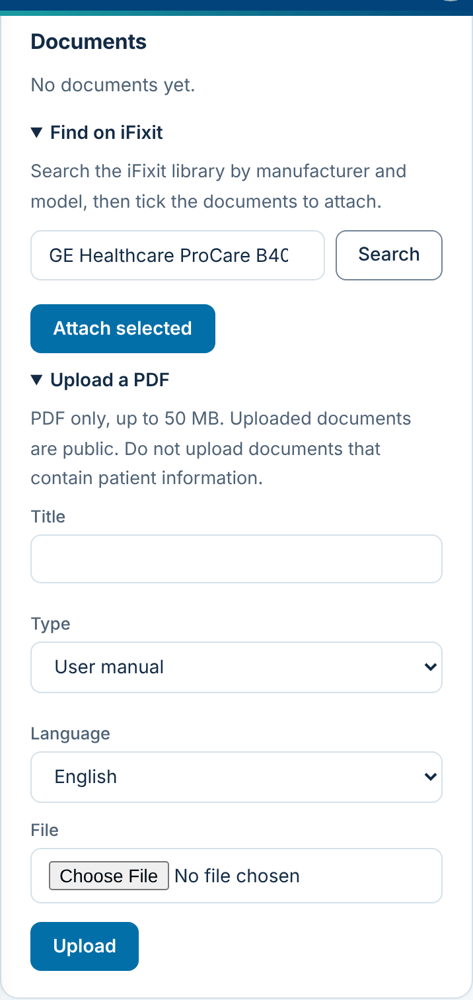
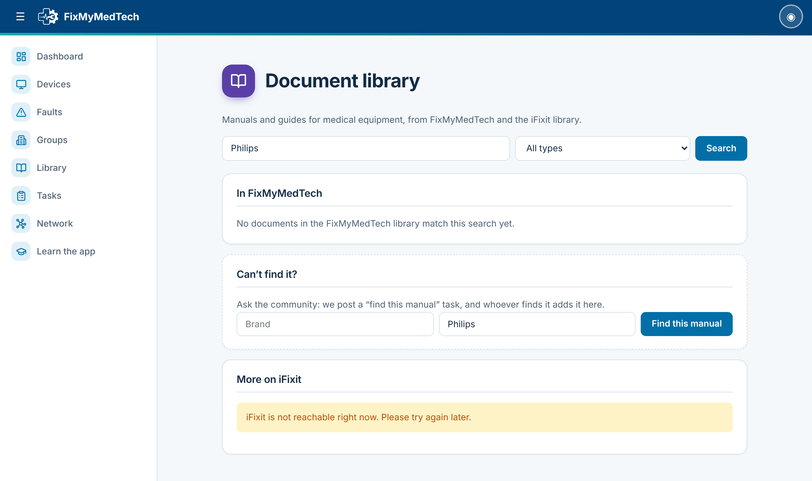

# Joindre un manuel et chercher dans la bibliothèque

**Dans l'application :** Équipements → **Appareils** → **⋯** à côté de l'appareil → **Modifier** → **Documents**. La recherche est dans Équipements → **Bibliothèque**.

**Pour qui :** les ingénieurs et les administrateurs de clinique qui s'occupent d'un appareil ; toute personne qui cherche un manuel.

**Ce qu'il vous faut avant :** pour joindre un manuel, vous devez pouvoir modifier l'appareil (administrateur de sa clinique, personne qui l'a enregistré, ou administrateur de l'organisation qui l'entretient). Pour chercher dans la bibliothèque, rien : elle est ouverte à tous, même sans être connecté.

## Joindre un manuel à un appareil

1. Allez dans **Appareils**. Sur la ligne de l'appareil, touchez **⋯**, puis **Modifier**.
2. Descendez jusqu'à la carte **Documents**. Choisissez comment ajouter un manuel :
    - **Chercher sur iFixit.** La recherche part du fabricant et du modèle de l'appareil. Touchez **Chercher**, cochez les manuels voulus, touchez **Joindre la sélection**.
    - **Téléverser un PDF.** Remplissez le **Titre**, le **Type** et la **Langue**, choisissez le **Fichier** (PDF seulement, 50 Mo au plus), touchez **Téléverser**.
3. Les documents apparaissent sur la page de l'appareil (tuile **Manuels**) et sur sa page QR publique.

!!! warning "Les documents téléversés sont publics"
    Toute personne qui scanne l'appareil peut les ouvrir. Ne téléversez jamais un document avec des informations sur des patients.

Vous pouvez aussi joindre des manuels iFixit pendant l'enregistrement de l'appareil (étape 6 sur 6).

<figure markdown>
{ .phone loading=lazy }
<figcaption>La carte Documents, sur la page de modification de l'appareil.</figcaption>
</figure>

## Chercher dans la bibliothèque

1. Ouvrez **Bibliothèque**.
2. Tapez un appareil, un fabricant ou un modèle, et touchez **Chercher**. Filtrez par type si vous voulez : **Manuel d'utilisation**, **Manuel de service**, **Guide rapide**, **Schéma**, **Guide général**.
3. Les résultats montrent d'abord ce qui est **Dans FixMyMedTech** (avec le nombre d'appareils qui utilisent chaque document), puis **Plus sur iFixit**.

Sans recherche, la bibliothèque range les documents de FixMyMedTech par marque, puis par modèle. La page d'un appareil liste aussi les manuels de la bibliothèque de même marque et modèle, même s'ils ne lui sont pas joints.

{ .shot loading=lazy }

??? note "Voir la vidéo (enregistrée sur une version précédente de l'application)"
    <video src="../videos/attach-manual-fr.mp4" controls playsinline preload="none" style="width:100%;max-width:360px;border-radius:12px;display:block;margin:0 auto;"></video>

## Et ensuite

Le manuel reste dans la bibliothèque : le prochain ingénieur qui a la même marque et le même modèle le trouve aussi.

## En cas de problème

- **Aucun manuel nulle part.** Sur la page de l'appareil, touchez la tuile **Manuels**, puis **Trouver ce manuel** (affiché quand l'appareil a un modèle et aucun manuel). Ou, après une recherche sans résultat dans la bibliothèque, sous **Introuvable ?**, donnez la marque et le modèle et touchez **Trouver ce manuel**. Une tâche *Trouver un manuel* (20 points) est publiée sur le [tableau des tâches](community-work.md). Si quelqu'un a déjà demandé la même marque et le même modèle, sa tâche est réutilisée.
- **« iFixit n'est pas joignable pour le moment. »** Réessayez plus tard, ou téléversez le PDF.
- **Je ne vois pas Modifier.** Vous n'avez pas le droit de modifier cet appareil. Demandez à l'administrateur de la clinique ou à l'ingénieur qui l'a enregistré.
