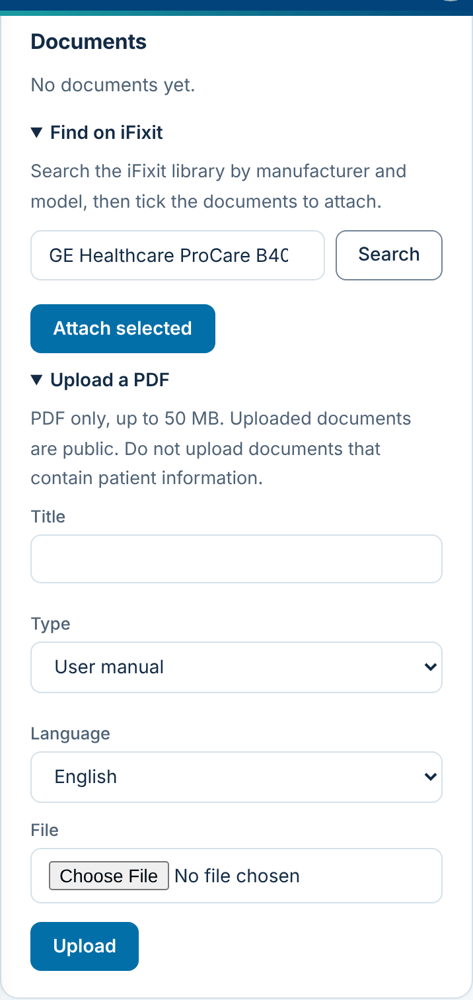
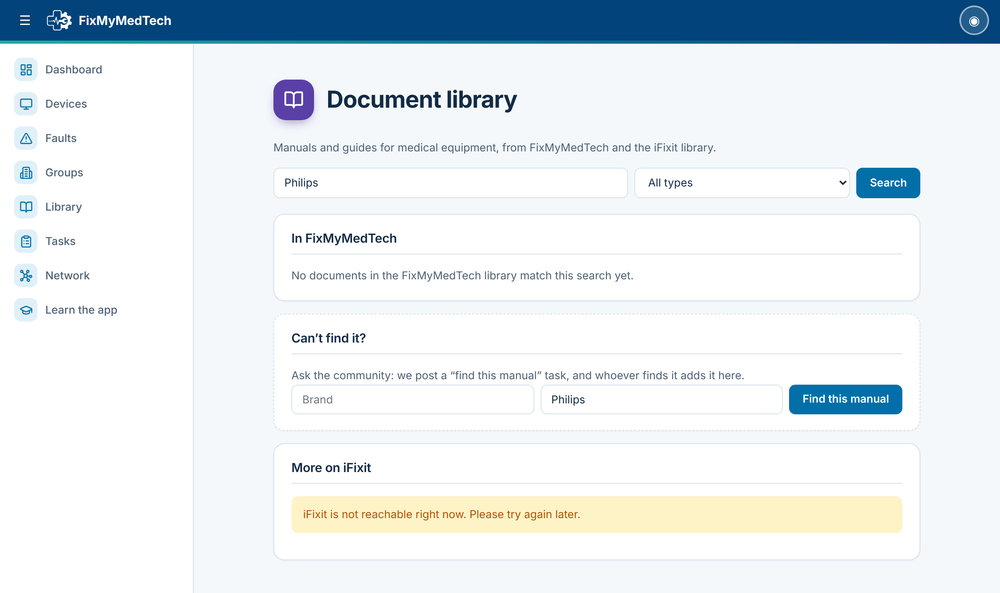

# Attach a manual and search the library

**In the app:** Equipment → **Devices** → **⋯** next to the device → **Edit** → **Documents**. The search is in Equipment → **Library**.

**Who this is for:** engineers and clinic administrators who look after a device; anyone looking for a manual.

**What you need before:** to attach, you must be allowed to edit the device (its clinic's administrator, the person who registered it, or the administrator of the organisation that maintains it). To search the library, nothing: it is open to everyone, even signed out.

## Attach a manual to a device

1. Go to **Devices**. On the device's row, tap **⋯**, then **Edit**.
2. Scroll to the **Documents** card. Choose how to add a manual:
    - **Find on iFixit.** The search starts from the device's manufacturer and model. Tap **Search**, tick the manuals you want, tap **Attach selected**.
    - **Upload a PDF.** Fill in the **Title**, **Type** and **Language**, choose the **File** (PDF only, up to 50 MB), tap **Upload**.
3. The documents now show on the device page (**Manuals** tile) and on its public QR page.

!!! warning "Uploaded documents are public"
    Anyone who scans the device can open them. Never upload a document with patient information.

You can also attach iFixit manuals while registering the device (step 6 of 6).

<figure markdown>
{ .phone loading=lazy }
<figcaption>The Documents card, on the device's edit page.</figcaption>
</figure>

## Search the library

1. Open **Library**.
2. Type a device, a manufacturer or a model, and tap **Search**. Filter by type if you like: **User manual**, **Service manual**, **Quick guide**, **Diagram / schematic**, **General guide**.
3. The results show first what is **In FixMyMedTech** (with how many devices use each document), then **More on iFixit**.

Without a search, the library groups FixMyMedTech's documents by brand, then model. A device page also lists library manuals of the same brand and model, even when they are not attached to it.

{ .shot loading=lazy }

??? note "Watch the video (recorded on an earlier version of the app)"
    <video src="../videos/attach-manual-en.mp4" controls playsinline preload="none" style="width:100%;max-width:360px;border-radius:12px;display:block;margin:0 auto;"></video>

## What happens next

The manual stays in the library: the next engineer with the same brand and model finds it too.

## If something goes wrong

- **No manual anywhere.** On the device page, tap the **Manuals** tile, then **Find this manual** (shown when the device has a model and no manual). Or, after a library search with no result, under **Can't find it?**, give the brand and model and tap **Find this manual**. A *Find a manual* task (20 points) goes on the [task board](community-work.md). If someone already asked for the same brand and model, their task is reused.
- **"iFixit is not reachable right now."** Try again later, or upload the PDF.
- **I don't see Edit.** You are not allowed to edit this device. Ask the clinic's administrator or the engineer who registered it.
