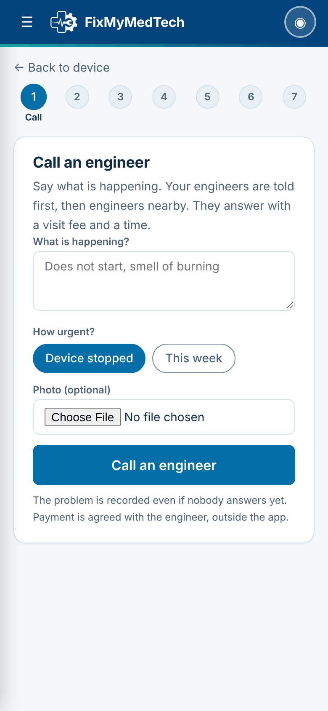
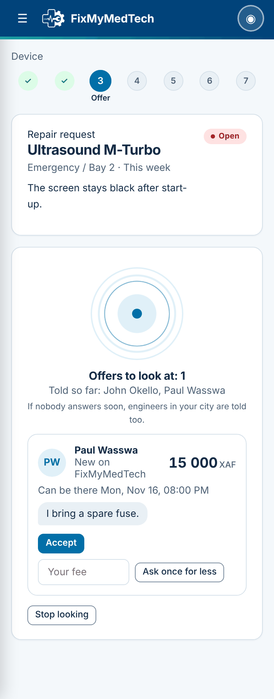

# Llamar a un ingeniero

**En la aplicación:** Equipamiento → **Dispositivos** → el dispositivo → **Llamar a un ingeniero** (también en la página QR del dispositivo y en una falla abierta).

**Para quién es:** personal y administradores de la clínica cuyo dispositivo se ha parado o tiene un problema.

**Qué necesitas antes:** has iniciado sesión y tienes un rol en la clínica del dispositivo (o en la organización que lo mantiene).

Llamar a un ingeniero funciona un poco como pedir un taxi: se avisa a los ingenieros, ellos envían una oferta y tú eliges una. **El pago se hace fuera de la aplicación**: las tarifas se anotan, no se cobra nada.

## Pasos

1. En la página del dispositivo, toca **Llamar a un ingeniero**.
2. En **¿Qué pasa?**, describe el problema. Elige **¿Qué tan urgente?**: **El equipo se paró** o **Esta semana**. Añade una foto si puedes. Toca **Llamar a un ingeniero** al final del formulario.
3. La página de la solicitud muestra los pasos: *Llamada → Búsqueda → Oferta → Acuerdo → Diagnóstico → Reparación → Cierre*, y a quién se ha avisado (**Avisados:**).
4. Se avisa a los ingenieros en este orden:
    1. los ingenieros responsables de tu clínica y los técnicos de la organización que mantiene el dispositivo;
    2. el ingeniero que registró el dispositivo;
    3. si nadie ha ofrecido nada después de 20 minutos (**El equipo se paró**) o de 4 horas (**Esta semana**), los Colaboradores que viven en tu ciudad. (Si no hay nadie en 1 y 2, se les avisa de inmediato.)
5. Cada oferta muestra al ingeniero, una **tarifa de visita** y cuándo **Puede llegar**. Toca **Aceptar**. O escribe tu precio y toca **Pedir menos una vez**: puedes hacerlo una vez por oferta, y el ingeniero acepta o rechaza.
6. Al aceptar una oferta, la falla se asigna a ese ingeniero. Las demás ofertas se cierran.
7. El ingeniero viene, escribe un diagnóstico y una cotización. Tú la apruebas en la página de la falla (mira [Reportar una falla y conseguir que se repare](report-fault.md)).
8. Cuando el ingeniero dice que está arreglado, responde **¿Funciona ahora?**:
    - **Funciona** cierra la solicitud. Valora la reparación (de 1 a 5 estrellas) y deja unas palabras si quieres.
    - **Todavía no funciona** devuelve la reparación al mismo ingeniero, con el mismo acuerdo. Recibe un correo.

<figure markdown>
{ .phone loading=lazy }
<figcaption>Di qué pasa y qué tan urgente es.</figcaption>
</figure>
<figure markdown>
{ .phone loading=lazy }
<figcaption>Una oferta: tarifa de visita y hora de llegada.</figcaption>
</figure>

## Qué pasa después

- Una oferta cubre la visita y el diagnóstico. La reparación en sí se cotiza después del diagnóstico.
- El problema queda registrado como una falla aunque todavía nadie responda.
- ¿Cambiaste de idea? Toca **Dejar de buscar**.

## Para ingenieros

Los ingenieros responden desde **Trabajo → Solicitudes**: mira [Solicitudes y ofertas](requests.md).

## Si algo sale mal

- **"Solo el personal de la clínica puede llamar a un ingeniero."** Necesitas un rol en la clínica del dispositivo. Pide a su administrador que te añada (**Grupos**).
- **"Aún no hay ingenieros a quien avisar. La solicitud sigue abierta."** Tu clínica todavía no tiene ingeniero responsable, y no hay nadie en tu ciudad. Nombra uno (**Grupos → tu clínica → Ingenieros**) o pregunta a la comunidad.
- **Nadie responde.** Pasado el tiempo de espera, también se avisa a los ingenieros de tu ciudad. Comprueba que la ciudad y la región de tu clínica estén rellenas (**Grupos → tu clínica → Editar**): la búsqueda por ciudad las usa.
