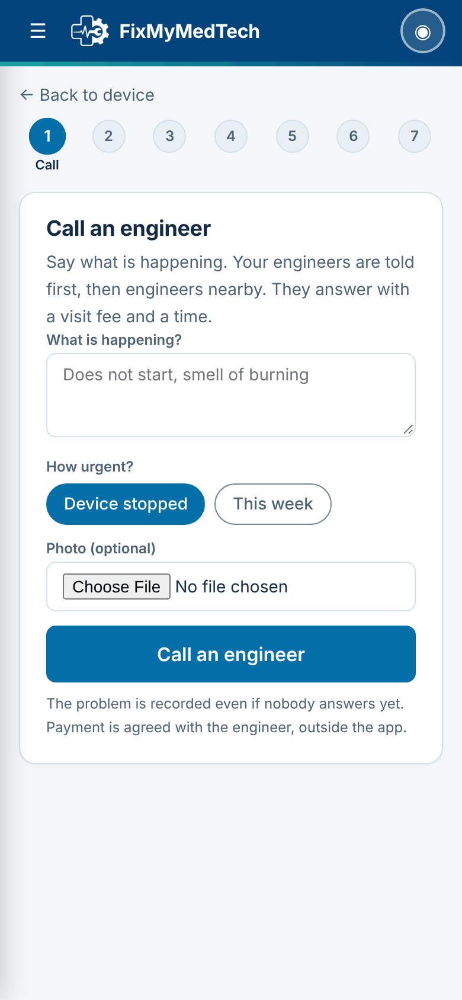
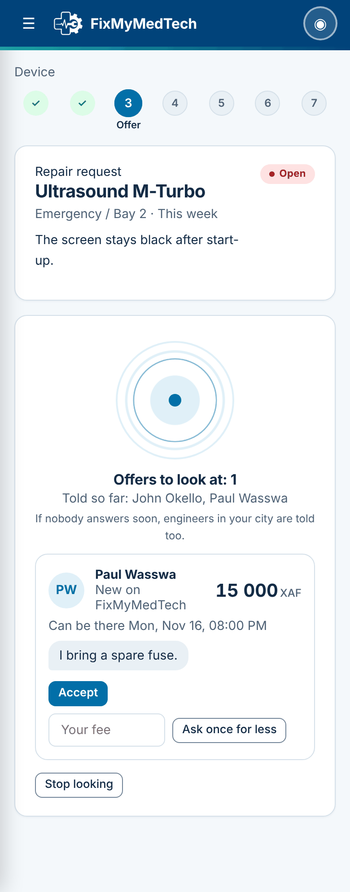

# Appeler un ingénieur

**Dans l'application :** Équipements → **Appareils** → l'appareil → **Appeler un ingénieur** (aussi sur la page QR de l'appareil et sur une panne ouverte).

**Pour qui :** le personnel et les administrateurs de clinique dont un appareil est à l'arrêt ou a un problème.

**Ce qu'il vous faut avant :** vous êtes connecté et vous avez un rôle dans la clinique de l'appareil (ou dans l'organisation qui l'entretient).

Appeler un ingénieur marche un peu comme appeler un taxi : des ingénieurs sont prévenus, ils envoient une offre, vous en choisissez une. **Le paiement se fait hors de l'application** : les prix sont notés, rien n'est prélevé.

## Étapes

1. Sur la page de l'appareil, touchez **Appeler un ingénieur**.
2. Sous **Que se passe-t-il ?**, décrivez le problème. Choisissez **C'est urgent ?** : **L'appareil est à l'arrêt** ou **Cette semaine**. Ajoutez une photo si possible. Touchez **Appeler un ingénieur** en bas du formulaire.
3. La page de la demande montre les étapes : *Appel → Recherche → Offre → Accord → Diagnostic → Réparation → Validation*, et qui a été prévenu (**Prévenus :**).
4. Les ingénieurs sont prévenus dans cet ordre :
    1. les ingénieurs responsables de votre clinique, et les techniciens de l'organisation qui entretient l'appareil ;
    2. l'ingénieur qui a enregistré l'appareil ;
    3. si personne n'a fait d'offre après 20 minutes (**L'appareil est à l'arrêt**) ou 4 heures (**Cette semaine**), les contributeurs qui habitent votre ville. (S'il n'y a personne aux points 1 et 2, ils sont prévenus tout de suite.)
5. Chaque offre montre l'ingénieur, un **prix de visite** et quand il **Peut venir**. Touchez **Accepter**. Ou tapez votre prix et touchez **Demander moins (une fois)** : une seule fois par offre, puis l'ingénieur accepte ou refuse.
6. Accepter une offre assigne la panne à cet ingénieur. Les autres offres se ferment.
7. L'ingénieur vient, écrit un diagnostic et un devis. Vous l'approuvez sur la page de la panne (voir [Signaler une panne et la faire réparer](report-fault.md)).
8. Quand l'ingénieur dit que c'est réparé, répondez à **Ça marche maintenant ?** :
    - **Ça marche** clôt la demande. Notez la réparation (1 à 5 étoiles) et laissez un mot si vous voulez.
    - **Ça ne marche toujours pas** renvoie la réparation au même ingénieur, avec le même accord. Il reçoit un e-mail.

<figure markdown>
{ .phone loading=lazy }
<figcaption>Dites ce qui se passe et si c'est urgent.</figcaption>
</figure>
<figure markdown>
{ .phone loading=lazy }
<figcaption>Une offre : prix de visite et heure d'arrivée.</figcaption>
</figure>

## Et ensuite

- Une offre couvre le déplacement et le diagnostic. La réparation elle-même est chiffrée après le diagnostic.
- Le problème est enregistré comme panne même si personne ne répond encore.
- Vous avez changé d'avis ? Touchez **Arrêter la recherche**.

## Pour les ingénieurs

Les ingénieurs répondent depuis **Travail → Demandes** : voir [Demandes et offres](requests.md).

## En cas de problème

- **« Seul le personnel de la clinique peut appeler un ingénieur. »** Il vous faut un rôle dans la clinique de l'appareil. Demandez à son administrateur de vous ajouter (**Groupes**).
- **« Pas encore d'ingénieur à prévenir. La demande reste ouverte. »** Votre clinique n'a pas encore d'ingénieur responsable, et personne dans votre ville. Nommez-en un (**Groupes → votre clinique → Ingénieurs**) ou demandez à la communauté.
- **Personne ne répond.** Après le délai, les ingénieurs de votre ville sont aussi prévenus. Vérifiez que la ville et la région de votre clinique sont remplies (**Groupes → votre clinique → Modifier**) : la recherche par ville les utilise.
