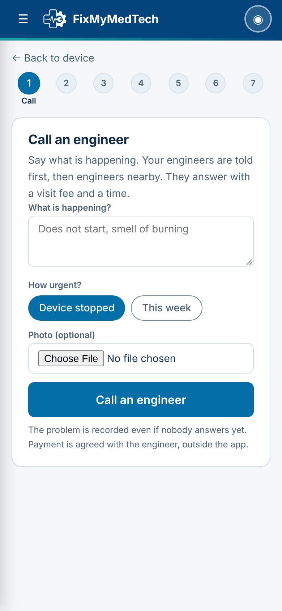
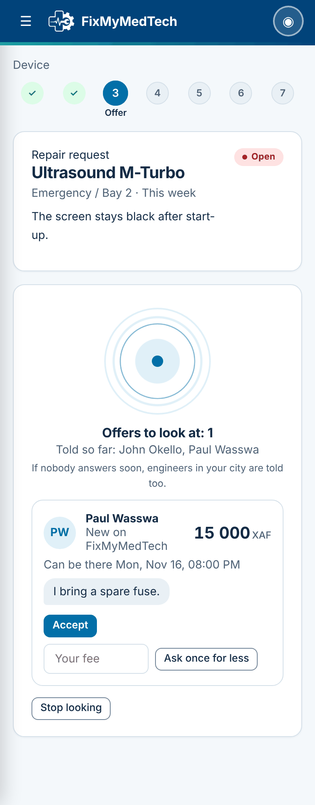

# Call an engineer

**In the app:** Equipment → **Devices** → the device → **Call an engineer** (also on the device's QR page and on an open fault).

**Who this is for:** clinic staff and administrators whose device has stopped or has a problem.

**What you need before:** you are signed in and you have a role at the device's clinic (or at the organisation that maintains it).

Calling an engineer works a bit like calling a ride: engineers are told, they send an offer, you pick one. **Payment stays outside the app**: the fees are written down, nothing is charged.

## Steps

1. On the device page, tap **Call an engineer**.
2. Under **What is happening?**, describe the problem. Choose **How urgent?**: **Device stopped** or **This week**. Add a photo if you can. Tap **Call an engineer** at the bottom of the form.
3. The request page shows the steps: *Call → Match → Offer → Agree → Diagnose → Repair → Sign off*, and who has been told (**Told so far:**).
4. Engineers are told in this order:
    1. your clinic's responsible engineers, and the technicians of the organisation that maintains the device;
    2. the engineer who registered the device;
    3. if nobody has offered after 20 minutes (**Device stopped**) or 4 hours (**This week**), Contributors who live in your city. (If there is nobody in 1 and 2, they are told at once.)
5. Each offer shows the engineer, a **visit fee** and when they **Can be there**. Tap **Accept**. Or type your price and tap **Ask once for less**: you can do it once per offer, and the engineer accepts or declines.
6. Accepting an offer assigns the fault to that engineer. The other offers close.
7. The engineer comes, writes a diagnosis and a quote. You approve it on the fault page (see [Report a fault and get it repaired](report-fault.md)).
8. When the engineer says it is fixed, answer **Does it work now?**:
    - **It works** closes the request. Rate the repair (1 to 5 stars) and leave a word if you like.
    - **It still doesn't work** sends the repair back to the same engineer, on the same agreement. They get an email.

<figure markdown>
{ .phone loading=lazy }
<figcaption>Say what is happening and how urgent it is.</figcaption>
</figure>
<figure markdown>
{ .phone loading=lazy }
<figcaption>An offer: visit fee and arrival time.</figcaption>
</figure>

## What happens next

- An offer covers coming and diagnosing. The repair itself is quoted after the diagnosis.
- The problem is recorded as a fault even if nobody answers yet.
- Changed your mind? Tap **Stop looking**.

## For engineers

Engineers answer from **Work → Requests**: see [Requests and offers](requests.md).

## If something goes wrong

- **"Only the clinic's people can call an engineer."** You need a role at the device's clinic. Ask its administrator to add you (**Groups**).
- **"No engineer to tell yet. Your request stays open."** Your clinic has no responsible engineer yet, and nobody in your city. Name one (**Groups → your clinic → Engineers**) or ask the community.
- **Nobody answers.** After the waiting time, engineers of your city are told too. Check your clinic's city and region are filled in (**Groups → your clinic → Edit**): the city match uses them.
