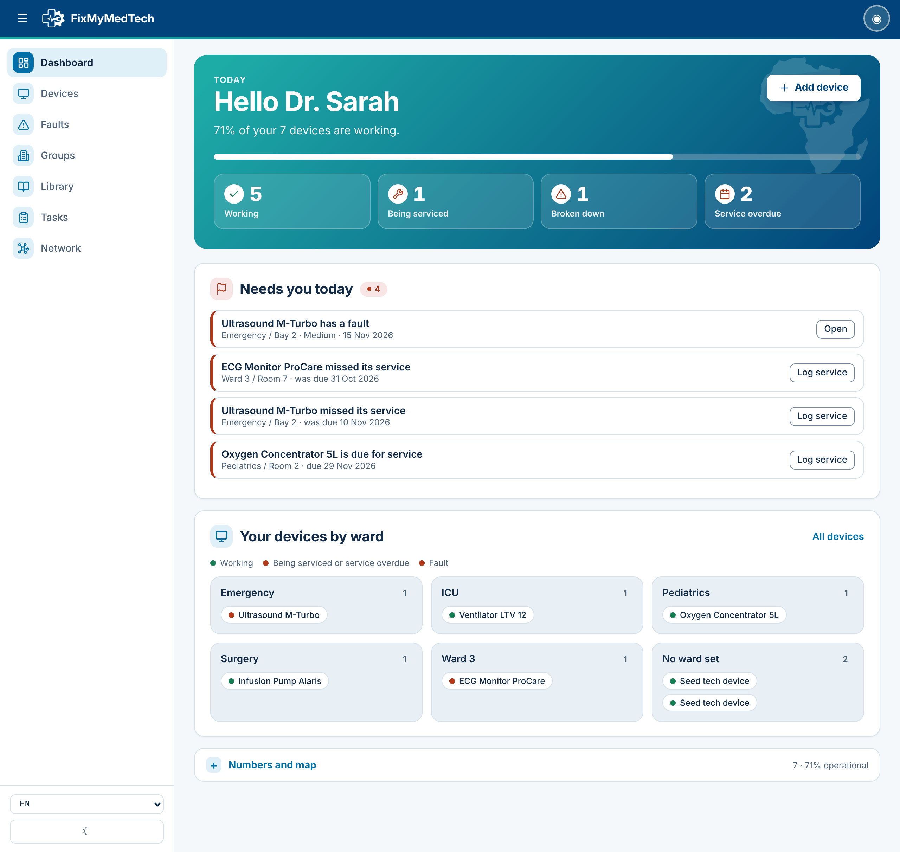
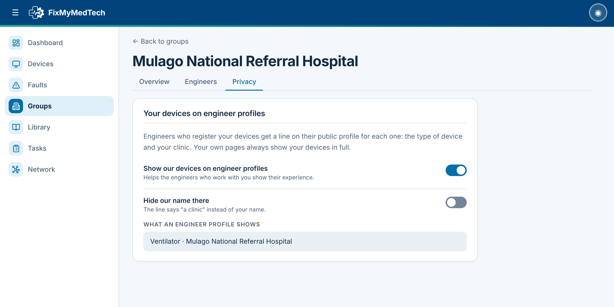

# Cuida los dispositivos de tu clínica

**En la aplicación:** Equipamiento → **Panel** y **Dispositivos**; la pestaña **Privacidad** de la clínica está en **Grupos**.

**Para quién es:** administradores y personal de la clínica, y los ingenieros que cuidan una clínica.

**Qué necesitas antes:** tu clínica está configurada y tiene dispositivos (mira [Configura tu clínica](clinic-setup.md) y [Registrar un dispositivo](register-device.md)).

## Pasos

1. Abre **Panel**. Empieza por **Te necesita hoy**:
    - **fallas abiertas**, en rojo cuando la gravedad es alta o crítica: **Abrir** lleva a la falla;
    - **servicios atrasados**: **Registrar servicio** abre el registro de mantenimiento de ese dispositivo;
    - **servicios previstos en los próximos 14 días**.

    Cuando no hay nada pendiente, la tarjeta dice **Todo en orden**.
2. Mira **Tus equipos por servicio**. Los dispositivos se agrupan según la primera parte de su ubicación (*Sala 3 / Habitación 7* va bajo *Sala 3*). Los dispositivos que necesitan a alguien van primero. Toca un dispositivo para abrirlo.
3. Abre **Dispositivos** para ver la lista completa. **Requiere atención** deja solo los dispositivos con una falla, en mantenimiento o con un servicio atrasado. **Lista** y **Por clínica** cambian la vista.
4. Abre un dispositivo. Su página empieza con una tarjeta de identidad: foto, tipo, marca y modelo, ubicación y estado, las acciones (**Reportar un problema**, **Llamar a un ingeniero**, **Iniciar registro de mantenimiento**, **Mostrar QR**) y tres casillas:
    - **Próximo servicio**: la fecha, y si está al día, próximo o atrasado;
    - **Manuales**: cuántos hay adjuntos (mira [Adjuntar un manual](attach-manual.md));
    - **Reparaciones**: cuántas fallas siguen abiertas.

    El propietario, la ubicación, el historial y el código QR están en **Más detalles**.
5. Después de un servicio, el ingeniero rellena el registro de mantenimiento (**Iniciar registro de mantenimiento**). Cuando se cierra el registro, la fecha del próximo servicio avanza.

{ .shot loading=lazy }

Los colores de los puntos:

| Punto | Significa |
| --- | --- |
| Verde | Funcionando, servicio al día |
| Naranja | En servicio, o servicio atrasado |
| Rojo | Tiene una falla abierta |
| Gris | Dado de baja |

## Fechas de servicio y recordatorios

- Cada categoría de dispositivo tiene un intervalo de servicio en meses (por ejemplo cada 6 meses). Un dispositivo puede tener su propio intervalo en su página de edición (**Servicio cada**).
- Cuando se cierra un registro de mantenimiento, la fecha del próximo servicio avanza ese intervalo, o pasa a la fecha escrita en el registro.
- Los administradores de la clínica y de la organización que mantiene el dispositivo reciben un correo cuando un servicio vence en los próximos 14 días, y otro cuando está atrasado.

## Quién puede ver tus dispositivos { #who-can-see-your-devices }

- **La página QR pública** (lo que ve cualquiera que escanee la etiqueta): el nombre del dispositivo, la marca, el número de serie, el estado, la fecha del servicio, los manuales y las fallas abiertas, con **⚠ Reportar falla** y **Llamar a un ingeniero**. No los datos privados de la clínica.
- **La página privada del dispositivo**: los miembros de tu clínica y de la organización que mantiene el dispositivo, la persona que lo registró y tus ingenieros responsables confirmados (cuando sus pasos de bienvenida están hechos y tu clínica está activa).
- **Los perfiles de ingenieros**: un ingeniero que registra tus dispositivos tiene una línea por dispositivo en su perfil público, por ejemplo *Ventilador · Hospital Mulago*. En **Grupos → tu clínica → Privacidad**, un administrador puede desmarcar **Mostrar nuestros equipos en los perfiles de los ingenieros**, o marcar **Ocultar nuestro nombre allí** (la línea dirá entonces *una clínica*). Toca **Guardar**. Una vista previa muestra lo que mostrará un perfil.

{ .shot loading=lazy }

## Si algo sale mal

- **Un dispositivo está en la sala equivocada.** Edita el dispositivo (**Dispositivos → ⋯ → Editar**) y corrige la **Ubicación en el centro de salud**: la parte antes de la primera "/" es la sala.
- **La fecha del próximo servicio es incorrecta.** Edita el dispositivo y cambia las fechas o **Servicio cada**.
- **No recibimos correos de recordatorio.** Comprueba que los correos de tus administradores sean correctos y mira en la carpeta de spam.
