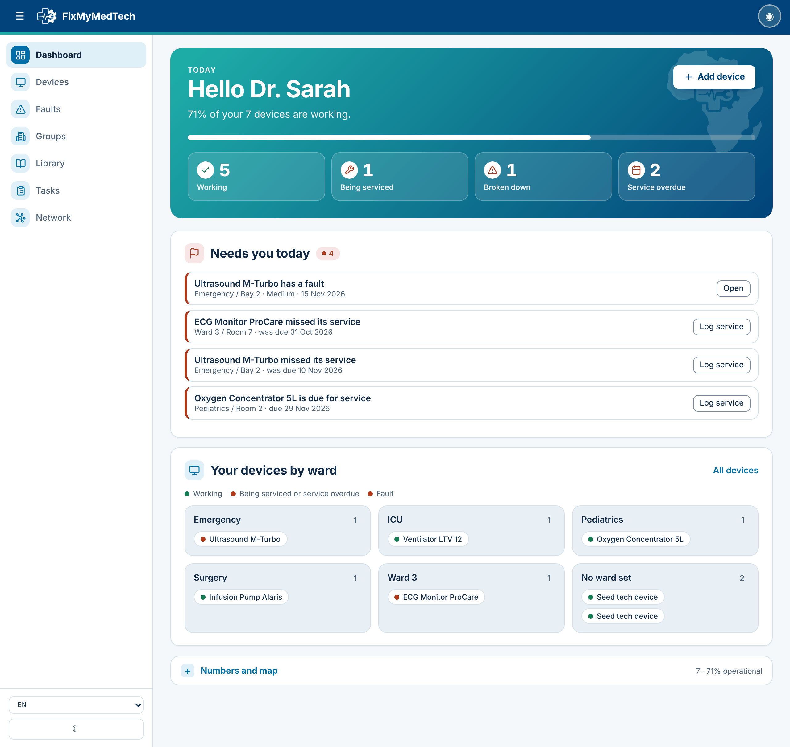
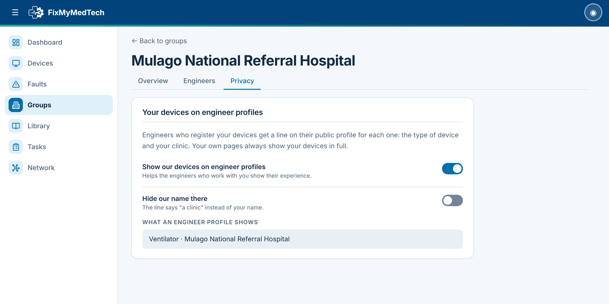

# Suivre les appareils de votre clinique

**Dans l'application :** Équipements → **Tableau de bord** et **Appareils** ; l'onglet **Confidentialité** de la clinique est dans **Groupes**.

**Pour qui :** les administrateurs et le personnel de clinique, et les ingénieurs qui s'occupent d'une clinique.

**Ce qu'il vous faut avant :** votre clinique est configurée et a des appareils (voir [Configurer votre clinique](clinic-setup.md) et [Enregistrer un appareil](register-device.md)).

## Étapes

1. Ouvrez le **Tableau de bord**. Commencez par **À traiter aujourd'hui** :
    - les **pannes ouvertes**, en rouge quand la gravité est élevée ou critique : **Ouvrir** mène à la panne ;
    - les **entretiens manqués** : **Noter l'entretien** ouvre le journal d'entretien de l'appareil ;
    - les **entretiens prévus dans les 14 prochains jours**.

    Quand rien n'attend, la carte dit **Tout est en ordre**.
2. Regardez **Vos équipements par service**. Les appareils sont groupés selon la première partie de leur emplacement (*Service 3 / Chambre 7* va sous *Service 3*). Les appareils qui ont besoin de quelqu'un viennent en premier. Touchez un appareil pour l'ouvrir.
3. Ouvrez **Appareils** pour la liste complète. **À traiter** ne garde que les appareils en panne, en maintenance ou avec un entretien manqué. **Liste** et **Par clinique** changent la vue.
4. Ouvrez un appareil. Sa page commence par une carte d'identité : photo, type, marque et modèle, emplacement et statut, les actions (**Signaler un problème**, **Appeler un ingénieur**, **Démarrer le journal d'entretien**, **Afficher le QR**) et trois tuiles :
    - **Prochain entretien** : la date, et s'il est à l'heure, bientôt dû ou en retard ;
    - **Manuels** : combien sont joints (voir [Joindre un manuel](attach-manual.md)) ;
    - **Réparations** : combien de pannes sont encore ouvertes.

    Le responsable, l'emplacement, l'historique et le code QR sont sous **Plus de détails**.
5. Après un entretien, l'ingénieur remplit le journal d'entretien (**Démarrer le journal d'entretien**). Quand le journal est clôturé, la date du prochain entretien avance.

{ .shot loading=lazy }

Les couleurs des points :

| Point | Signifie |
| --- | --- |
| Vert | Opérationnel, entretien à jour |
| Orange | En maintenance, ou entretien en retard |
| Rouge | Une panne est ouverte |
| Gris | Décommissionné |

## Dates d'entretien et rappels

- Chaque catégorie d'appareil a un intervalle d'entretien en mois (par exemple tous les 6 mois). Un appareil peut avoir son propre intervalle sur sa page de modification (**Entretien tous les**).
- Quand un journal d'entretien est clôturé, la date du prochain entretien avance de cet intervalle, ou passe à la date écrite dans le journal.
- Les administrateurs de la clinique et de l'organisation qui entretient l'appareil reçoivent un e-mail quand un entretien est dû dans les 14 jours, et un autre quand il est en retard.

## Qui peut voir vos appareils { #who-can-see-your-devices }

- **La page QR publique** (ce que voit toute personne qui scanne l'étiquette) : le nom de l'appareil, la marque, le numéro de série, le statut, la date d'entretien, les manuels et les pannes ouvertes, avec **⚠ Signaler un problème** et **Appeler un ingénieur**. Pas les informations privées de la clinique.
- **La page privée de l'appareil** : les membres de votre clinique et de l'organisation qui entretient l'appareil, la personne qui l'a enregistré, et vos ingénieurs responsables confirmés (une fois leurs étapes d'accueil terminées et votre clinique active).
- **Les profils d'ingénieurs** : un ingénieur qui enregistre vos appareils a une ligne par appareil sur son profil public, par exemple *Ventilateur · Mulago Hospital*. Dans **Groupes → votre clinique → Confidentialité**, un administrateur peut décocher **Montrer nos équipements sur les profils des ingénieurs**, ou cocher **Masquer notre nom** (la ligne dit alors *une clinique*). Touchez **Enregistrer**. Un aperçu montre ce qu'un profil affichera.

{ .shot loading=lazy }

## En cas de problème

- **Un appareil est dans le mauvais service.** Modifiez l'appareil (**Appareils → ⋯ → Modifier**) et corrigez l'**Emplacement dans la clinique** : la partie avant le premier « / » est le service.
- **La date du prochain entretien est fausse.** Modifiez l'appareil et changez les dates ou **Entretien tous les**.
- **Nous ne recevons pas de rappels.** Vérifiez les adresses e-mail de vos administrateurs, et regardez dans les courriers indésirables.
