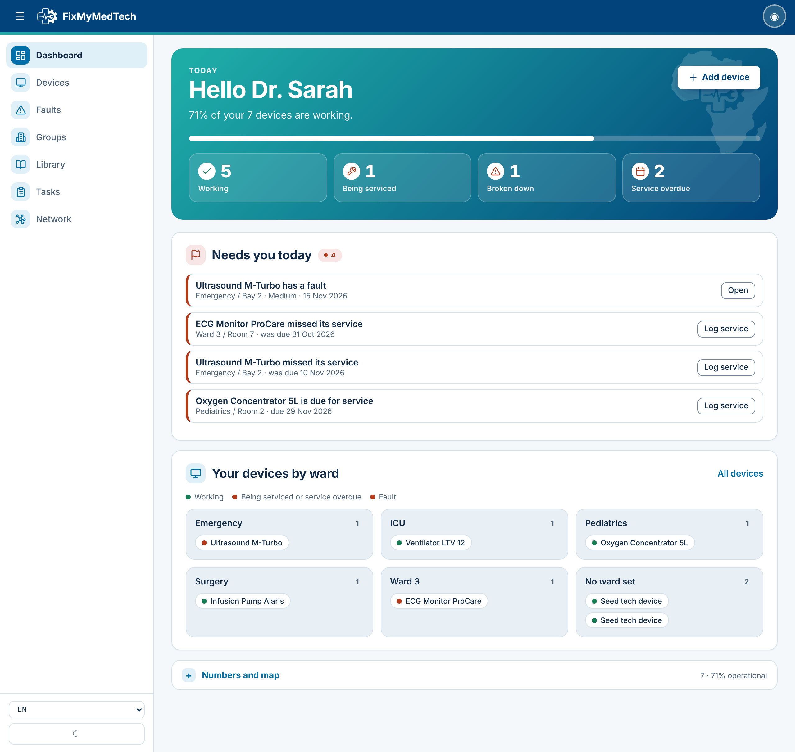
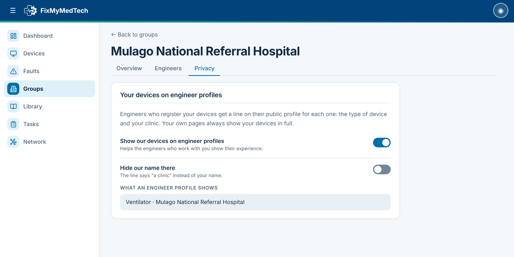

# Look after your clinic's devices

**In the app:** Equipment → **Dashboard** and **Devices**; the clinic's **Privacy** tab is in **Groups**.

**Who this is for:** clinic administrators and staff, and the engineers who look after a clinic.

**What you need before:** your clinic is set up and has devices (see [Set up your clinic](clinic-setup.md) and [Register a device](register-device.md)).

## Steps

1. Open **Dashboard**. Start with **Needs you today**:
    - **open faults**, in red when the severity is high or critical: **Open** goes to the fault;
    - **missed services**: **Log service** opens the maintenance log for that device;
    - **services due in the next 14 days**.

    When nothing is waiting, the card says **All clear**.
2. Look at **Your devices by ward**. Devices are grouped by the first part of their location (*Ward 3 / Room 7* goes under *Ward 3*). Devices that need someone come first. Tap a device to open it.
3. Open **Devices** for the full list. **Needs attention** keeps only devices with a fault, in maintenance, or with a missed service. **List** and **By clinic** change the view.
4. Open a device. Its page starts with an ID card: photo, type, brand and model, location and status, the actions (**Report a problem**, **Call an engineer**, **Start maintenance log**, **Show QR**) and three tiles:
    - **Next service**: the date, and whether it is on time, due soon or overdue;
    - **Manuals**: how many are attached (see [Attach a manual](attach-manual.md));
    - **Repairs**: how many faults are still open.

    Owner, location, history and the QR code are under **More details**.
5. After a service, the engineer fills in the maintenance log (**Start maintenance log**). When the log is closed, the next service date moves forward.

{ .shot loading=lazy }

The colours of the dots:

| Dot | Means |
| --- | --- |
| Green | Working, service on time |
| Orange | Being serviced, or service overdue |
| Red | Has an open fault |
| Grey | Decommissioned |

## Service dates and reminders

- Every device category has a service interval in months (for example every 6 months). A device can have its own interval on its edit page (**Service every**).
- When a maintenance log is closed, the next service date moves forward by that interval, or to the date written in the log.
- The administrators of the clinic and of the organisation that maintains the device get an email when a service is due within 14 days, and another when it is overdue.

## Who can see your devices

- **The public QR page** (what anyone sees when scanning the sticker): the device's name, brand, serial number, status, service due date, manuals and open faults, with **⚠ Report fault** and **Call an engineer**. Not the clinic's private details.
- **The private device page**: the members of your clinic and of the organisation that maintains the device, the person who registered it, and your confirmed responsible engineers (once their welcome steps are done and your clinic is active).
- **Engineer profiles**: an engineer who registers your devices gets one line per device on their public profile, for example *Ventilator · Mulago Hospital*. In **Groups → your clinic → Privacy**, an administrator can untick **Show our devices on engineer profiles**, or tick **Hide our name there** (the line then says *a clinic*). Tap **Save**. A preview shows what a profile will display.

{ .shot loading=lazy }

## If something goes wrong

- **A device is in the wrong ward.** Edit the device (**Devices → ⋯ → Edit**) and fix **Location in the clinic**: the part before the first "/" is the ward.
- **The next service date is wrong.** Edit the device and change the dates or **Service every**.
- **We get no reminder emails.** Check that your administrators' email addresses are right, and look in the spam folder.
