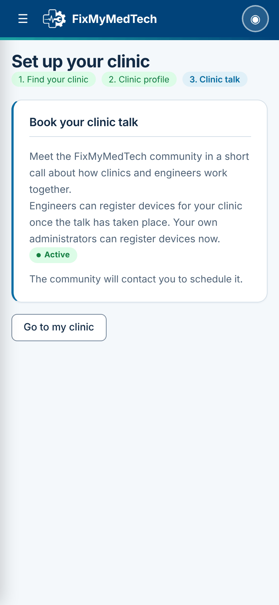

# Configura tu clínica

**En la aplicación:** **Configura tu clínica** se abre sola después de crear una cuenta de clínica; más tarde, la página de la clínica está en **Grupos**.

**Para quién es:** la persona que crea la cuenta de la clínica (administrador, enfermero jefe, responsable).

**Qué necesitas antes:** una cuenta de clínica, creada a partir de la invitación de un ingeniero (**Crear la cuenta de la clínica**) o en **platform.fixmymedtech.org/clinic/signup** (**Registra tu clínica**). Mira [Trabajo en una clínica](start-clinic.md#1-get-your-account).

Mientras la clínica no esté configurada, todas las páginas de una cuenta de clínica te traen de vuelta aquí.

## Pasos

1. **Busca tu clínica.** Toca **Usar mi ubicación**, o escribe tu ciudad y toca **Buscar**. La lista muestra los centros de salud de healthsites.io, del más cercano al más lejano. Toca **Es mi clínica**.
2. **¿No aparece?** En **Mi clínica no aparece**, toca **Crear mi clínica**. Rellena **Nombre de la clínica**, **País**, **Región**, **Dirección** y **Tipo** (**Clínica**, **Hospital**, **Centro de salud**, **Laboratorio**). Toca **Crear la clínica**. Se marca para añadirla más tarde a healthsites.io.
3. **Perfil de la clínica.** Revisa el nombre, el país, la región, la dirección, el **Correo de contacto** y el tipo. Toca **OK**.
4. **Ingenieros** (si te invitó un ingeniero). Responde a *"¿Confirmas que {engineer} puede registrar equipos en nombre de {clinic}?"*: **Sí** o **Ahora no**. Después añade otros ingenieros si quieres: su correo, **Externo** o **Interno (personal)**, **Añadir ingeniero**.
5. **Charla de la clínica** (si nadie te invitó). Toca **Reservar la charla**. ¿No hay enlace de reserva? La comunidad te contacta.
6. Toca **Ir a mi clínica**.

<figure markdown>
{ .phone loading=lazy }
<figcaption>Paso 1: busca tu clínica.</figcaption>
</figure>
<figure markdown>
{ .phone loading=lazy }
<figcaption>Paso 3 para las clínicas sin invitación.</figcaption>
</figure>

## Qué pasa después

- **Clínica invitada**: activa al instante. Los ingenieros que confirmaste pueden registrar tus dispositivos en cuanto sus propios pasos de bienvenida estén hechos.
- **Clínica sin invitación**: después de la charla de la clínica, un Conector de clínicas desbloquea tu clínica. Hasta entonces **nadie registra dispositivos para ella, ni siquiera sus administradores**. (La página de configuración dice que tus administradores ya pueden registrar dispositivos: ya no es así, hace falta el desbloqueo.)
- Más tarde, gestiona tus ingenieros desde **Grupos → tu clínica → Ingenieros**: **Confirmar**, **Quitar** (sus dispositivos se quedan en la clínica), o añade nuevos. Cada ingeniero muestra **Puede registrar**, **Esperando pasos de bienvenida**, **Esperando la charla de la clínica** o **Ahora no**.

{ .shot loading=lazy }

## Si algo sale mal

- **"Esta clínica ya tiene un administrador en FixMyMedTech. Pídele que te añada."** Alguien ya la gestiona. Pídele que te invite desde **Grupos**.
- **"La búsqueda en healthsites.io no está disponible ahora."** Crea tu clínica con **Crear mi clínica**.
- **"Lugar no encontrado."** Revisa la ortografía, o usa **Usar mi ubicación**.
- **"Tu ubicación no está disponible."** Permite la ubicación para el sitio en tu navegador, o busca tu ciudad.
