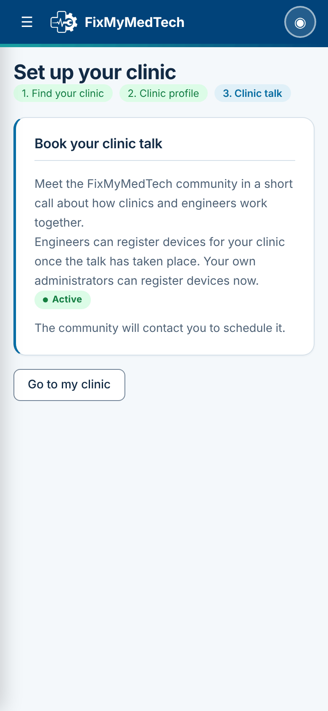

# Configurer votre clinique

**Dans l'application :** **Configurez votre clinique** s'ouvre tout seul après la création d'un compte clinique ; plus tard, la page de la clinique est dans **Groupes**.

**Pour qui :** la personne qui crée le compte de la clinique (administrateur, infirmier en chef, responsable).

**Ce qu'il vous faut avant :** un compte clinique, créé à partir de l'invitation d'un ingénieur (**Créer le compte de la clinique**) ou sur **platform.fixmymedtech.org/clinic/signup** (**Inscrivez votre clinique**). Voir [Je travaille dans une clinique](start-clinic.md#1-get-your-account).

Tant que la clinique n'est pas configurée, chaque page d'un compte clinique vous ramène ici.

## Étapes

1. **Trouvez votre clinique.** Touchez **Utiliser ma position**, ou tapez votre ville et touchez **Rechercher**. La liste montre les établissements de santé de healthsites.io, du plus proche au plus éloigné. Touchez **C'est ma clinique**.
2. **Pas dans la liste ?** Sous **Ma clinique n'est pas dans la liste**, touchez **Créer ma clinique**. Remplissez **Nom de la clinique**, **Pays**, **Région**, **Adresse** et **Type** (**Clinique**, **Hôpital**, **Centre de santé**, **Laboratoire**). Touchez **Créer la clinique**. Elle est signalée pour être ajoutée plus tard à healthsites.io.
3. **Profil de la clinique.** Vérifiez le nom, le pays, la région, l'adresse, l'**E-mail de contact** et le type. Touchez **OK**.
4. **Ingénieurs** (si un ingénieur vous a invité). Répondez à *« Confirmez-vous que {ingénieur} peut enregistrer des équipements au nom de {clinique} ? »* : **Oui** ou **Pas maintenant**. Ajoutez ensuite d'autres ingénieurs si vous le souhaitez : leur e-mail, **Externe** ou **Interne (personnel)**, **Ajouter l'ingénieur**.
5. **Rencontre clinique** (si personne ne vous a invité). Touchez **Réserver la rencontre**. Pas de lien de réservation ? La communauté vous contacte.
6. Touchez **Aller à ma clinique**.

<figure markdown>
{ .phone loading=lazy }
<figcaption>Étape 1 : trouvez votre clinique.</figcaption>
</figure>
<figure markdown>
{ .phone loading=lazy }
<figcaption>Étape 3 pour les cliniques sans invitation.</figcaption>
</figure>

## Et ensuite

- **Clinique invitée** : active tout de suite. Les ingénieurs que vous avez confirmés peuvent enregistrer vos appareils dès que leurs propres étapes d'accueil sont terminées.
- **Clinique sans invitation** : après la rencontre clinique, un Connecteur de cliniques débloque votre clinique. D'ici là, **personne ne peut enregistrer d'appareils pour elle, pas même ses administrateurs.** (La page de configuration dit que vos administrateurs peuvent déjà enregistrer des appareils : ce n'est plus vrai, le déblocage est nécessaire.)
- Plus tard, gérez vos ingénieurs depuis **Groupes → votre clinique → Ingénieurs** : **Confirmer**, **Retirer** (leurs appareils restent à la clinique), ou ajoutez-en de nouveaux. Chaque ingénieur affiche **Peut enregistrer**, **En attente des étapes d'accueil**, **En attente de la rencontre clinique** ou **Pas maintenant**.

{ .shot loading=lazy }

## En cas de problème

- **« Cette clinique a déjà un administrateur sur FixMyMedTech. Demandez-lui de vous ajouter. »** Quelqu'un la gère déjà. Demandez-lui de vous inviter depuis **Groupes**.
- **« La recherche healthsites.io n'est pas disponible pour le moment. »** Créez votre clinique avec **Créer ma clinique**.
- **« Lieu introuvable. »** Vérifiez l'orthographe, ou utilisez **Utiliser ma position**.
- **« Votre position n'est pas disponible. »** Autorisez la position pour le site dans votre navigateur, ou cherchez votre ville.
