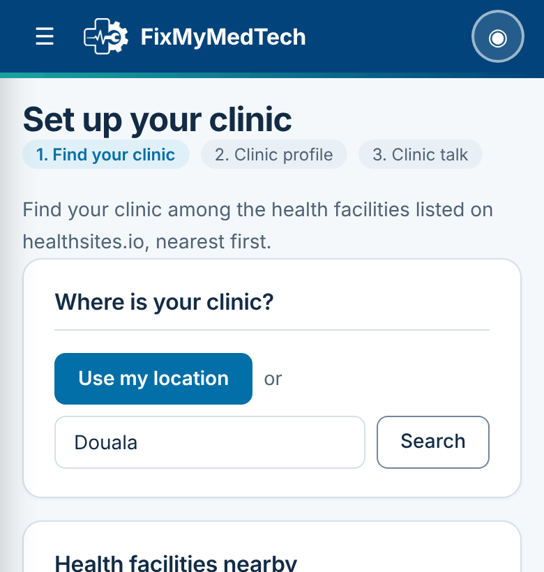
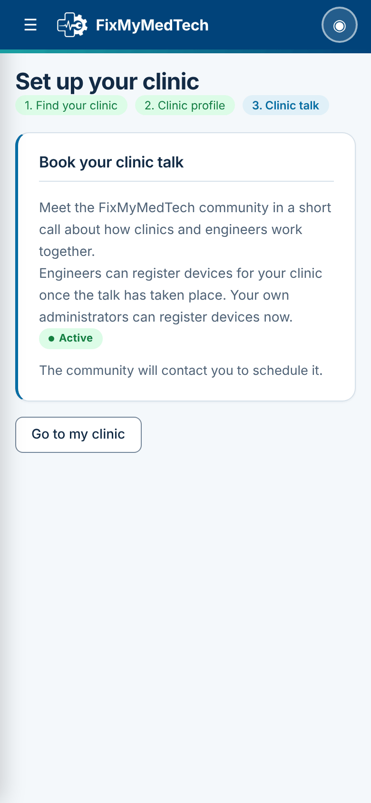
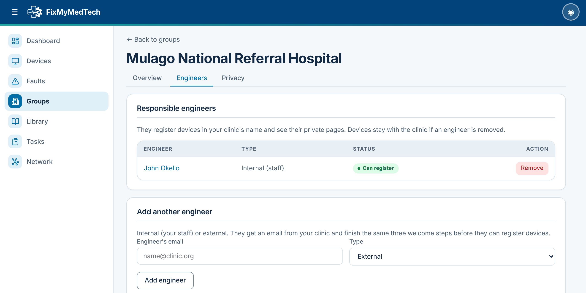

# Set up your clinic

**In the app:** **Set up your clinic** opens by itself after a clinic account is created; later, the clinic's page is in **Groups**.

**Who this is for:** the person who creates the clinic's account (administrator, head nurse, manager).

**What you need before:** a clinic account, made from an engineer's invitation (**Create the clinic account**) or at **platform.fixmymedtech.org/clinic/signup** (**Sign up your clinic**). See [I work in a clinic](start-clinic.md#1-get-your-account).

Until the clinic is set up, every page of a clinic account brings you back here.

## Steps

1. **Find your clinic.** Tap **Use my location**, or type your city or town and tap **Search**. The list shows the health facilities listed on healthsites.io, nearest first. Tap **This is my clinic**.
2. **Not listed?** Under **My clinic isn't listed**, tap **Create my clinic**. Fill in the **Clinic name**, **Country**, **Region**, **Address** and **Type** (**Clinic**, **Hospital**, **Health centre**, **Laboratory**). Tap **Create the clinic**. It is flagged to be added to healthsites.io later.
3. **Clinic profile.** Check the name, country, region, address, **Contact email** and type. Tap **OK**.
4. **Engineers** (if an engineer invited you). Answer *"Do you confirm that {engineer} can register devices in the name of {clinic}?"*: **Yes** or **Not now**. Then add other engineers if you like: their email, **External** or **Internal (staff)**, **Add engineer**.
5. **Clinic talk** (if nobody invited you). Tap **Book the clinic talk**. No booking link? The community contacts you.
6. Tap **Go to my clinic**.

<figure markdown>
{ .phone loading=lazy }
<figcaption>Step 1: find your clinic.</figcaption>
</figure>
<figure markdown>
{ .phone loading=lazy }
<figcaption>Step 3 for clinics without an invitation.</figcaption>
</figure>

## What happens next

- **Invited clinic**: active at once. The engineers you confirmed can register your devices as soon as their own welcome steps are done.
- **Clinic without invitation**: after the clinic talk, a Clinics Connector unlocks your clinic. Until then **nobody registers devices for it, its administrators included**. (The setup page says your administrators can register devices now: that is not the case any more; the unlock is needed.)
- Later, manage your engineers from **Groups → your clinic → Engineers**: **Confirm**, **Remove** (their devices stay with the clinic), or add new ones. Each engineer shows **Can register**, **Waiting for welcome steps**, **Waiting for clinic talk** or **Not now**.

{ .shot loading=lazy }

## If something goes wrong

- **"This clinic already has an administrator on FixMyMedTech. Ask them to add you."** Someone already manages it. Ask them to invite you from **Groups**.
- **"The healthsites.io search is not available right now."** Create your clinic with **Create my clinic**.
- **"Place not found."** Check the spelling, or use **Use my location**.
- **"Your location is not available."** Allow location for the site in your browser, or search your city.
