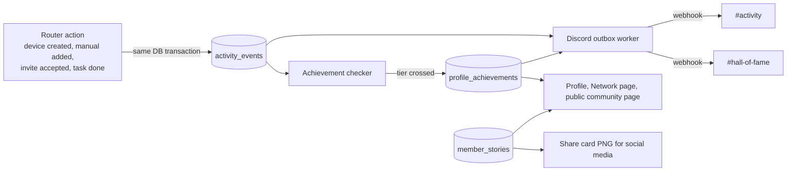

# Community activity, achievements and member stories: technical plan

Status: proposal, not built yet. Written 2026-10-23, updated 2026-10-30 against `dev` (Discord account linking and the document library had landed).

This plan covers three things that build on the feedback button (`routers/feedback.py`, `config/discord.py`):

1. **Activity feed.** The app posts what members do ("Amina registered a device in Ashanti") to Discord.
2. **Achievements.** Members earn tiered trophies ("Registered 50 devices") that appear on Discord, on their profile and in the Network directory.
3. **Member stories.** Each member can publish a short bio, a photo or video and "why I joined", shown on a public community page and turned into share cards for social media.

The product rules (who can do what, what is decided, what is open) live in the docs vault: `activity-feed-and-achievements` and `member-stories` feature notes, and the community note. This page is about how to build it in this codebase.

## What already exists

| Piece | Where | Reused for |
| --- | --- | --- |
| Discord webhook posting, background task, `discord_status` column, no-mention safety | `config/discord.py`, `routers/feedback.py` | Generalised into one Discord sender for all posts |
| Four activity counts per member (devices registered, faults resolved, maintenance closed, invites), computed in SQL | `routers/profile.py` `_metric_subqueries`, `_counts_for` | The counters achievements are checked against |
| Who invited whom | `users.invited_by` (migration 025) | Invite achievements |
| Who registered a device | `devices.registered_by` | Device achievements and posts |
| Discord account linking: `users.discord_user_id`, `discord_username` (migration 027), "Connect Discord" on the profile page | `routers/discord_link.py` | @mentioning a member in their own posts |
| Welcome channel post on first link, and a post for every new device (`announce_new_device`) | `routers/discord_link.py`, `config/discord.py` `post_to_welcome_channel`, `DISCORD_WELCOME_WEBHOOK_URL` | Replaced by the activity feed: per-device posts move into the daily digest (see Noise control) |
| Document library: `documents.uploaded_by`, `contribution_status`, `device_documents` (migration 028) | `models/models.py` | Crediting manuals |
| Image processing (Pillow), MinIO storage | `utils/photo_processing.py`, `config/storage.py` | Story photos and share cards |

Gaps the plan has to fill: organisations have no "invited by" and no "anonymise registrations" flag; there is no community task board yet; nothing records a talk or a distributor contact.

Naming clash to avoid: the app already has a "My tasks" page (`/tasks`, fault and maintenance assignments). Call the new board "community tasks" everywhere in code and UI.

## Architecture



Three rules shape it:

- **Record first, post later.** Like feedback, nothing waits on Discord. Every action writes an event row in the same transaction as the action itself, so an event can't be lost or invented.
- **One outbox, one sender.** Feedback fires one background task per report. That is fine for a few reports a day but not for a feed: a busy day of registrations would hit Discord's webhook rate limit (about 30 messages a minute per channel) and lose posts. A single worker drains a queue at a safe pace and retries.
- **Privacy is decided when the post is written, from one function.** The text that goes to Discord is built by the same function that builds the line on a member's public profile, so the two can never disagree.

## Data model

A new migration with the next free number (`029_community_activity.sql` at the time of writing; check `infrastructure/migrations/` and other open branches first) (and matching classes in `models/models.py`). All tables in schema `fixmymedtech`.

### `activity_events` (append-only log)

| Column | Type | Notes |
| --- | --- | --- |
| `id` | uuid | |
| `kind` | text | `device_registered`, `manual_added`, `member_invited`, `clinic_invited`, `fault_resolved`, `maintenance_closed`, `community_task_done`, `contribution_logged`, `story_published` |
| `actor_id` | uuid → profiles | Who did it |
| `organization_id` | uuid → organizations, null | The clinic involved, used for privacy and region |
| `subject_type`, `subject_id` | text, uuid | e.g. `device` + its id |
| `country`, `region` | text | Copied from the organization at the time. Never GPS coordinates |
| `data` | jsonb | Small extras, e.g. device category slug, task kind |
| `created_at` | timestamptz | |
| `discord_status` | text | `pending`, `sent`, `digested`, `skipped`, `failed`, `disabled` (same idea as `feedback.discord_status`) |
| `discord_message_id` | text | Kept so a post can be deleted later |
| `hidden` | bool | Set by the community team to take a post down |

### `profile_achievements`

| Column | Type | Notes |
| --- | --- | --- |
| `id` | uuid | |
| `profile_id` | uuid → profiles | |
| `achievement` | text | Key from the catalogue in code, e.g. `devices_registered` |
| `tier` | int | The threshold reached, e.g. 50. `1` for one-off achievements |
| `awarded_at` | timestamptz | |
| `awarded_by` | uuid → profiles, null | Set when the community team awards it by hand |
| `revoked_at` | timestamptz, null | Kept, not deleted, so the history stays honest |
| `announce` | bool | False for the silent backfill at launch |
| `discord_status`, `discord_message_id` | | As above |

`UNIQUE (profile_id, achievement, tier)` makes awarding idempotent: checking twice can never award twice.

### `member_stories`

| Column | Type | Notes |
| --- | --- | --- |
| `profile_id` | uuid → profiles, primary key | One story per member |
| `display_name`, `city`, `country` | text | What the member wants shown; may differ from account data |
| `bio` | text, ≤ 280 chars | Short bio |
| `why_joined` | text, ≤ 500 chars | Completes "I joined Fix My MedTech because…" |
| `photo_key` | text | MinIO key, compressed like avatars |
| `video_url` | text | Link to YouTube/Vimeo/Drive. No video upload in phase 1 (size, transcoding, storage cost) |
| `lang` | text | Language the story is written in |
| `consent_website`, `consent_social`, `consent_discord` | bool | Three separate consents |
| `status` | text | `draft`, `submitted`, `approved`, `rejected`, `withdrawn` |
| `reviewed_by`, `reviewed_at` | | Community team |
| `updated_at` | timestamptz | Editing an approved story sends it back to `submitted` |

### Columns added to existing tables

| Table | Column | Why |
| --- | --- | --- |
| `profiles` | `activity_visibility text default 'anonymous'` | `named`, `anonymous` or `off`. See privacy |
| `organizations` | `invited_by uuid → profiles` | "Invited their first clinic". Belongs to the sign-up and invitations feature |
| `organizations` | `anonymise_registrations bool default false` | Decision #5 in the vault. Belongs to device registration; this plan only reads it |
| `organizations` | `approval_status` | Only devices at approved clinics count. Belongs to clinic approval |

The last three come from other features. This plan reads them and must not ship device posts before `anonymise_registrations` exists.

## Achievements catalogue

The catalogue lives in code (`backend/utils/achievements.py`), not in the database: it changes with releases, it needs translations in `i18n.py`, and code review is the right gate for changing what earns credit.

```python
ACHIEVEMENTS = {
    # key: (counter, tiers)
    "devices_registered":  ("devices",      [1, 5, 10, 20, 50, 100, 200, 500, 1000]),
    "manuals_added":       ("manuals",      [1, 5, 10, 25, 50, 100]),
    "colleagues_invited":  ("invites",      [1, 5, 10, 25, 50]),
    "clinics_invited":     ("clinics",      [1, 5, 10, 25]),
    "faults_resolved":     ("repairs",      [1, 10, 25, 50, 100, 250]),
    "maintenance_closed":  ("maintenance",  [1, 10, 25, 50, 100, 250]),
    # community tasks, once the task board exists
    "clinics_verified":    ("task:verify_clinic",       [1, 10, 25, 50]),
    "manuals_found":       ("task:find_manual",         [1, 5, 10, 25]),
    "distributors_contacted": ("task:contact_distributor", [1, 5, 10]),
    "approval_meetings":   ("task:approval_meeting",    [1, 5, 10, 25]),
    # logged by the community team, no in-app action
    "talks_organised":     ("logged:talk",              [1, 5, 10]),
    # one-off
    "region_pioneer":      (None, None),   # first device ever registered in a region
    "story_published":     (None, None),
}
```

How a check runs, after each event:

1. Look up the achievements whose counter the event moves (a `device_registered` event moves `devices`).
2. Count for that one member. `devices`, `repairs`, `maintenance` and `invites` reuse the SQL in `routers/profile.py`, moved to a shared `utils/activity_counts.py` so the Network table, the profile page and achievements count the same way. New counters (`manuals`, `clinics`, `task:*`, `logged:*`) are added there too. `manuals` counts `documents` rows by `uploaded_by`, excluding uploads with `contribution_status = 'rejected'`. The Discord id for mentions lives on `users`: select the column on its own, never load the `User` row into a response (it carries `hashed_password`).
3. Insert every tier at or below the count that the member doesn't have yet (`INSERT … ON CONFLICT DO NOTHING`). Only the highest new tier is announced, so registering 6 devices at once in a bulk import posts "5 devices", not "1" and "5".

`region_pioneer` is checked on `device_registered`: no earlier counted device has the same `country` + `region`.

**What counts.** Only devices at approved clinics that haven't been retired. A device retired within 24 hours of being registered is not counted (devices are retired, never deleted). This blocks the obvious way to farm trophies. The community team can revoke any achievement from SQLAdmin.

**Points.** Achievements are badges, points are the currency of the community task board. They stay separate: points are specified in the task board feature, achievements only read task completions. If the team later wants achievements to give points, add a `points` field to the catalogue; the data model doesn't change.

**Launch backfill.** A one-off script awards every achievement members already earned, with `announce = false`, so launch day doesn't flood Discord with hundreds of old trophies. One summary post ("42 members already hold 180 trophies") is sent instead.

## Discord

### Channels and configuration

| Channel | Type | What goes there | Env var |
| --- | --- | --- | --- |
| `#feedback` | forum | Unchanged | `DISCORD_FEEDBACK_WEBHOOK_URL` |
| `#activity` | text | Activity posts and daily digests | `DISCORD_ACTIVITY_WEBHOOK_URL` |
| `#hall-of-fame` | text | Achievements | `DISCORD_ACHIEVEMENTS_WEBHOOK_URL` |
| `#welcome` | text | Already exists: welcome on first Discord link. Also gets approved member stories (if `consent_discord`). Per-device posts stop here | `DISCORD_WELCOME_WEBHOOK_URL` (exists) |

Each var unset = that stream is off, the rows get `discord_status = 'disabled'`, the same convention as feedback. New vars go in `.env.example`, the three compose files, and the `.env` heredoc in both deploy workflows.

Webhooks are enough for phases 1 to 3: no bot to host, no bot token to protect. A bot is only needed in phase 4, to give members Discord roles that match their trophies.

### Refactor of `config/discord.py`

- Keep `create_forum_thread` and `post_to_welcome_channel` as they are.
- Generalise the shared `_execute` helper into `post_message(webhook_url, content, embeds=None, mention_user_id=None) -> message_id`, for any text channel, and have `post_to_welcome_channel` call it.
- Add `delete_message(webhook_url, message_id)`, used when a member withdraws consent or the team hides a post.
- `allowed_mentions` stays `{"parse": []}` always. When a member has linked Discord and chose `named`, it becomes `{"parse": [], "users": [their_id]}`, so only they can be pinged, never `@everyone` or a role.
- Never log the exception text from a failed request: it contains the webhook URL, which is the secret (already handled this way in feedback).

### Outbox worker

A loop started in `lifespan` in `main.py`:

- Every 10 seconds, take up to 10 pending rows (events and achievements, oldest first) and send them, at most one message every 2 seconds per webhook.
- On HTTP 429, sleep for the `retry_after` Discord returns. On other errors, mark `failed` and retry with backoff up to 5 times.
- The app runs one uvicorn worker today. If that changes, select rows with `FOR UPDATE SKIP LOCKED` so two workers never send the same post.
- Feedback can move onto the same worker later. Not needed now.

### Noise control

Posting every single device would bury everything else. Rules:

| Event | Posted as |
| --- | --- |
| Device registered | Not posted one by one. A daily digest per country at 18:00 UTC: "Today 23 devices were registered in Ghana (12 in Ashanti, 11 in Greater Accra) by 4 members." Rows become `digested` |
| First device in a region (`region_pioneer`) | Posted immediately |
| Manual added | Posted immediately (rare and useful to everyone) |
| Member invited, clinic invited | Posted immediately, as "X brought a new colleague" with no name for the invitee until they choose a visibility |
| Fault resolved, maintenance closed | Not posted one by one (they can contain sensitive context). Only achievements |
| Achievement | Posted immediately in `#hall-of-fame` |
| Story approved | Posted in `#welcome` |

A weekly leaderboard post (top contributors of the week, among `named` members only) is a cheap phase 2 addition.

### Post format

Short text plus one embed, in English for now (open question: which language the Discord uses). Example achievement post:

> 🏆 **@amina** reached **50 devices registered**!
> -# Kumasi, Ghana · 3rd member to reach this tier

Example activity post with an anonymised clinic:

> 📘 A member in Ashanti, Ghana added a manual for an infant incubator.

No links to device pages, no serial numbers, no QR codes, no fault text.

## Privacy

This is the part to get right before anything ships, because a Discord post can't be taken back once people have read it.

1. **The member chooses.** `profiles.activity_visibility`:
   - `named`: username (and @mention if Discord is linked).
   - `anonymous` (default): "A member in Ghana".
   - `off`: nothing about them is posted, achievements still show on their own profile.
   The choice is asked once after sign-up, with an example post, and can be changed on the profile page. Changing to `off` deletes their past Discord posts through the stored message ids.
2. **The clinic chooses.** If `organizations.anonymise_registrations` is on, posts never name the clinic or the device type: "a device in Ashanti". Region and country only, never the device's GPS coordinates. The rule lives in one function, `public_device_line(device, org)`, used by both the profile page and the Discord text.
3. **Only counts from sensitive work.** Faults and maintenance can mention patients or incidents. They feed achievements ("resolved 10 faults") but their content never leaves the app.
4. **Stories need three explicit consents** (website, social media, Discord) and a community team review before anything is public. Withdrawing a story removes it from the website at once and deletes the Discord post; the team is told to remove social media posts by hand, since those were posted manually.
5. **Untrusted text.** Bios and "why I joined" are user text: keep `allowed_mentions` locked, strip Discord markdown links, cap lengths, and escape them on the website like every other page.
6. **The invitee is not the subject.** "X invited a colleague" never names the colleague unless the colleague chose `named`.

## Member stories

Backend (`routers/community.py`, new):

| Endpoint | Who | Does |
| --- | --- | --- |
| `GET/PUT /api/community/me/story` | Logged-in member | Read and edit their own story; `PUT` with `submit=true` sends it for review |
| `POST /api/community/me/story/photo` | Logged-in member | Upload photo (same compression as avatars) |
| `GET /api/community/public/members` | Anyone | Approved stories with `consent_website`, plus their achievements. Paginated, filter by country |
| `GET /api/community/public/members/{username}` | Anyone | One story |
| `GET /api/community/stories/{id}/card.png` | Community team | 1080×1080 share card made with Pillow: photo, name, city, the "why I joined" quote, top 3 achievements, logo |

Review happens in SQLAdmin first (a `MemberStoryAdmin` view with approve/reject actions), restricted to superusers today. A proper community-team role in the app comes with the task board.

Frontend:

- `features/community/`: `api.py` plus pages `/community` (public grid of members, `pub_shell`) and `/community/<username>` (story, photo, embedded video link, achievements). Register before any overlapping route in `frontend/main.py`.
- Profile page: a "My story" section with the form, a live preview of the "Hi, my name is … I'm based in … and I joined Fix My MedTech because …" sentence, and the three consent boxes.
- Network page and profiles: show earned trophies as small badges.
- All strings in `i18n.py` for en, es and fr.

Social media stays manual in phase 3: the team downloads the share card and posts it. Automatic posting to LinkedIn, Facebook or Instagram needs app reviews and per-platform tokens, and isn't worth it before there's a steady flow of stories.

## Delivery plan

| Phase | Ships | Depends on | Size |
| --- | --- | --- | --- |
| 1. Activity feed | `activity_events`, outbox worker, `#activity` posts and daily digest, visibility setting, digest replacing `announce_new_device` | Clinic `anonymise_registrations` flag and approval status (device registration, clinic approval) | ~1 week |
| 2. Achievements | Catalogue, checker, `profile_achievements`, `#hall-of-fame`, badges on profile and Network, backfill script, weekly leaderboard | Phase 1 | ~1 week |
| 3. Member stories | `member_stories`, story form, review in SQLAdmin, public `/community` pages, share cards, story posts in `#welcome` | Phase 1 (visibility), not phase 2 | ~1 to 1.5 weeks |
| 4. Community tasks | Task-based achievements, "log a contribution" form for talks and distributor contacts, Discord roles through a bot | Community task board | with the board |

Phase 3 can run in parallel with phase 2. A useful first slice, if the team wants something visible within days: phase 1 limited to "manual added" and "first device in a region", plus the visibility setting.

## Testing

The repo has no test suite. For this feature, add at least:

- Unit tests for the achievement checker (tier crossing, bulk import, idempotency, revoked achievements, deleted devices).
- Unit tests for `public_device_line` covering every visibility × anonymisation combination.
- A `DISCORD_DRY_RUN=1` mode that logs the post text instead of sending, so the privacy wording can be checked on dev before any real channel is wired.

## Open questions

- Default visibility: `anonymous` (proposed) or ask before anything is posted?
- Language of Discord posts: English only, or one channel per language?
- Should high tiers (500, 1000 devices) be confirmed by the community team before they're announced?
- Can members of clinics (not just engineers and registrars) earn achievements?
- Video: links only, or short uploads (≤ 60 s) later?
