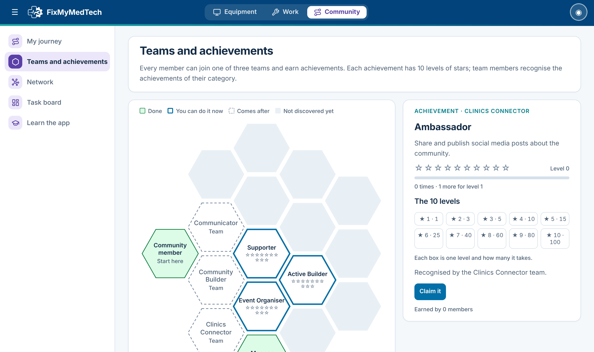
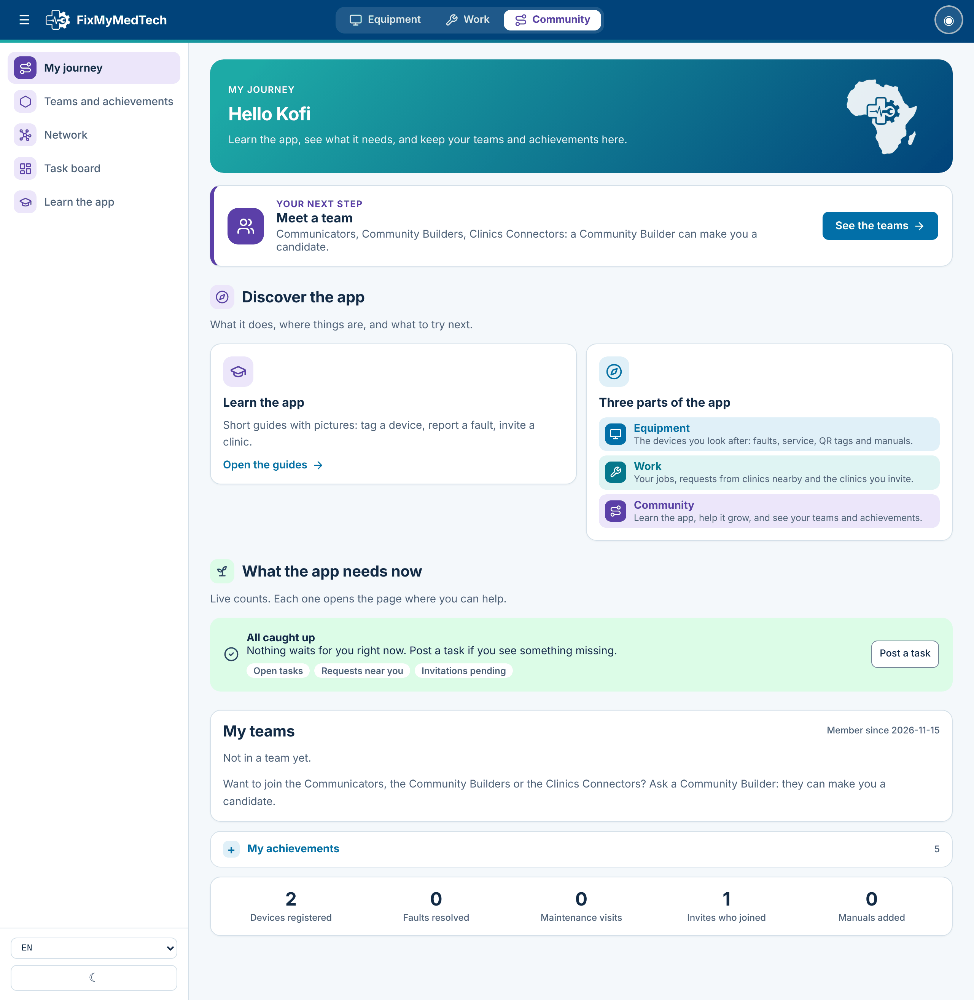

# Cómo funciona la comunidad

**En la aplicación:** Comunidad → **Mi recorrido**, **Equipos y logros**, **Tablero de tareas**.

**Para quién es:** ingenieros, técnicos y estudiantes que quieren participar en la comunidad de FixMyMedTech.

**Qué necesitas antes:** una cuenta (mira [Soy ingeniero](start-engineer.md)).

FixMyMedTech es una comunidad de personas que mantienen en funcionamiento los dispositivos médicos. Entras con tres pasos de bienvenida y después puedes unirte a un equipo y ganar logros por lo que haces.

## 1. Pasos de bienvenida: de Visitante a Colaborador

| Paso | Hecho cuando |
| --- | --- |
| **Completa tu perfil** | Tu perfil tiene un nombre, un país, una ciudad y unas palabras sobre por qué elegiste la ingeniería biomédica |
| **Añade una foto** | Tu perfil tiene una foto |
| **Asiste a una charla de la comunidad** | Un anfitrión lo marca después de una videollamada corta |

Cuando los tres están hechos eres **Colaborador**: se abre toda la plataforma. Unirte al Discord y la pregunta sobre redes sociales de la misma página son opcionales.

## 2. Equipos

Hay tres equipos. El nombre del equipo es el título que puedes poner en LinkedIn (por ejemplo *Constructor de comunidad, FixMyMedTech*).

| Equipo | Qué hace |
| --- | --- |
| **Comunicador** | Cuenta al mundo lo que hace la comunidad |
| **Constructor de comunidad** | Hace de la comunidad un lugar al que la gente quiere unirse y quedarse. Da la bienvenida a los nuevos y dirige las charlas de la comunidad |
| **Conector de clínicas** | Lleva la plataforma a las clínicas, sobre el terreno. Dirige las charlas de la clínica |

En un equipo eres **Candidato**, **Miembro** o **Líder**:

1. Un **Constructor de comunidad** te hace **Candidato** de un equipo. Pídeselo a uno (los encuentras en **Red**).
2. El **Líder** de ese equipo te hace **Miembro**.
3. Solo los superusuarios nombran a los **Líderes**.

## 3. Logros y estrellas

Hay cinco logros, cada uno con 10 niveles de estrellas. Se alcanza un nivel cuando tu contador llega a su número.

| Logro | Equipo | Cómo se cuenta | Niveles |
| --- | --- | --- | --- |
| **Cartógrafo** | Conector de clínicas | Dispositivos que registraste (automático) | 1, 5, 10, 20, 35, 50, 75, 100, 150, 200 |
| **Embajador** | Conector de clínicas | Publicaciones en redes sociales compartidas o publicadas, reconocidas | 1, 3, 5, 10, 15, 25, 40, 60, 80, 100 |
| **Apoyo** | Constructor de comunidad | Veces que ayudaste a un colega ingeniero, reconocidas | 1, 3, 5, 10, 15, 25, 40, 60, 80, 100 |
| **Organizador de eventos** | Constructor de comunidad | Eventos que organizaste, reconocidos | 1, 2, 3, 5, 8, 12, 16, 20, 25, 30 |
| **Constructor activo** | Constructor de comunidad | Reuniones de la comunidad a las que asististe, reconocidas | 1, 3, 5, 10, 15, 20, 30, 40, 50, 60 |

"Reconocido" significa que un miembro de ese equipo lo confirma: tú lo **reclamas**, o un miembro lo registra por ti. Mira [Reclamos, tablero de tareas y manuales que faltan](community-work.md).

## Pasos

1. Abre **Equipos y logros**. El mapa muestra los equipos y los logros como casillas:
    - verde: hecho (eres colaborador, estás en ese equipo, o tienes al menos una estrella);
    - borde azul: puedes hacerlo ahora;
    - borde de rayas: viene después (por ejemplo un equipo al que no te has unido);
    - gris, sin nombre: aún no descubierto.
2. Toca una casilla. El panel de la derecha explica el equipo o el logro: sus 10 niveles, quién lo reconoce y **Reclamarlo** para los logros reconocidos.
3. Abre **Mi recorrido**, el inicio de la Comunidad. Tiene dos mitades: **Descubre la aplicación** (las guías cortas de **Aprende a usar la app**, los tres mundos, tu próximo paso) y lo que la aplicación necesita ahora (tareas abiertas, manuales por encontrar, solicitudes por confirmar, personas que esperan una charla: cada número abre la página donde puedes ayudar). Debajo están tus equipos, tus logros con sus estrellas y tus contadores (dispositivos registrados, fallas resueltas, visitas de mantenimiento, invitados que se unieron, manuales añadidos).
4. Toma pequeños trabajos en el **Tablero de tareas** para ganar puntos.

{ .shot loading=lazy }

{ .shot loading=lazy }

## Qué pasa después

- Los miembros y líderes de un equipo validan los reclamos en [Por validar](validate.md) y ven **Admin comunidad**.
- Los Constructores de comunidad y los Conectores de clínicas dirigen charlas: mira [Anfitrión de charlas](talk-host.md).
- Los poderes de equipo se pausan después de seis meses sin ninguna actividad. Cualquier acción en la aplicación los reactiva.

## Si algo sale mal

- **"Todavía no estás en un equipo."** Pide a un Constructor de comunidad que te haga Candidato.
- **Mis estrellas no se movieron.** Los logros reconocidos necesitan que un miembro del equipo confirme tu reclamo. Cartógrafo solo cuenta los dispositivos que registraste tú mismo.
- **No puedo reclamar nada.** Los reclamos se abren cuando tus pasos de bienvenida están hechos.
