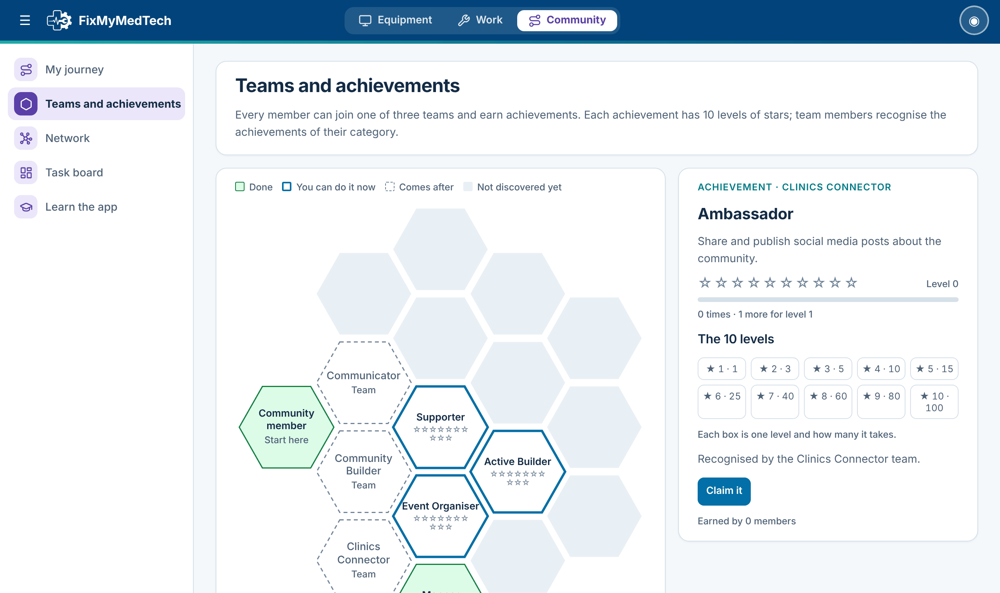
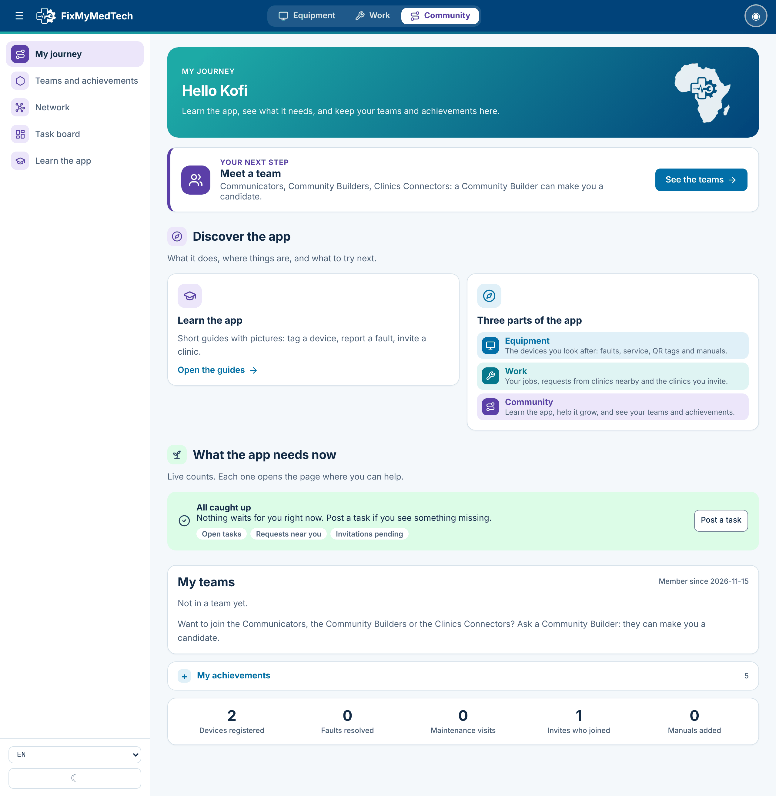

# Comment fonctionne la communauté

**Dans l'application :** Communauté → **Mon parcours**, **Équipes et réussites**, **Tableau des tâches**.

**Pour qui :** ingénieurs, techniciens et étudiants qui veulent participer à la communauté FixMyMedTech.

**Ce qu'il vous faut avant :** un compte (voir [Je suis ingénieur](start-engineer.md)).

FixMyMedTech est une communauté de personnes qui gardent les appareils médicaux en état de marche. Vous entrez avec trois étapes d'accueil, puis vous pouvez rejoindre une équipe et gagner des réussites pour ce que vous faites.

## 1. Étapes d'accueil : de Visiteur à Contributeur

| Étape | Terminée quand |
| --- | --- |
| **Complétez votre profil** | Votre profil a un nom, un pays, une ville et quelques mots sur la raison de votre choix du génie biomédical |
| **Ajoutez une photo** | Votre profil a une photo |
| **Assistez à une rencontre de la communauté** | Un animateur la coche après un court appel vidéo |

Quand les trois sont faites, vous êtes **Contributeur** : toute la plateforme s'ouvre. Rejoindre le Discord et la question sur les réseaux sociaux, sur la même page, sont facultatifs.

## 2. Équipes

Il y a trois équipes. Le nom de l'équipe est le titre que vous pouvez mettre sur LinkedIn (par exemple *Bâtisseur de communauté, FixMyMedTech*).

| Équipe | Ce qu'elle fait |
| --- | --- |
| **Communicant** | Raconte au monde ce que fait la communauté |
| **Bâtisseur de communauté** | Fait de la communauté un lieu que l'on veut rejoindre et où l'on reste. Accueille les nouveaux et anime les rencontres de la communauté |
| **Connecteur de cliniques** | Amène la plateforme dans les cliniques, sur le terrain. Anime les rencontres cliniques |

Dans une équipe, vous êtes **Candidat**, **Membre** ou **Responsable** :

1. Un **Bâtisseur de communauté** fait de vous un **Candidat** pour une équipe. Demandez à l'un d'eux (vous les trouvez dans **Réseau**).
2. Le **Responsable** de cette équipe fait de vous un **Membre**.
3. Seuls les superutilisateurs nomment les **Responsables**.

## 3. Réussites et étoiles

Il y a cinq réussites, chacune avec 10 niveaux d'étoiles. Un niveau est atteint quand votre compte arrive à son nombre.

| Réussite | Équipe | Comment elle est comptée | Niveaux |
| --- | --- | --- | --- |
| **Cartographe** | Connecteur de cliniques | Appareils que vous avez enregistrés (automatique) | 1, 5, 10, 20, 35, 50, 75, 100, 150, 200 |
| **Ambassadeur** | Connecteur de cliniques | Messages sur les réseaux sociaux partagés ou publiés, reconnus | 1, 3, 5, 10, 15, 25, 40, 60, 80, 100 |
| **Soutien** | Bâtisseur de communauté | Fois où vous avez aidé un collègue ingénieur, reconnues | 1, 3, 5, 10, 15, 25, 40, 60, 80, 100 |
| **Organisateur d'événements** | Bâtisseur de communauté | Événements que vous avez organisés, reconnus | 1, 2, 3, 5, 8, 12, 16, 20, 25, 30 |
| **Bâtisseur actif** | Bâtisseur de communauté | Réunions de la communauté auxquelles vous avez assisté, reconnues | 1, 3, 5, 10, 15, 20, 30, 40, 50, 60 |

« Reconnu » veut dire qu'un membre de cette équipe le confirme : vous le **déclarez**, ou un membre l'enregistre pour vous. Voir [Déclarations, tableau des tâches et manuels manquants](community-work.md).

## Étapes

1. Ouvrez **Équipes et réussites**. La carte montre les équipes et les réussites sous forme de tuiles :
    - vert : fait (vous êtes contributeur, dans cette équipe, ou vous avez au moins une étoile) ;
    - bordure bleue : vous pouvez le faire maintenant ;
    - bordure en pointillés : vient après (par exemple une équipe que vous n'avez pas rejointe) ;
    - gris, sans nom : pas encore découvert.
2. Touchez une tuile. Le panneau de droite explique l'équipe ou la réussite : ses 10 niveaux, qui la reconnaît, et **Le déclarer** pour les réussites reconnues.
3. Ouvrez **Mon parcours**, l'accueil de la Communauté. Il a deux moitiés : **Découvrir l’application** (les guides courts de **Apprendre l’application**, les trois mondes, votre prochaine étape) et ce dont l'application a besoin maintenant (tâches ouvertes, manuels à trouver, demandes à confirmer, personnes qui attendent une rencontre : chaque nombre ouvre la page où vous pouvez aider). En dessous : vos équipes, vos réussites avec leurs étoiles, et vos comptes (appareils enregistrés, pannes résolues, visites d'entretien, invités qui ont rejoint, manuels ajoutés).
4. Prenez de petits travaux sur le **Tableau des tâches** pour gagner des points.

{ .shot loading=lazy }

{ .shot loading=lazy }

## Et ensuite

- Les membres et responsables d'une équipe valident les déclarations dans [À valider](validate.md) et voient **Admin communauté**.
- Les Bâtisseurs de communauté et les Connecteurs de cliniques animent des rencontres : voir [Animation des rencontres](talk-host.md).
- Les pouvoirs d'équipe se mettent en pause après six mois sans aucune activité. N'importe quelle action dans l'application les relance.

## En cas de problème

- **« Pas encore dans une équipe. »** Demandez à un Bâtisseur de communauté de faire de vous un Candidat.
- **Mes étoiles n'ont pas bougé.** Les réussites reconnues ont besoin qu'un membre de l'équipe confirme votre déclaration. Cartographe ne compte que les appareils que vous avez enregistrés vous-même.
- **Je ne peux rien déclarer.** Les déclarations s'ouvrent quand vos étapes d'accueil sont terminées.
