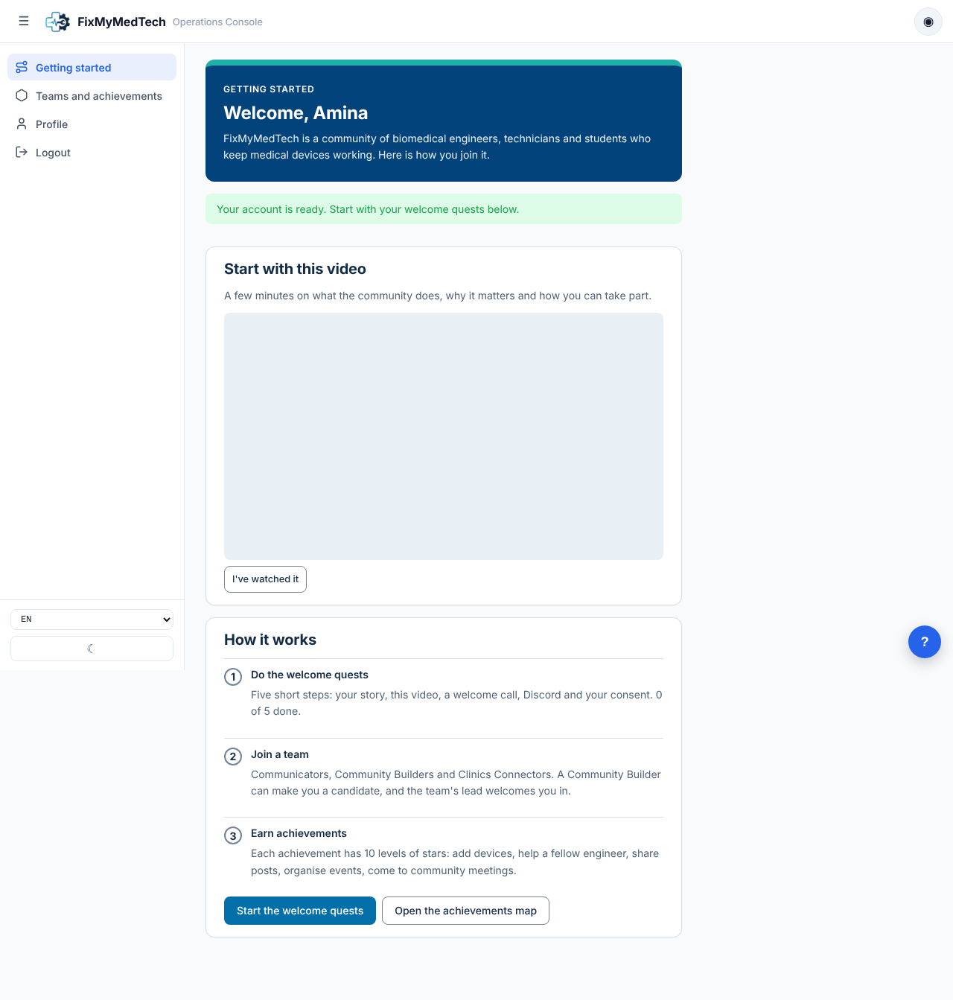
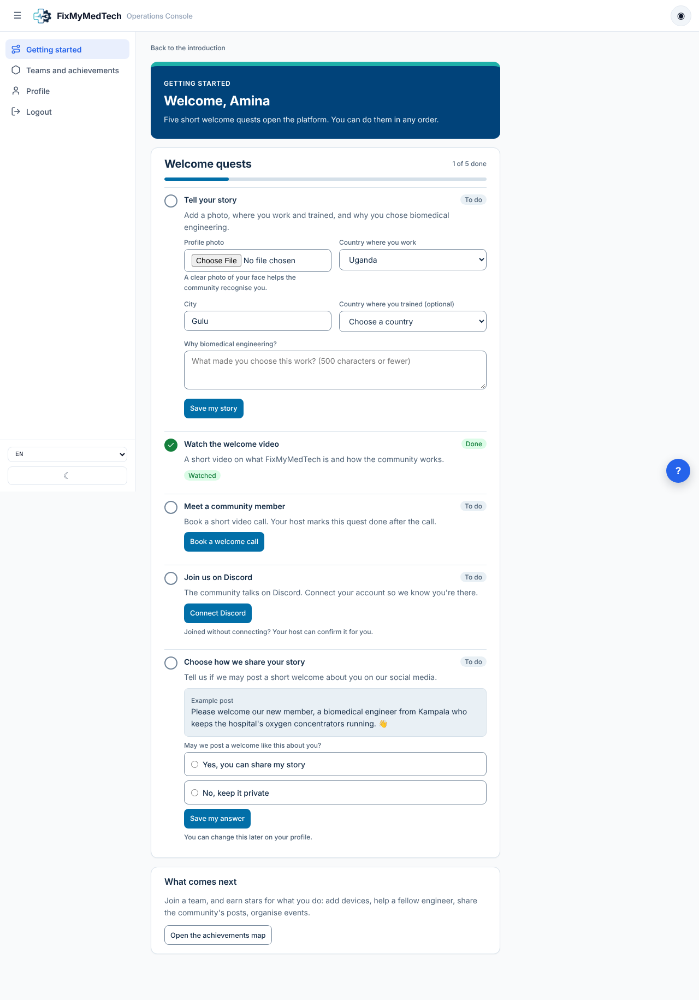
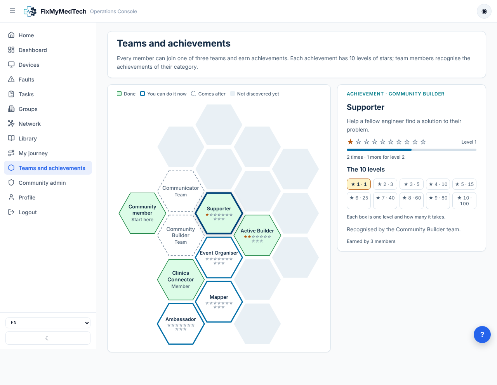
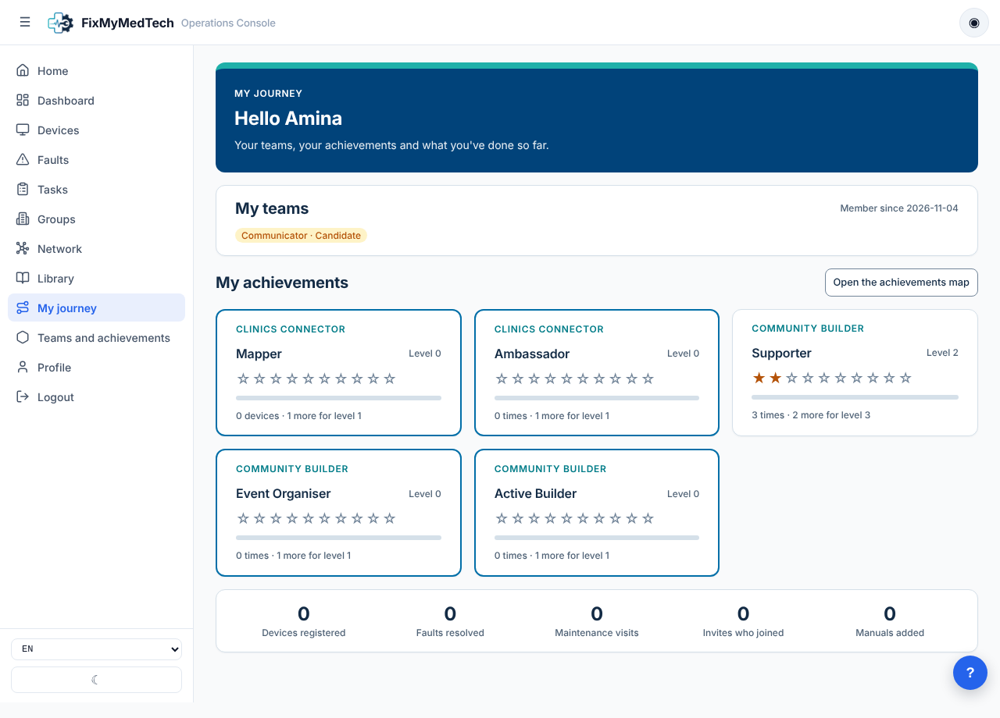
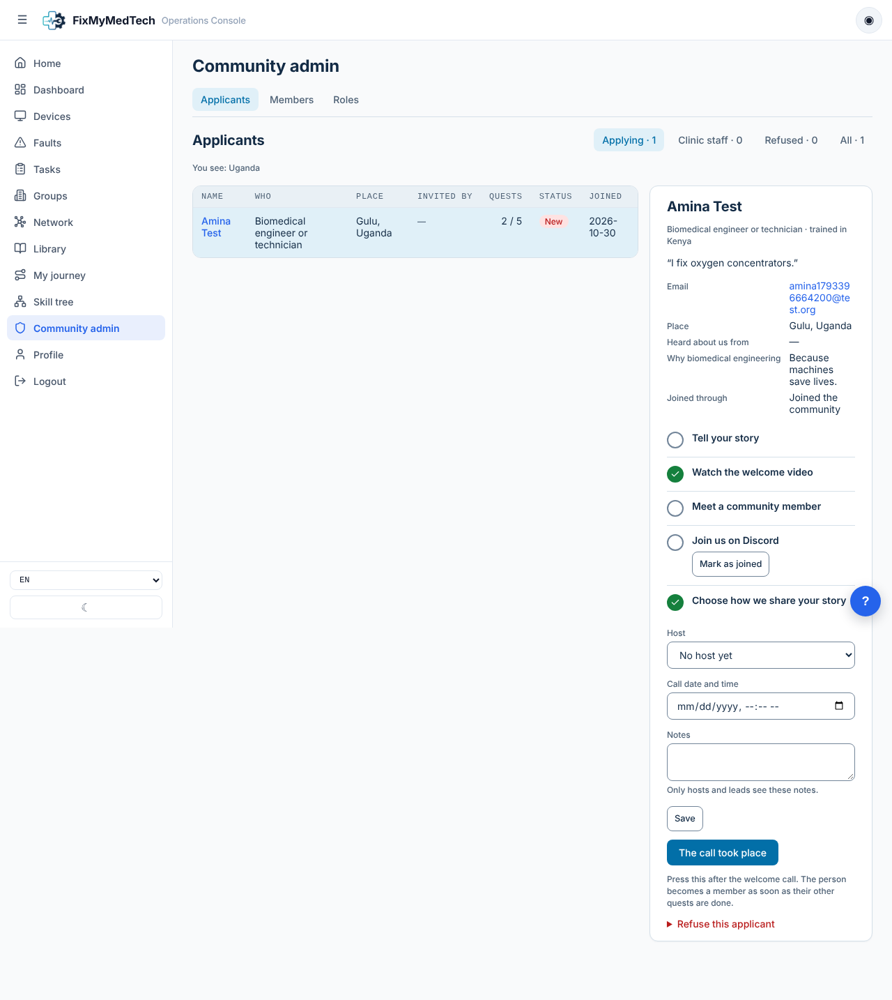
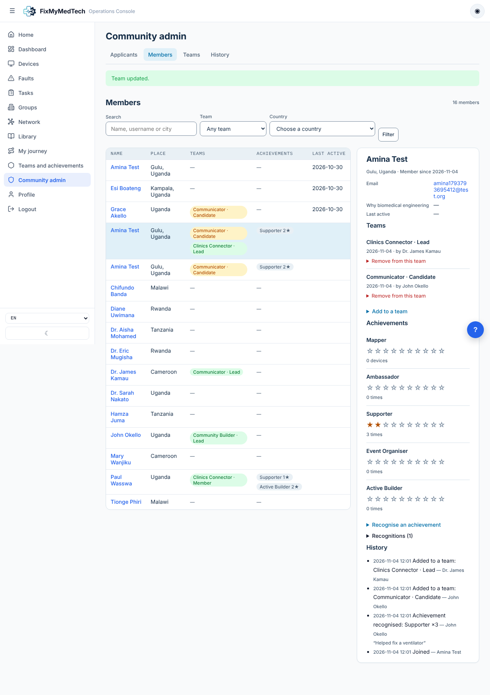
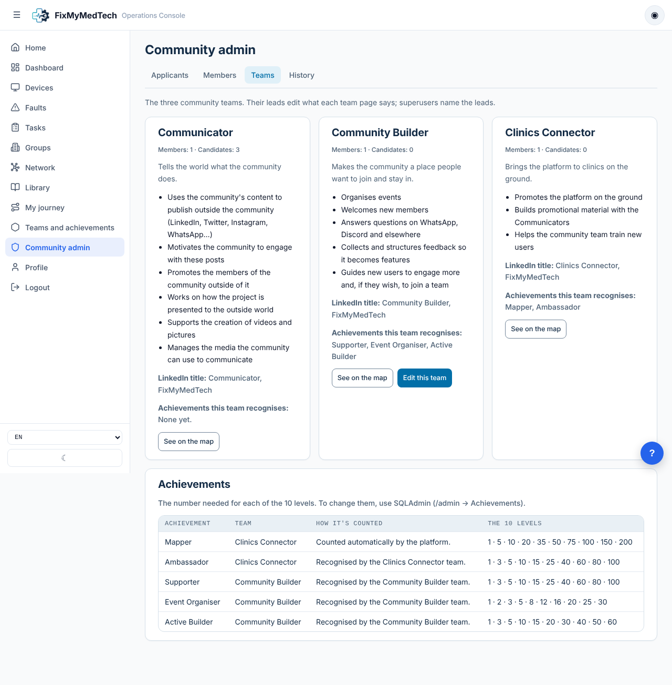

# Community journey: how to use it

Status: phase 1 rebuilt around teams and achievements (2026-11-04). The design and the later phases are in the [technical plan](community-journey.md).

This page explains what the community journey does, how each kind of person uses it, and how to set it up and run it. It is written for whoever runs the community, not only for developers.

## What it does, in short

- **New people join at `/join`.** They become **applicants**. An applicant can log in, but only sees Getting started, the teams and achievements map, and their profile. The rest of the platform (devices, faults, dashboard, organisations, the device library) stays closed.
- **Getting started opens on an introduction page** with the concept video first, then "How it works" in three steps. The welcome quests are one click further.
- **Five welcome quests make you a member.** When all five are done, the person becomes a **member**, sees a welcome page, and the whole platform opens.
- **There are three teams**: **Communicator**, **Community Builder** and **Clinics Connector**. In each team a person is a **Candidate**, a **Member** or a **Lead**. The team name is the title people put on LinkedIn.
- **There are five achievements, each with 10 levels of stars.** Mapper and Ambassador belong to Clinics Connector; Supporter, Event Organiser and Active Builder belong to Community Builder. Mapper is counted by the platform (devices added); the others are recognised by members of their team.
- **The map is public** (`/community/achievements`): hexagon tiles for the first step, the teams and the achievements, with a detail panel beside it.
- **Every member has a journey** (`/community`): their teams, their achievements with stars, and their counts.
- **Community admin** (`/community/admin`) is where team members recognise achievements, Community Builders welcome applicants and make candidates, leads manage their team, and superusers name leads.
- **Nobody already on the platform loses access.** The migration made every existing account a member.

## The introduction and the welcome quests



The introduction page (`/community/start`) is the first thing an applicant sees. Watching the video to the end there (or pressing **I've watched it**) also ticks the video quest.



| Quest | How it gets done |
| --- | --- |
| Tell your story | Automatic once the profile has a photo, a country, a city, a country of training and a "why biomedical engineering" answer. |
| Watch the welcome video | Automatic when the YouTube video on the introduction page reaches the end, or with the "I've watched it" button. |
| Meet a community member | The host presses **The call took place** in Community admin after the welcome call. |
| Join us on Discord | Automatic when the person connects Discord on their profile. If they joined without connecting, a Community Builder presses **Mark as joined**. |
| Choose how we share your story | Automatic when they answer yes or no to the social media question. |

The quests can be done in any order. The status changes the moment the last one is done; on their next page load the person lands on the welcome page.

**Clinic staff** invited by their clinic (the existing organisation invite) become **clinic staff**, not applicants. The platform is open for them right away. Their Getting started page invites them to do the same quests if they want to become community members.

## Teams and achievements



### The tiles

| Tile | Meaning |
| --- | --- |
| Green | Done: you are a member, in this team, or have at least one star |
| Blue border | You can do it now |
| Dashed border | Comes after (for example a team you haven't joined) |
| Grey, no label | Not discovered yet: room for future teams and achievements |

Click a tile to see its panel: what a team does and how to join it, or an achievement's stars, the 10 levels and who recognises it.

### Joining a team

1. A **Community Builder** makes the person a **Candidate** for any team.
2. That team's **Lead** makes them a **Member** (or removes them).
3. Only **superusers** name **Leads**.

Members and leads see the team's LinkedIn title on its panel and are invited to add it to their profile. Communicators help them share the news.

### Earning stars

Each achievement has 10 levels. A level is reached when the count reaches its number:

| Achievement | Team | How it's counted | Levels |
| --- | --- | --- | --- |
| Mapper | Clinics Connector | Devices the person registered (automatic) | 1, 5, 10, 20, 35, 50, 75, 100, 150, 200 |
| Ambassador | Clinics Connector | Social posts shared or published, recognised | 1, 3, 5, 10, 15, 25, 40, 60, 80, 100 |
| Supporter | Community Builder | Times they helped a fellow engineer, recognised | 1, 3, 5, 10, 15, 25, 40, 60, 80, 100 |
| Event Organiser | Community Builder | Events organised, recognised | 1, 2, 3, 5, 8, 12, 16, 20, 25, 30 |
| Active Builder | Community Builder | Community meetings attended, recognised | 1, 3, 5, 10, 15, 20, 30, 40, 50, 60 |

These are starting values; a superuser can change them (see below).



## Who can do what

| Person | What they can do |
| --- | --- |
| Candidate | Nothing extra yet: they are on their way into the team |
| Any team member or lead | See the Members tab; recognise achievements of their team's category |
| Community Builder (member or lead) | Also: see and review applicants, record welcome calls, confirm Discord, make anyone a Candidate for any team |
| A team's Lead | Also: make people Members of their team or remove them, edit the team's page, see the History tab |
| Superuser | Everything, including naming and removing Leads |

Nobody can recognise their own achievements; ask another team member. Team powers **pause** after six months without any activity. Any action on the platform restarts them.

## For Community Builders: reviewing an applicant



1. Open **Community admin → Applicants**. "Applying" lists people still doing their quests, newest first.
2. Click a name. The panel on the right shows their answers and their five quests.
3. Pick yourself (or another Community Builder) as **Host** and set the call date. Press **Save**. The applicant sees the date and the host's name on their page.
4. After the call, press **The call took place**. If their other quests are done, they become a member right away.
5. If they joined Discord without connecting it, press **Mark as joined**.
6. To refuse, open **Refuse this applicant** and give a reason. The applicant sees the reason. **Reopen the application** undoes it.

The **Clinic staff** filter lists people invited by their clinic who haven't finished the quests. Nothing is needed from you there.

## For team members and leads: the Members tab



1. **Community admin → Members**. Search by name, username or city, or filter by team or country.
2. Click a member. The panel shows their teams, their achievements with stars, the recognitions and the history.
3. **Recognise an achievement**: pick the achievement (you only see your team's), how many times (for example 3 posts shared), and an optional note. Press **Recognise**.
4. **Add to a team**: pick a team and level. You only see the levels you are allowed to give. Giving a new level to someone already in the team changes their level.
5. **Remove from this team** and **Remove this recognition** ask for a reason, which is kept in the history. A recognition can be removed by the person who gave it, the team's lead or a superuser.

Only members can join teams or earn achievements; applicants have to finish their quests first.

## For leads: editing the team page



**Community admin → Teams** shows the three teams, what they do, their LinkedIn titles and the achievements they recognise. A team's lead sees **Edit this team**: the name, short description, LinkedIn title and the list of tasks (one per line), in English, French and Spanish. English is required; empty French or Spanish fields fall back to English.

The same tab lists the achievements with their 10 levels.

## For superusers

- **Make someone a superuser**: SQLAdmin (`/admin`) → Users → edit the user → tick **Is Superuser**.
- **Name a lead**: Members tab → the person → **Add to a team** → "Team · Lead".
- **Change the levels of an achievement**: SQLAdmin → **Achievements** → `levels` (exactly 10 numbers, smallest first). The same screen holds the names and descriptions per language. Untick **active** to hide an achievement.
- **Teams** can also be edited in SQLAdmin → **Community teams**.
- **History** (Community admin → History) lists every change: joins, calls, quests confirmed, refusals, team changes, recognitions and team page edits. Each line says who did it and why.

Changes apply on the next page load.

## Setting it up

### Settings to fill in

Four links, none of them secret. Locally they go in `.env`. For dev and production, add them as **repository variables** (GitHub → Settings → Secrets and variables → Actions → Variables tab); the deploy workflows write them into the server's `.env`.

| Variable | What it is | If empty |
| --- | --- | --- |
| `COMMUNITY_BOOKING_URL` | Booking page for the welcome call (Calendly, Cal.com, Google appointment page…) | Applicants are told a member will email them |
| `COMMUNITY_INTRO_VIDEO_URL` | YouTube link of the concept video shown on the introduction page | The page says the video isn't available; the "I've watched it" button still works |
| `STAFF_INTRO_VIDEO_URL` | Shorter video for clinic staff | Uses the main video |
| `DISCORD_INVITE_URL` | Invite link to the Discord server | The "Open the Discord server" button is hidden |

Connecting Discord also needs the existing `DISCORD_CLIENT_ID` and `DISCORD_CLIENT_SECRET`.

### Database

Migration `029_community_journey.sql` runs by itself when the backend starts. It adds the community columns on profiles, creates the team, achievement, quest, application and history tables, seeds the 3 teams and 5 achievements in three languages, and makes every existing account a member. If your local database already ran the earlier draft (`029_community_roles.sql`), the new file removes the old role tables and keeps the history.

### Trying it locally

```bash
docker compose -f docker-compose.local.yml up --build -d
python scripts/seed_test_data.py
```

All test passwords are `Pass123!`.

| Account | What it shows |
| --- | --- |
| `applicant@test.org` | An applicant (Esi Boateng, Kampala) with an open application |
| `tech@mulago.org` (John Okello) | Community Builder lead: reviews applicants, makes candidates, recognises Supporter, Event Organiser and Active Builder |
| `admin@kenyatta.org` | Communicator lead: can edit the Communicator page |
| `eng@mulago.org` (Paul Wasswa) | Clinics Connector member with Supporter and Active Builder stars |
| `nurse@mulago.org` | Candidate Communicator |

Make one of them a superuser in SQLAdmin to name leads and see everything. To test the full journey, join at `/join` with a new email, then review yourself as `tech@mulago.org`.

### Tests

```bash
cd backend && pip install pytest && python -m pytest tests -q
```

The tests cover member status, the pause rule, star levels, the seeded levels and who can do what. They don't need a database.

## Where the code is

| Piece | File |
| --- | --- |
| Rules: status, quests, pause, star levels, powers | `backend/utils/community.py` |
| API (`/api/community/...`) | `backend/routers/community.py` |
| Platform gate (applicants get 403 `community_access_pending`) | `backend/utils/profile.py` `require_platform_access`, attached to routers in `backend/main.py` |
| Pages | `frontend/features/community/pages/` (`start.py` intro and quests, `achievements.py` map, `journey.py`, `admin_*.py`) |
| Hexagon map | `frontend/features/community/ui.py` `hex_map`, `MAP_LAYOUT` |
| Applicant redirect | `frontend/features/auth/helper.py` `require_auth`, `APPLICANT_PATHS` |
| Text in three languages | `frontend/i18n.py`, keys `cj.*` |
| Styles | `.cj-*` classes in `frontend/components.py`, built on the design system tokens |

## Not yet built

- Communicator achievements: none are defined yet, so the Communicator team recognises none.
- Discord announcements when someone joins a team or earns a star, the public members page, points and the task board.
- Adding a new team or achievement tile to the map needs a line in `MAP_LAYOUT` (the database rows alone don't place it).
