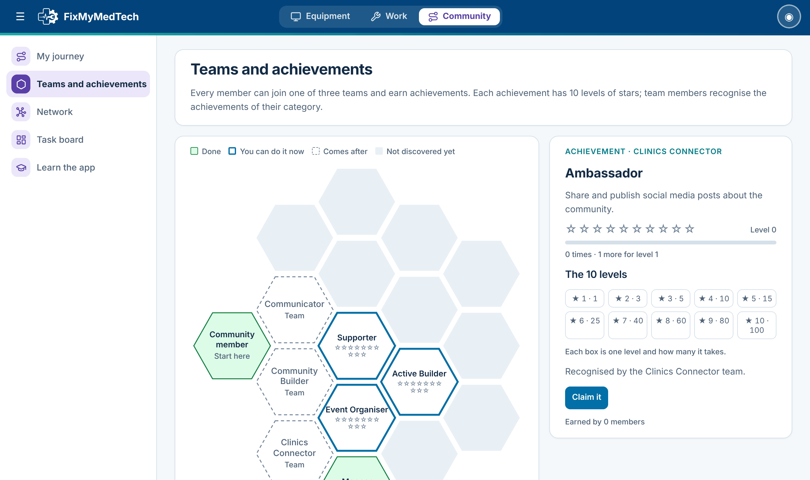

# How the community works

**In the app:** Community → **My journey**, **Teams and achievements**, **Task board**.

**Who this is for:** engineers, technicians and students who want to take part in the FixMyMedTech community.

**What you need before:** an account (see [I am an engineer](start-engineer.md)).

FixMyMedTech is a community of people who keep medical devices working. You enter with three welcome steps, then you can join a team and earn achievements for what you do.

## 1. Welcome steps: from Visitor to Contributor

| Step | Done when |
| --- | --- |
| **Complete your profile** | Your profile has a name, a country, a city and a few words on why you chose biomedical engineering |
| **Add a photo** | Your profile has a photo |
| **Attend a community talk** | A host ticks it after a short video call |

When the three are done you are a **Contributor**: the whole platform opens. Joining the Discord and the social media question on the same page are optional.

## 2. Teams

There are three teams. The team name is the title you can put on LinkedIn (for example *Community Builder, FixMyMedTech*).

| Team | What it does |
| --- | --- |
| **Communicator** | Tells the world what the community does |
| **Community Builder** | Makes the community a place people want to join and stay in. Welcomes new people and hosts the community talks |
| **Clinics Connector** | Brings the platform to clinics on the ground. Hosts the clinic talks |

In a team you are a **Candidate**, a **Member** or a **Lead**:

1. A **Community Builder** makes you a **Candidate** for a team. Ask one (find them in **Network**).
2. That team's **Lead** makes you a **Member**.
3. Only superusers name **Leads**.

## 3. Achievements and stars

There are five achievements, each with 10 levels of stars. A level is reached when your count reaches its number.

| Achievement | Team | How it is counted | Levels |
| --- | --- | --- | --- |
| **Mapper** | Clinics Connector | Devices you registered (automatic) | 1, 5, 10, 20, 35, 50, 75, 100, 150, 200 |
| **Ambassador** | Clinics Connector | Social media posts shared or published, recognised | 1, 3, 5, 10, 15, 25, 40, 60, 80, 100 |
| **Supporter** | Community Builder | Times you helped a fellow engineer, recognised | 1, 3, 5, 10, 15, 25, 40, 60, 80, 100 |
| **Event Organiser** | Community Builder | Events you organised, recognised | 1, 2, 3, 5, 8, 12, 16, 20, 25, 30 |
| **Active Builder** | Community Builder | Community meetings you attended, recognised | 1, 3, 5, 10, 15, 20, 30, 40, 50, 60 |

"Recognised" means a member of that team confirms it: you **claim** it, or a member records it for you. See [Claims, task board and missing manuals](community-work.md).

## Steps

1. Open **Teams and achievements**. The map shows the teams and achievements as tiles:
    - green: done (you are a contributor, in this team, or have at least one star);
    - blue border: you can do it now;
    - dashed border: comes after (for example a team you haven't joined);
    - grey, no label: not discovered yet.
2. Tap a tile. The panel on the right explains the team or the achievement: its 10 levels, who recognises it, and **Claim it** for recognised achievements.
3. Open **My journey** to see your teams, your achievements with their stars, and your counts (devices registered, faults resolved, maintenance visits, invites who joined, manuals added).
4. Take small jobs on the **Task board** to earn points.

{ .shot loading=lazy }

## What happens next

- Members and leads of a team validate claims in [To validate](validate.md) and see **Community admin**.
- Community Builders and Clinics Connectors host talks: see [Talk host](talk-host.md).
- Team powers pause after six months without any activity. Any action in the app restarts them.

## If something goes wrong

- **"Not in a team yet."** Ask a Community Builder to make you a candidate.
- **My stars didn't move.** Recognised achievements need a team member to confirm your claim. Mapper counts only the devices you registered yourself.
- **I can't claim anything.** Claims open when your welcome steps are done.
