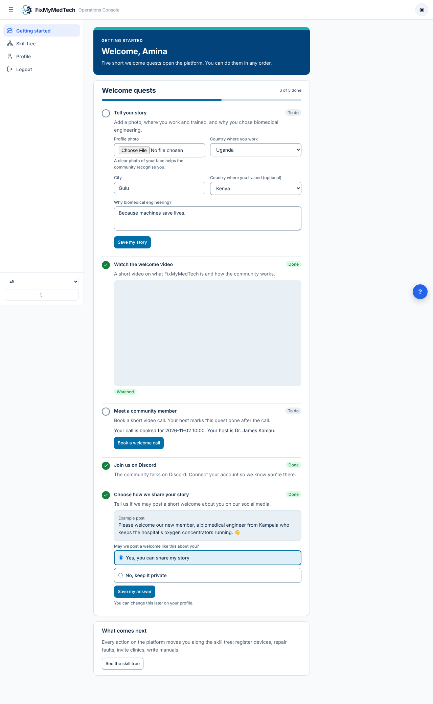
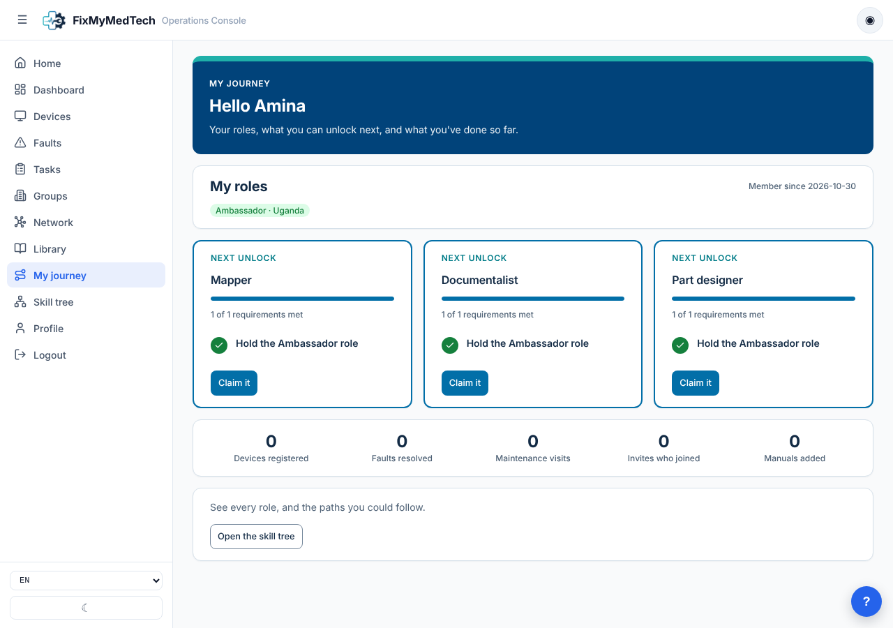
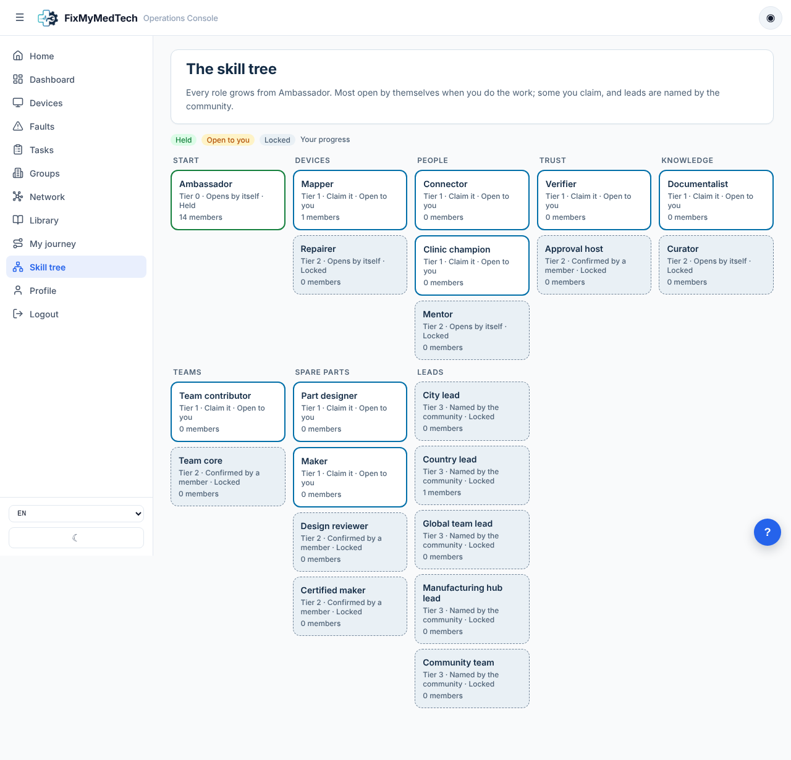
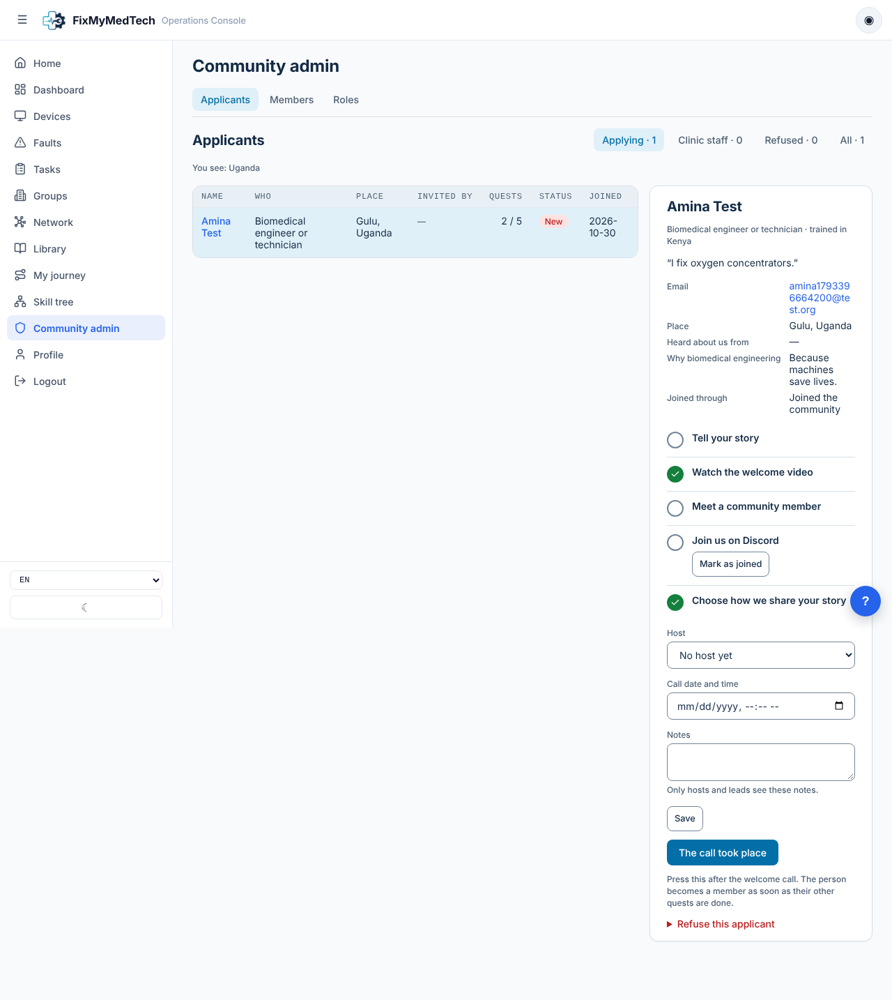
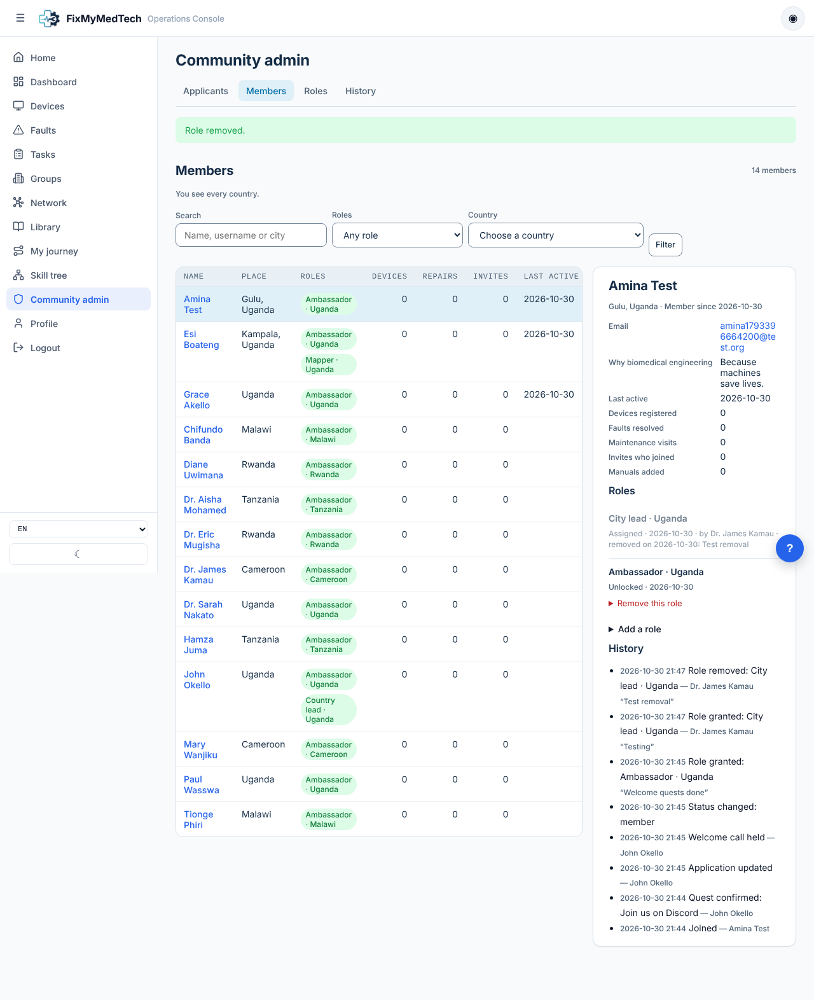

# Community journey: how to use it

Status: phase 1 built (2026-10-30). The design and the later phases are in the [technical plan](community-journey.md).

This page explains what phase 1 does, how each kind of person uses it, and how to set it up and run it. It is written for whoever runs the community, not only for developers.

## What phase 1 does, in short

- **New people join at `/join`.** They become **applicants**. An applicant can log in, but can only see the welcome pages, the skill tree and their profile. The rest of the platform (devices, faults, dashboard, organisations, the device library) stays closed.
- **Five welcome quests open the platform.** When all five are done, the person becomes a **member**, gets the **Ambassador** role, sees a welcome page, and the whole platform opens.
- **Every member has a journey** (`/community`): their roles, the next three roles they can unlock, and their counts.
- **The skill tree is public** (`/community/tree`). Each role has its own page with how to unlock it, what it unlocks and the title to put on LinkedIn.
- **Community admin** (`/community/admin`) is where hosts, leads and the community team review applicants, see members, give or remove roles and read the history.
- **Nobody already on the platform loses access.** The migration made every existing account a member with the Ambassador role.

## The welcome quests



| Quest | How it gets done |
| --- | --- |
| Tell your story | Automatic once the profile has a photo, a country, a city, a country of training and a "why biomedical engineering" answer. |
| Watch the welcome video | Automatic when the YouTube video reaches the end. There is also an "I've watched it" button for slow connections. |
| Meet a community member | The host presses **The call took place** in Community admin after the welcome call. |
| Join us on Discord | Automatic when the person connects Discord on their profile. If they joined without connecting, a host or lead presses **Mark as joined**. |
| Choose how we share your story | Automatic when they answer yes or no to the social media question. |

The quests can be done in any order. The status changes the moment the last one is done; on their next page load the person lands on the welcome page.

**Clinic staff** invited by their clinic (the existing organisation invite) are different: they become **clinic staff**, not applicants. The platform is open for them right away. Their getting started page invites them to do the same quests if they want to become Ambassadors.

## For applicants and members

- Join at `/join`. The old `/signup` link sends people there too, and keeps any `?ref=` invite code.
- An invite link is `/join?ref=<username>`. It records who invited them, which counts towards the inviter's roles.
- After joining, everything happens on **Getting started** (`/community/start`).
- Once a member, the sidebar shows **My journey** and **Skill tree**.



### How roles unlock

Every role has one of four unlock types, shown on the tree and on each role page:

| Unlock | Meaning |
| --- | --- |
| Opens by itself | Granted automatically the next time the person opens a page, once every requirement is met. |
| Claim it | When every requirement is met, a **Claim** button appears on the role page. |
| Confirmed by a member | A member with the confirming role checks the work. In phase 1 there is no confirm button yet, so a community team admin gives these roles from Community admin. |
| Named by the community | Leads. Only a community team admin gives them. |

Roles **pause** after six months without any activity. Any action on the platform restarts them. A paused role keeps showing, but its permissions stop working.



## For hosts and leads

Community admin is in the sidebar for anyone whose role carries one of the admin permissions. Each tab only shows if you have its permission.

| Role | What it can do in Community admin |
| --- | --- |
| Approval host | See applicants, set host and call time, record the call, refuse; confirm Discord |
| Mentor | See applicants; confirm Discord |
| City lead | See applicants and members in their country |
| Country lead | Everything an approval host can do in their country, plus see members |
| Team lead, Manufacturing hub lead | See members of their team |
| Community team | All of the above everywhere, plus the History tab |
| Superuser | Everything, including giving and removing roles |

Country roles only see people in their own country. The line under each tab title says what you see ("You see: Uganda").

### Reviewing an applicant



1. Open **Community admin → Applicants**. "Applying" lists people still doing their quests, newest first.
2. Click a name. The panel on the right shows their answers and their five quests.
3. Pick yourself (or another host) as **Host** and set the call date. Press **Save**. The applicant sees the date and the host's name on their page.
4. After the call, press **The call took place**. If their other quests are done, they become a member right away.
5. If they joined Discord without connecting it, press **Mark as joined**.
6. To refuse, open **Refuse this applicant** and give a reason. The applicant sees the reason. **Reopen the application** undoes it.

The **Clinic staff** filter lists people invited by their clinic who haven't finished the quests. Nothing is needed from you there.

## For community team admins (superusers)

### Giving or removing a role



1. **Community admin → Members**. Search by name, username or city, or filter by role or country.
2. Click a member. The panel shows their roles, counts and history.
3. **Add a role**: choose the role, the country (for country roles, like City lead) or the team (for team roles), add a reason, and press **Add the role**.
4. **Remove this role** under a role: a reason is required and is kept in the history.

Only members can be given roles; applicants have to finish their quests first.

### Making someone a community team admin

For now, community team admins are **superusers**. Make someone a superuser in SQLAdmin: `/admin` → Users → edit the user → tick **Is Superuser**. Superusers hold every permission and see every country.

Giving someone the **Community team** role (from the Members tab) gives them the review and history permissions without full superuser rights.

### Changing the skill tree

The **Roles** tab shows every role with its requirements, permissions and number of holders, and lists every permission with the roles that carry it. It is read only. To change the tree, use SQLAdmin (`/admin`):

- **Community roles**: names, descriptions and LinkedIn titles in English, French and Spanish (JSON fields), the unlock type, tier and sort order. Untick **active** to hide a role.
- **Role requirements**: one row per requirement. `kind` is `role` (ref = role key), `metric` (ref = a count like `faults_resolved`, threshold = how many), `quest` (ref = quest key) or `confirmation`.
- **Role permissions**: one row per (role, permission). The permission keys are fixed in code (`backend/utils/community.py`, `PERMISSIONS`); the Roles tab lists them with what each allows.

Changes apply on the next page load. An editor inside Community admin is planned for phase 1b.

### History

**Community admin → History** lists every change: joins, application updates, calls held, quests confirmed, refusals, roles granted or removed, status changes. Each line says who did it and why. "Automatic" means the platform did it (for example Ambassador granted when the quests were done).

## Setting it up

### Settings to fill in

Four links, none of them secret. Locally they go in `.env`. For dev and production, add them as **repository variables** (GitHub → Settings → Secrets and variables → Actions → Variables tab); the deploy workflows write them into the server's `.env`.

| Variable | What it is | If empty |
| --- | --- | --- |
| `COMMUNITY_BOOKING_URL` | Booking page for the welcome call (Calendly, Cal.com, Google appointment page…) | Applicants are told a member will email them |
| `COMMUNITY_INTRO_VIDEO_URL` | YouTube link of the welcome video | The page says the video isn't available; the "I've watched it" button still works |
| `STAFF_INTRO_VIDEO_URL` | Shorter video for clinic staff | Uses the main video |
| `DISCORD_INVITE_URL` | Invite link to the Discord server | The "Open the Discord server" button is hidden |

Connecting Discord also needs the existing `DISCORD_CLIENT_ID` and `DISCORD_CLIENT_SECRET`.

### Database

Migration `029_community_roles.sql` runs by itself when the backend starts. It adds the community columns on profiles and seven new tables, seeds the 21 roles with their requirements and permissions, and makes every existing account a member with the Ambassador role.

### Trying it locally

```bash
docker compose -f docker-compose.local.yml up --build -d
python scripts/seed_test_data.py
```

All test passwords are `Pass123!`.

| Account | What it shows |
| --- | --- |
| `applicant@test.org` | An applicant (Esi Boateng, Kampala) with an open application |
| `tech@mulago.org` | Country lead for Uganda: sees Esi in Applicants |
| `admin@mulago.org` and the other seed accounts | Ordinary members with the Ambassador role |

Make one of them a superuser in SQLAdmin to try the Members and History tabs with role changes. To test the full journey, join at `/join` with a new email and a Ugandan city, then review yourself as `tech@mulago.org`.

### Tests

```bash
cd backend && pip install pytest && python -m pytest tests -q
```

The tests cover the unlock rules, the pause rule, the welcome quests and the permission scopes. They don't need a database.

## Where the code is

| Piece | File |
| --- | --- |
| Rules: unlocks, quests, pause, permissions | `backend/utils/community.py` |
| API (`/api/community/...`) | `backend/routers/community.py` |
| Platform gate (applicants get 403 `community_access_pending`) | `backend/utils/profile.py` `require_platform_access`, attached to routers in `backend/main.py` |
| Pages | `frontend/features/community/pages/` |
| Applicant redirect | `frontend/features/auth/helper.py` `require_auth`, `APPLICANT_PATHS` |
| Text in three languages | `frontend/i18n.py`, keys `cj.*` |
| Styles | `.cj-*` classes in `frontend/components.py`, built on the design system tokens |

## Not in phase 1

- Confirm buttons for "confirmed by a member" roles (Team core, Design reviewer, Approval host, Certified maker): give them by hand for now.
- Discord announcements when a role unlocks, the public members page, points and the task board.
- Counts for verifications, team contributions, part designs and parts delivered: they stay at zero until those features exist, so roles that need them can't unlock yet.
- An editor for the tree inside Community admin (phase 1b).
