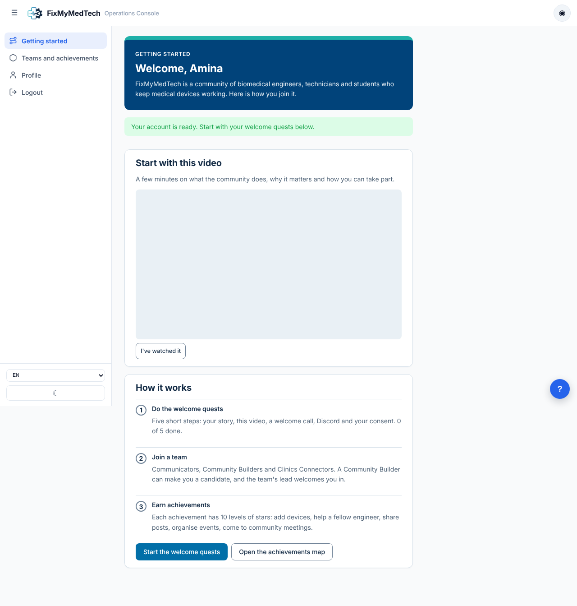
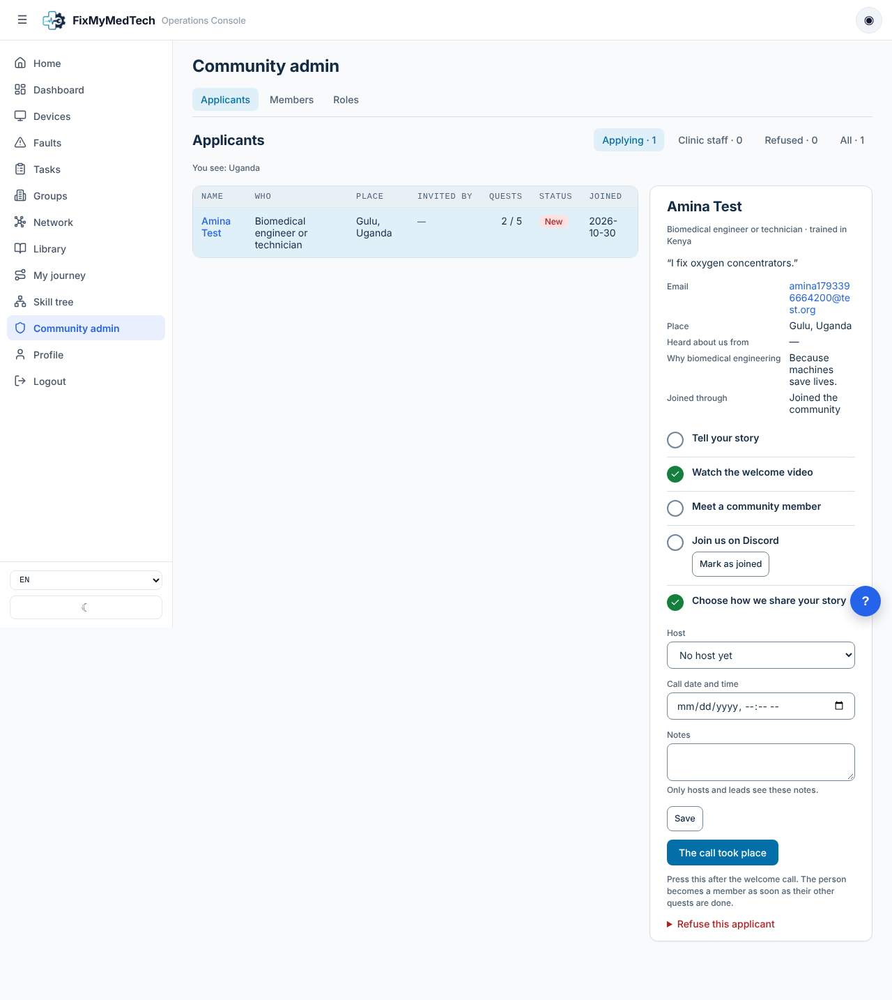
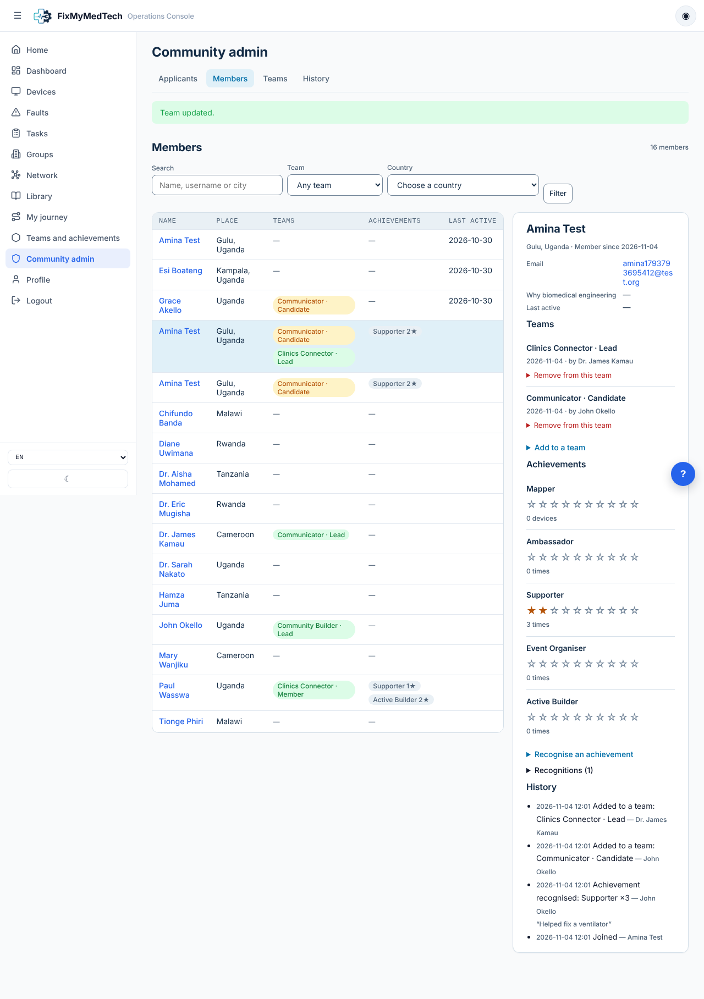
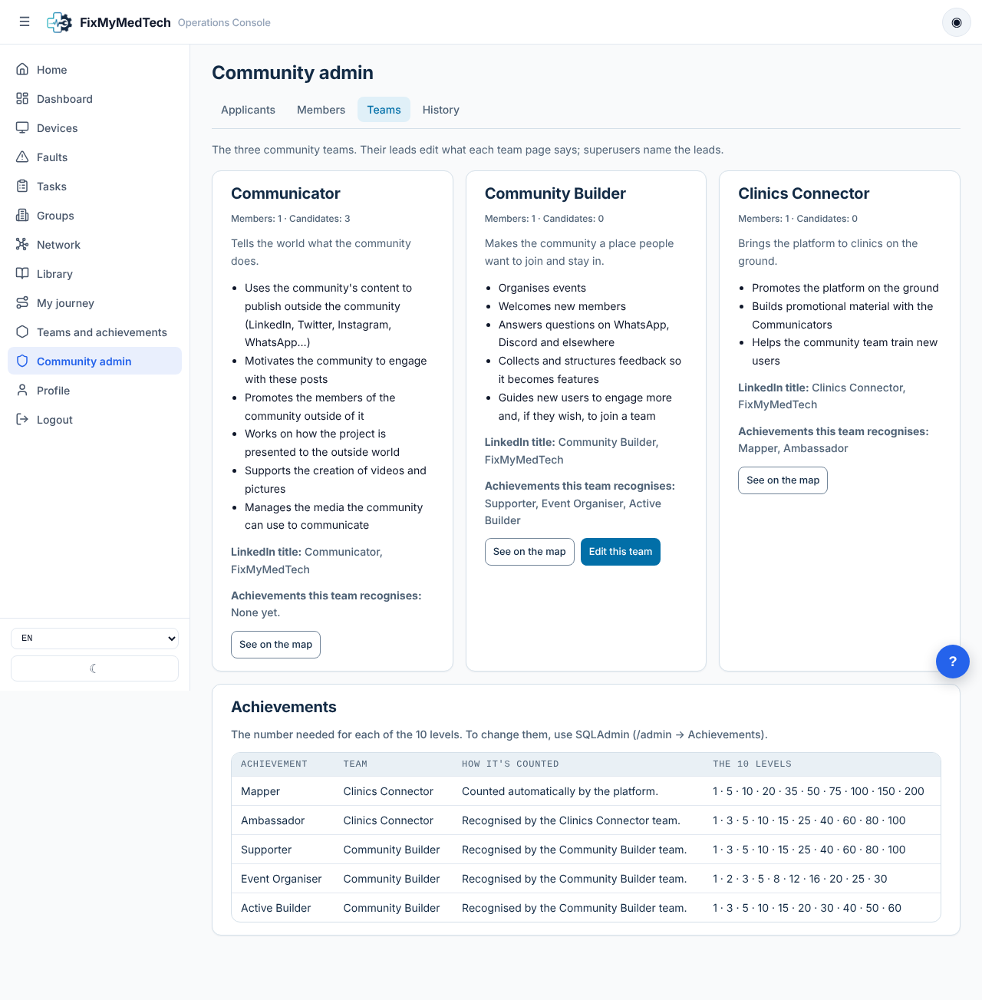

# Community journey: setup and testing

For whoever runs and develops the community features. The user guide is [How the community works](community-guide.md); the design and later phases are in the [technical plan](community-journey.md).

Status: phase 1 rebuilt around teams and achievements (2026-11-04), merged with the engineer and clinic onboarding flow (2026-11-14: three welcome quests, clinics and talk hosts), the three worlds navigation (2026-11-15).

## How it fits together

- **New engineers join at `/join`** (`/signup` redirects there). They are `member_status = 'applicant'`, shown as **Visitor**, and only reach `/community/start*`, the library and their profile (`APPLICANT_PATHS` in `frontend/features/auth/helper.py`); the API answers 403 `community_access_pending` elsewhere (`require_platform_access`).
- **Three welcome quests** (`utils/community.py`, `WELCOME_QUESTS`): profile complete, profile photo, community talk. When done, `member_status = 'member'` (shown as **Contributor**). It never goes back.
- **Clinic accounts** (`account_kind = 'clinic'`, from `/clinic/signup` or an invitation) and staff added with **Invite user** are `member_status = 'staff'`: no quests needed. Staff become members if they do the quests.
- **Clinics**: invited clinics are `clinic_status = 'active'`. A clinic created without an invitation (at `/clinic/signup`, or from **Groups** by anyone) is `talk_pending` until a Clinics Connector unlocks it on `/host`; until then nobody registers devices for it, its admins included (decision 2026-11-13). Rules: `backend/utils/onboarding.py`.
- **Navigation**: `user_worlds()` in `frontend/components.py` builds the worlds from `member_status`, `account_kind`, the community permissions and `is_talk_host`.

## Settings

Links, none of them secret. Locally they go in `.env`. For dev and production, add them as **repository variables** (GitHub → Settings → Secrets and variables → Actions → Variables); the deploy workflows write them into the server's `.env`.

| Variable | What it is | If empty |
| --- | --- | --- |
| `COMMUNITY_BOOKING_URL` | Booking page for the community talk (Calendly, Cal.com...) | Visitors are told a host will contact them |
| `CLINIC_TALK_BOOKING_URL` | Booking page for the clinic talk | Clinics are told the community will contact them |
| `COMMUNITY_INTRO_VIDEO_URL` | YouTube link of the concept video on the introduction page | The page says the video isn't available; "I've watched it" still works |
| `STAFF_INTRO_VIDEO_URL` | Shorter video for clinic staff | Uses the main video |
| `DISCORD_INVITE_URL` | Invite link to the Discord server | The "Open the Discord server" button is hidden |

Connecting Discord also needs `DISCORD_CLIENT_ID` and `DISCORD_CLIENT_SECRET`.

Other settings used by the user-facing features:

| Variable | Default | What it does |
| --- | --- | --- |
| `CALL_OFFER_POOL` | `city` | Who is told when a call for an engineer widens: `city` (Contributors whose city is in the clinic's region, address or name), `own` (responsible engineers and registrant only), `country` |
| `CALL_CURRENCY` | `XAF` | Currency shown next to visit fees |
| `MAINTENANCE_REMINDERS` | on | `off` stops the "service due" and "service overdue" emails |

The call proposals (visit fee and arrival time only, one counter-offer, 20 minutes / 4 hours before widening) are still to be confirmed with the community.

## Database

Migrations run by themselves when the backend starts: `029_community_journey.sql` (community columns, teams, achievements, quests, applications, history; seeds 3 teams and 5 achievements in three languages; makes every existing account a member), `030_onboarding_flow.sql` (account kind, clinic status, invitations, responsible engineers), `031_service_plans.sql` (service intervals), `032_call_an_engineer.sql` (calls), `033_claims_and_tasks.sql` (claims and task board).

## Trying it locally

```bash
docker compose -f docker-compose.local.yml up --build -d
python scripts/seed_test_data.py
python scripts/walk_onboarding.py      # optional: walks the whole onboarding flow, creates throwaway accounts
```

All test passwords are `Pass123!`.

| Account | What it shows |
| --- | --- |
| `visitor@fmt-demo.org` | A new engineer (Visitor): only Getting started and Library |
| `host@fmt-demo.org` | Talk host: confirms talks and unlocks clinics on `/host` |
| `admin@mulago.org` | Clinic administrator (clinic account, one Equipment menu) |
| `nurse@mulago.org` | Clinic staff (clinic account) |
| `tech@mulago.org` (John Okello) | Community Builder lead: reviews applicants, makes candidates, recognises Supporter, Event Organiser and Active Builder |
| `tech@kenyatta.org` | Communicator lead: can edit the Communicator page |
| `eng@mulago.org` (Paul Wasswa) | Clinics Connector member, responsible engineer at Mulago: gets its repair requests |
| `applicant@test.org` | An applicant with an open application |
| `eng<run>@fmt-demo.org` | Created by `walk_onboarding.py`: a Contributor with invited clinics |

Make one of them a superuser in SQLAdmin to name leads and see everything.

## Superuser tasks

- **Make someone a superuser**: SQLAdmin (`/admin`) → Users → edit → tick **Is Superuser**.
- **Name a lead**: Community admin → Members → the person → **Add to a team** → "Team · Lead".
- **Change the levels of an achievement**: SQLAdmin → **Achievements** → `levels` (exactly 10 numbers, smallest first). Names and descriptions per language are on the same screen. Untick **active** to hide one.
- **Teams** can also be edited in SQLAdmin → **Community teams**.
- Adding a team or achievement tile to the map needs a line in `MAP_LAYOUT` (`frontend/features/community/ui.py`); the database rows alone don't place it.

## Tests

```bash
cd backend && pip install pytest && python -m pytest tests -q
```

`backend/tests/` covers member status, the pause rule, star levels, the seeded levels, who can do what, calls and the community work rules. They don't need a database.

## Where the code is

| Piece | File |
| --- | --- |
| Rules: status, quests, pause, star levels, powers | `backend/utils/community.py` |
| Rules: who registers devices where, talk hosts | `backend/utils/onboarding.py` |
| Community API (`/api/community/...`) | `backend/routers/community.py` |
| Claims and task board API | `backend/routers/community_work.py` |
| Onboarding API (`/api/onboarding/...`) | `backend/routers/onboarding.py` |
| Calls (`/api/calls/...`) and matching rules | `backend/routers/calls.py`, `backend/utils/calls.py` |
| Platform gate (applicants get 403 `community_access_pending`) | `backend/utils/profile.py` `require_platform_access` |
| Community pages | `frontend/features/community/pages/` |
| Onboarding pages (`/invite-clinic`, `/clinic/setup`, `/host`, `/invite/...`) | `frontend/features/onboarding/pages/` |
| Worlds and sidebar | `frontend/components.py` `user_worlds`, `world_switcher`, `sidebar` |
| Applicant redirect | `frontend/features/auth/helper.py` `require_auth`, `APPLICANT_PATHS` |
| Text in three languages | `frontend/i18n.py` (keys `cj.*`, `ob.*`, `call.*`, `w5.*`) |

## Not yet built

- Communicator achievements: none are defined yet, so the Communicator team recognises none.
- Discord announcements when someone joins a team or earns a star, and the public members page.
- A "Member" community status after the Sociocracy for All training: today the app has Visitor and Contributor, and "Member" is a level inside a team.

## Earlier screenshots

These screenshots of the community pages date from phase 1 and are kept for reference.

<div class="shots" markdown>
{ .shot width=380 loading=lazy }
{ .shot width=380 loading=lazy }
{ .shot width=380 loading=lazy }
{ .shot width=380 loading=lazy }
</div>
