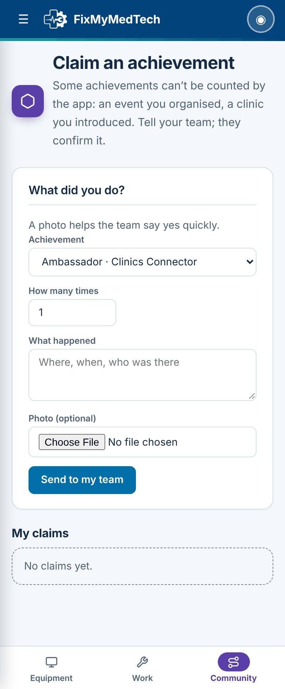
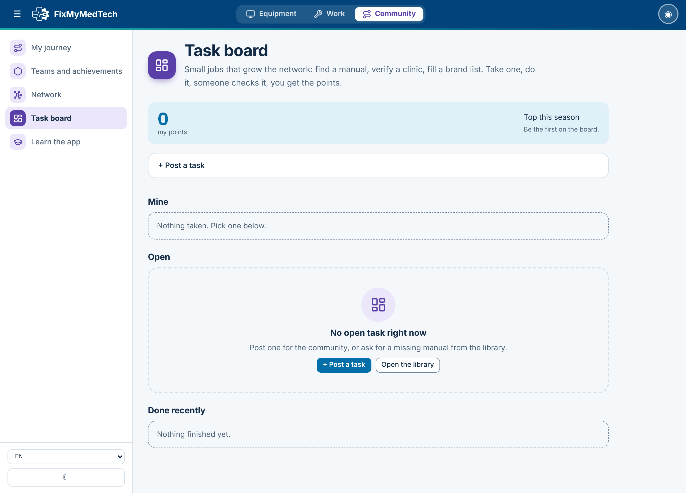

# Reclamos, tablero de tareas y manuales que faltan

**En la aplicación:** Comunidad → **Tablero de tareas**; los reclamos desde **Equipos y logros** → **Reclamarlo**.

**Para quién es:** Colaboradores (ingenieros con los pasos de bienvenida hechos).

**Qué necesitas antes:** tus pasos de bienvenida están hechos. Reclamar, publicar y tomar tareas está cerrado a los Visitantes.

## Reclama un logro

Algunos logros se cuentan solos (los dispositivos registrados). Otros no: un evento que organizaste, una publicación que compartiste, alguien a quien ayudaste. Son logros **reconocidos**: tú los reclamas y tu equipo los confirma.

1. Abre **Equipos y logros**, elige un logro y toca **Reclamarlo**. La página se llama **Reclamar un logro**.
2. En **¿Qué hiciste?**, elige el **Logro**, **Cuántas veces** y **Qué pasó** (dónde, cuándo, quién estaba). Añade una foto: ayuda al equipo a decir que sí rápido.
3. Toca **Enviar a mi equipo**.
4. Síguelo en **Mis reclamos**: **Esperando al equipo**, **Piden más información**, **Confirmado** o **Rechazado**.
5. Si el equipo pide más información, responde bajo el reclamo (puedes añadir una foto) y toca **Enviar de nuevo**.

Una vez confirmado, el contador sube y quizá también tus estrellas. La parte del equipo está en [Por validar](validate.md).

<figure markdown>
{ .phone loading=lazy }
<figcaption>Reclamar un logro.</figcaption>
</figure>

## El tablero de tareas

El **Tablero de tareas** reúne pequeños trabajos que hacen crecer la red:

| Tipo | Ejemplo |
| --- | --- |
| Encontrar un manual | Encontrar el manual de servicio de un Mindray BeneHeart D3 |
| Verificar una clínica | Comprobar que existe una clínica recién registrada |
| Marcas y modelos | Rellenar los modelos que vende una marca en la región |
| Otra | Cualquier otra cosa que necesite la comunidad |

1. **+ Publicar una tarea**: el tipo, qué hay que hacer, los detalles y los puntos (10 por defecto). Toca **Publicar la tarea**.
2. **Lo hago yo** toma una tarea abierta; pasa a **Mías**. **Devolverla** la reabre.
3. **Hecho**, con una nota o un enlace, la envía a revisión.
4. El autor de la tarea o un líder de equipo la revisa: **Está bien** te da los puntos, **Devolver** te la devuelve. Nadie revisa su propia tarea.

La parte de arriba del tablero muestra tus puntos y los primeros de la temporada.

{ .shot loading=lazy }

## Manuales que faltan

- **En la página de un dispositivo**, cuando no hay ningún manual adjunto y ninguno en la biblioteca para esa marca y modelo, toca **Encontrar este manual**. Publica una tarea *Encontrar un manual* que vale 20 puntos. Si alguien ya pidió la misma marca y modelo, se reutiliza su tarea.
- **En la Biblioteca**, una búsqueda sin resultados muestra **¿No lo encuentras?**: indica la marca y el modelo y toca **Encontrar este manual**. ¿Sin sesión iniciada? Inicia sesión primero.
- Quien encuentra el manual lo adjunta a un dispositivo o lo sube (mira [Adjuntar un manual](attach-manual.md)) y después marca la tarea como **Hecho**.

## Qué pasa después

Los reclamos confirmados y las tareas revisadas aparecen en **Mi recorrido** y en tu perfil.

## Si algo sale mal

- **"Los reclamos se abren al terminar tus pasos de bienvenida."** Termina primero tus tres pasos de bienvenida.
- **"This achievement counts by itself, no claim needed."** (mensaje en inglés) Cartógrafo cuenta los dispositivos que registras; no hay nada que reclamar.
- **Mi reclamo tarda mucho.** Necesita un líder, o dos miembros del equipo que reconoce ese logro. Pregunta en el canal de tu equipo.
