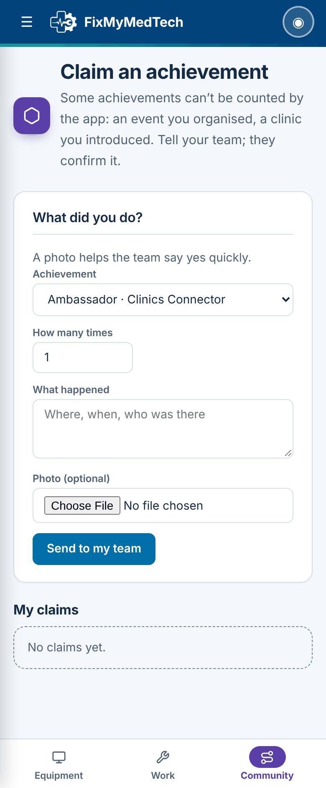
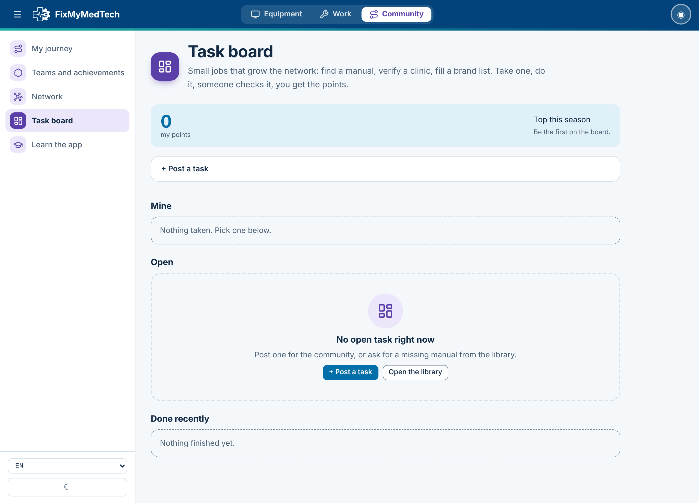

# Déclarations, tableau des tâches et manuels manquants

**Dans l'application :** Communauté → **Tableau des tâches** ; les déclarations depuis **Équipes et réussites** → **Le déclarer**.

**Pour qui :** les Contributeurs (ingénieurs dont les étapes d'accueil sont terminées).

**Ce qu'il vous faut avant :** vos étapes d'accueil sont terminées. Déclarer, publier et prendre des tâches est fermé aux Visiteurs.

## Déclarer une réussite

Certaines réussites se comptent seules (les appareils enregistrés). D'autres non : un événement que vous avez organisé, un message que vous avez partagé, une personne que vous avez aidée. Ce sont des réussites **reconnues** : vous les déclarez et votre équipe confirme.

1. Ouvrez **Équipes et réussites**, choisissez une réussite et touchez **Le déclarer**. La page s'appelle **Déclarer une réussite**.
2. Sous **Qu'avez-vous fait ?**, choisissez la **Réussite**, **Combien de fois**, et **Ce qui s'est passé** (où, quand, qui était là). Ajoutez une photo : elle aide l'équipe à dire oui vite.
3. Touchez **Envoyer à mon équipe**.
4. Suivez-la sous **Mes déclarations** : **En attente de l'équipe**, **Précisions demandées**, **Confirmé** ou **Refusé**.
5. Si l'équipe demande des précisions, répondez sous la déclaration (vous pouvez ajouter une photo) et touchez **Renvoyer**.

Une fois confirmée, le compte augmente, et vos étoiles peut-être aussi. Le côté de l'équipe est dans [À valider](validate.md) (en anglais).

<figure markdown>
{ .phone loading=lazy }
<figcaption>Déclarer une réussite.</figcaption>
</figure>

## Le tableau des tâches

Le **Tableau des tâches** réunit de petits travaux qui font grandir le réseau :

| Type | Exemple |
| --- | --- |
| Trouver un manuel | Trouver le manuel de service d'un Mindray BeneHeart D3 |
| Vérifier une clinique | Vérifier qu'une clinique nouvellement inscrite existe |
| Marques et modèles | Lister les modèles qu'une marque vend dans la région |
| Autre | Tout autre besoin de la communauté |

1. **+ Publier une tâche** : le type, ce qu'il faut faire, les détails et les points (10 par défaut). Touchez **Publier la tâche**.
2. **Je m'en occupe** prend une tâche ouverte ; elle passe dans **Les miennes**. **La rendre** la rouvre.
3. **Fait**, avec une note ou un lien, l'envoie à vérifier.
4. L'auteur de la tâche ou un responsable d'équipe la vérifie : **C'est bon** vous donne les points, **Renvoyer** vous la retourne. Personne ne vérifie sa propre tâche.

Le haut du tableau montre vos points et le classement de la saison.

{ .shot loading=lazy }

## Manuels manquants

- **Sur la page d'un appareil**, quand aucun manuel n'est joint et qu'aucun n'est dans la bibliothèque pour cette marque et ce modèle, touchez **Trouver ce manuel**. Cela publie une tâche *Trouver un manuel* qui vaut 20 points. Si quelqu'un a déjà demandé la même marque et le même modèle, sa tâche est réutilisée.
- **Dans la Bibliothèque**, une recherche sans résultat montre **Introuvable ?** : donnez la marque et le modèle et touchez **Trouver ce manuel**. Pas connecté ? Connectez-vous d'abord.
- La personne qui trouve le manuel le joint à un appareil ou le téléverse (voir [Joindre un manuel](attach-manual.md)), puis marque la tâche **Fait**.

## Et ensuite

Les déclarations confirmées et les tâches vérifiées apparaissent sur **Mon parcours** et sur votre profil.

## En cas de problème

- **« Les déclarations s'ouvrent une fois vos étapes d'accueil terminées. »** Terminez d'abord vos trois étapes d'accueil.
- **« This achievement counts by itself, no claim needed. »** (message en anglais) Cartographe compte les appareils que vous enregistrez : rien à déclarer.
- **Ma déclaration attend longtemps.** Elle a besoin d'un responsable, ou de deux membres de l'équipe qui reconnaît cette réussite. Demandez dans le canal de votre équipe.
