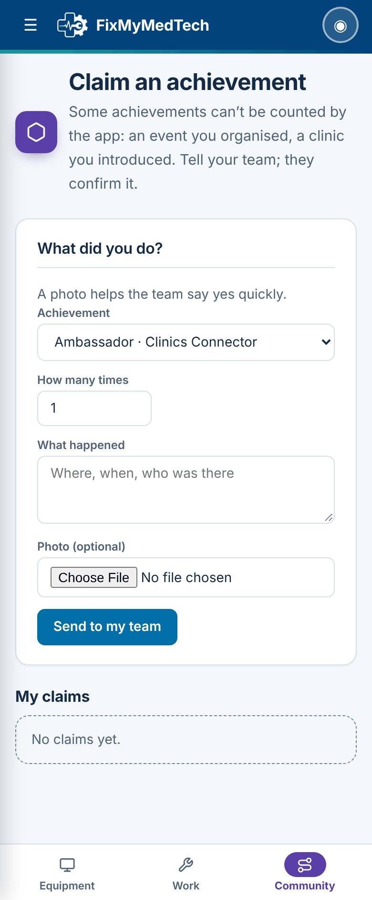
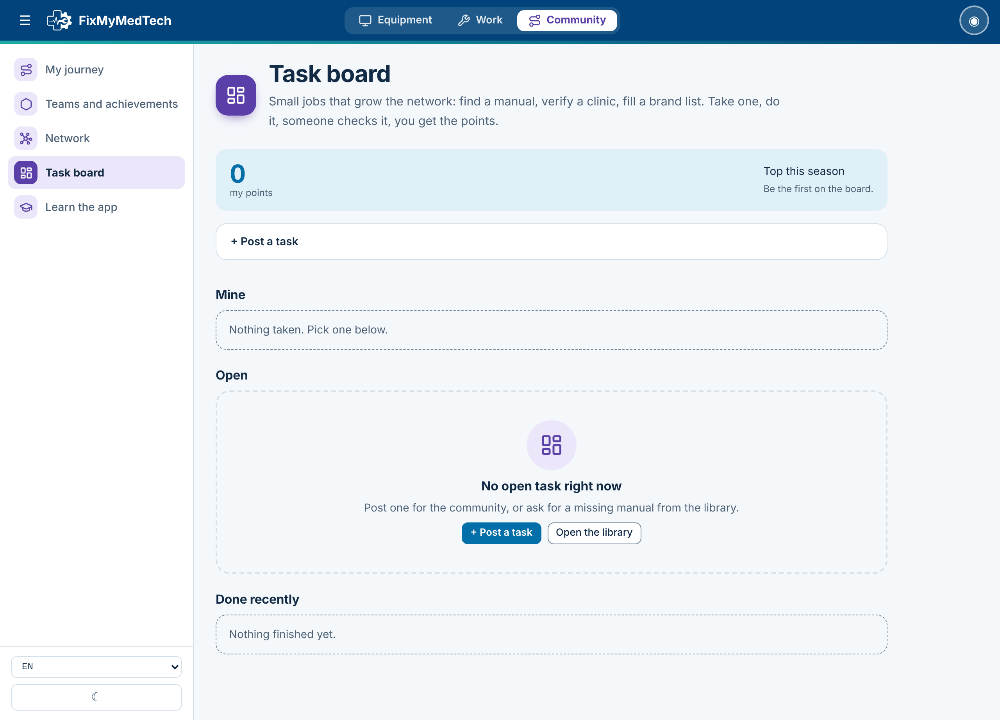

# Claims, task board and missing manuals

**In the app:** Community → **Task board**; claims from **Teams and achievements** → **Claim it**.

**Who this is for:** Contributors (engineers whose welcome steps are done).

**What you need before:** your welcome steps are done. Claims, posting and taking tasks are closed to Visitors.

## Claim an achievement

Some achievements count by themselves (devices registered). Others can't: an event you organised, a post you shared, someone you helped. Those are **recognised** achievements: you claim them and your team confirms.

1. Open **Teams and achievements**, pick an achievement and tap **Claim it**. The page is **Claim an achievement**.
2. Under **What did you do?**, choose the **Achievement**, **How many times**, and **What happened** (where, when, who was there). Add a photo: it helps the team say yes quickly.
3. Tap **Send to my team**.
4. Follow it under **My claims**: **Waiting for the team**, **They asked for more**, **Confirmed** or **Declined**.
5. If the team asks for more, answer under the claim (you can add a photo) and tap **Send again**.

Once confirmed, the count goes up and so may your stars. The team side is in [To validate](validate.md).

<figure markdown>
{ .phone loading=lazy }
<figcaption>Claim an achievement.</figcaption>
</figure>

## The task board

**Task board** holds small jobs that grow the network:

| Kind | Example |
| --- | --- |
| Find a manual | Find the service manual of a Mindray BeneHeart D3 |
| Verify a clinic | Check that a newly registered clinic exists |
| Brands and models | Fill in the models a brand sells in the region |
| Other | Anything else the community needs |

1. **+ Post a task**: the kind, what needs doing, details and points (10 by default). Tap **Post the task**.
2. **I'll do it** takes an open task; it moves to **Mine**. **Give it back** reopens it.
3. **Done**, with a note or a link, sends it for a check.
4. The task's author or a team lead checks it: **Looks good** gives you the points, **Send back** returns it. Nobody checks their own task.

The top of the board shows your points and the top of the season.

{ .shot loading=lazy }

## Missing manuals

- **On a device page**, when no manual is attached and none is in the library for that brand and model, tap **Find this manual**. It posts a *Find a manual* task worth 20 points. If someone already asked for the same brand and model, their task is reused.
- **In the Library**, a search with no result shows **Can't find it?**: give the brand and model and tap **Find this manual**. Signed out? Log in first.
- Whoever finds the manual attaches it to a device or uploads it (see [Attach a manual](attach-manual.md)), then marks the task **Done**.

## What happens next

Confirmed claims and checked tasks show on **My journey** and on your profile.

## If something goes wrong

- **"Claims open once your welcome steps are done."** Finish your three welcome steps first.
- **"This achievement counts by itself, no claim needed."** Mapper counts the devices you register; nothing to claim.
- **My claim waits for a long time.** It needs a lead, or two members of the team that recognises it. Ask in your team's channel.
