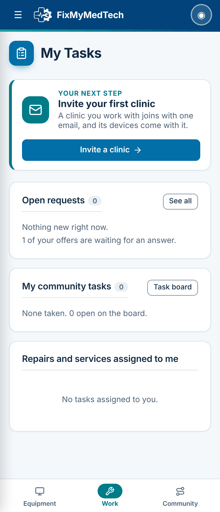
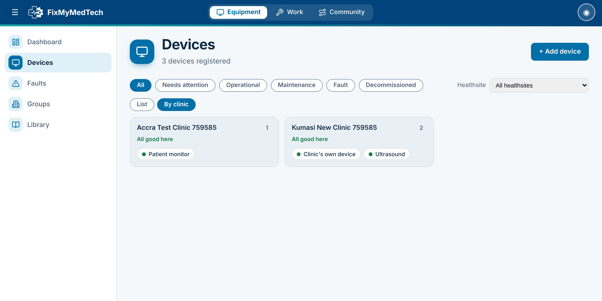
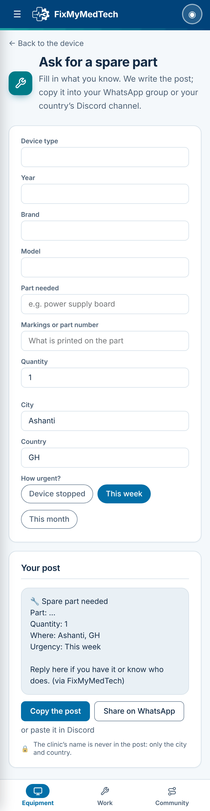

# Espacio del ingeniero

**En la aplicación:** Trabajo → **Tareas** (la página **Mis Tareas**); Equipamiento → **Dispositivos** → **Por clínica**.

**Para quién es:** ingenieros y técnicos con los pasos de bienvenida hechos (Colaboradores).

**Qué necesitas antes:** al menos una clínica que te haya nombrado (mira [Invitar a una clínica](invite-clinic.md)), o un rol en una organización que mantiene dispositivos.

## Pasos

### 1. Empieza tu día en Mis Tareas

Abre **Trabajo → Tareas**. **Mis Tareas** responde a "¿qué debo hacer ahora?":

- **Solicitudes abiertas**: las [llamadas a un ingeniero](requests.md) de las que te avisaron, las más urgentes primero, y cuántas de tus ofertas esperan respuesta. **Ver todo** abre **Solicitudes**.
- **Mis tareas comunitarias**: las tareas que tomaste en el [tablero de tareas](community-work.md), con sus puntos.
- **Reparaciones y servicios asignados a mí**: las fallas y registros de mantenimiento que se te asignaron.

<figure markdown>
{ .phone loading=lazy }
<figcaption>Mis Tareas en el teléfono.</figcaption>
</figure>

### 2. Mira tus dispositivos por clínica

En **Dispositivos**, cambia entre **Lista** y **Por clínica**. **Por clínica** muestra una tarjeta por clínica, los dispositivos que necesitan a alguien primero, y una línea como *2 necesitan a alguien* o *Todo bien aquí*. Los puntos usan los mismos colores que la vista de la clínica: verde funcionando, naranja en mantenimiento o servicio atrasado, rojo falla, gris dado de baja.

**Requiere atención** deja solo los dispositivos con una falla, en mantenimiento o con un servicio atrasado. Funciona en las dos vistas.

{ .shot loading=lazy }

### 3. Pide un repuesto

Desde la página de un dispositivo (**Pedir un repuesto**), o desde una falla abierta, la aplicación escribe un mensaje que puedes pegar en un grupo de WhatsApp o en el canal de Discord de tu país. No pide nada.

1. El tipo de dispositivo, la marca, el modelo y el año, y la ciudad y el país de la clínica, se rellenan por ti.
2. Añade la **Pieza necesaria**, lo que lleva impreso (**Marcas o número de pieza**), la **Cantidad** y **¿Qué tan urgente?**: **Equipo parado**, **Esta semana** o **Este mes**.
3. El mensaje se actualiza mientras escribes. Toca **Copiar el mensaje** o **Compartir en WhatsApp**.

El nombre de la clínica nunca aparece en el mensaje, solo su ciudad y su país. No se guarda nada.

<figure markdown>
{ .phone loading=lazy }
<figcaption>El mensaje del repuesto, listo para copiar.</figcaption>
</figure>

## Qué pasa después

- Una oferta aceptada, o una falla que se te asigna, aparece en **Reparaciones y servicios asignados a mí**. Sigue los pasos de [Reportar una falla y conseguir que se repare](report-fault.md).
- Cada dispositivo que registras cuenta para tu logro **Cartógrafo**; mira [Cómo funciona la comunidad](community-guide.md).

## Si algo sale mal

- **Mis Tareas está vacío.** Ninguna clínica ha llamado y no se te ha asignado nada. Invita a las clínicas con las que trabajas: [Invitar a una clínica](invite-clinic.md).
- **Faltan los dispositivos de una clínica.** Ves los dispositivos de una clínica cuando te confirmó como ingeniero responsable, tus pasos de bienvenida están hechos y la clínica está activa.
- **No veo Pedir un repuesto.** Aparece para los ingenieros, no para las cuentas de clínica.
