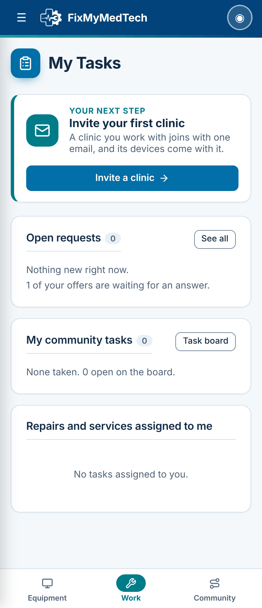
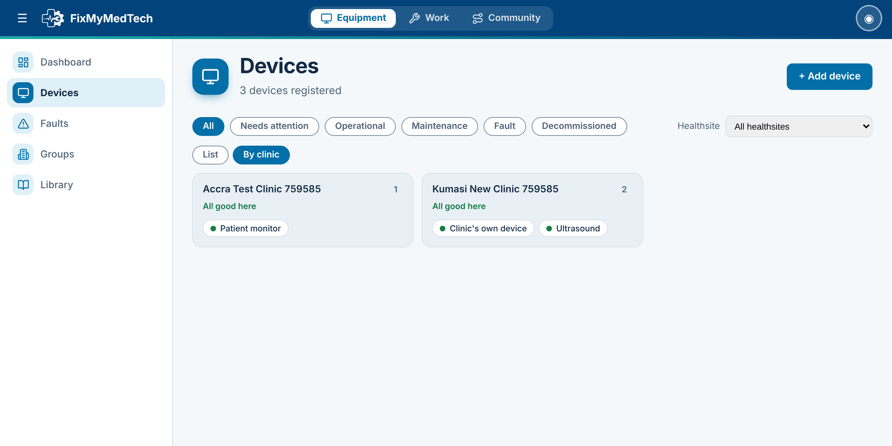
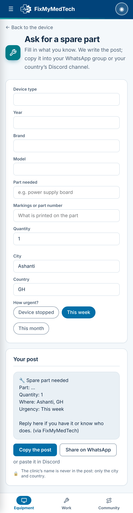

# L'espace de l'ingénieur

**Dans l'application :** Travail → **Tâches** (la page **Mes Tâches**) ; Équipements → **Appareils** → **Par clinique**.

**Pour qui :** les ingénieurs et techniciens dont les étapes d'accueil sont terminées (Contributeurs).

**Ce qu'il vous faut avant :** au moins une clinique qui vous a nommé (voir [Inviter une clinique](invite-clinic.md)), ou un rôle dans une organisation qui entretient des appareils.

## Étapes

### 1. Commencer la journée sur Mes Tâches

Ouvrez **Travail → Tâches**. **Mes Tâches** répond à « que dois-je faire maintenant ? » :

- **Demandes ouvertes** : les [appels à un ingénieur](requests.md) dont vous avez été prévenu, les plus urgents d'abord, et combien de vos offres attendent une réponse. **Tout voir** ouvre **Demandes**.
- **Mes tâches communautaires** : les tâches que vous avez prises sur le [tableau des tâches](community-work.md), avec leurs points.
- **Réparations et entretiens qui me sont confiés** : les pannes et journaux d'entretien qui vous sont assignés.

<figure markdown>
{ .phone loading=lazy }
<figcaption>Mes Tâches sur un téléphone.</figcaption>
</figure>

### 2. Voir vos appareils par clinique

Dans **Appareils**, passez de **Liste** à **Par clinique**. **Par clinique** montre une carte par clinique, les appareils qui ont besoin de quelqu'un d'abord, et une ligne comme *2 à traiter* ou *Tout va bien ici*. Les points ont les mêmes couleurs que dans la vue de la clinique : vert opérationnel, orange en maintenance ou entretien en retard, rouge en panne, gris décommissionné.

**À traiter** ne garde que les appareils en panne, en maintenance ou avec un entretien manqué. Ce filtre marche dans les deux vues.

{ .shot loading=lazy }

### 3. Demander une pièce

Depuis la page d'un appareil (**Demander une pièce**) ou depuis une panne ouverte, l'application écrit un message à coller dans un groupe WhatsApp ou dans le canal Discord de votre pays. Elle ne commande rien.

1. Le type d'appareil, la marque, le modèle et l'année, ainsi que la ville et le pays de la clinique, sont remplis pour vous.
2. Ajoutez la **Pièce recherchée**, ce qui est écrit dessus (**Marquages ou référence**), la **Quantité** et **Quelle urgence ?** : **Appareil à l'arrêt**, **Cette semaine** ou **Ce mois-ci**.
3. Le message se met à jour pendant que vous tapez. Touchez **Copier le message** ou **Partager sur WhatsApp**.

Le nom de la clinique n'est jamais dans le message, seulement sa ville et son pays. Rien n'est enregistré.

<figure markdown>
{ .phone loading=lazy }
<figcaption>Le message pour la pièce, prêt à copier.</figcaption>
</figure>

## Et ensuite

- Une offre acceptée, ou une panne qui vous est assignée, apparaît sous **Réparations et entretiens qui me sont confiés**. Suivez les étapes de [Signaler une panne et la faire réparer](report-fault.md).
- Chaque appareil que vous enregistrez compte pour votre réussite **Cartographe** ; voir [Comment fonctionne la communauté](community-guide.md).

## En cas de problème

- **Mes Tâches est vide.** Aucune clinique n'a appelé et rien ne vous est assigné. Invitez les cliniques avec lesquelles vous travaillez : [Inviter une clinique](invite-clinic.md).
- **Les appareils d'une clinique manquent.** Vous voyez les appareils d'une clinique une fois qu'elle vous a confirmé comme ingénieur responsable, que vos étapes d'accueil sont terminées et que la clinique est active.
- **Je ne vois pas Demander une pièce.** Le bouton est montré aux ingénieurs, pas aux comptes clinique.
