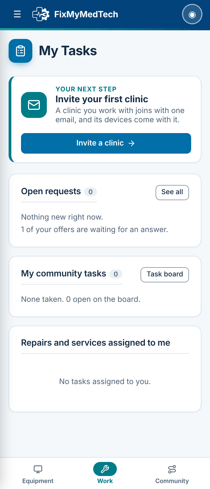
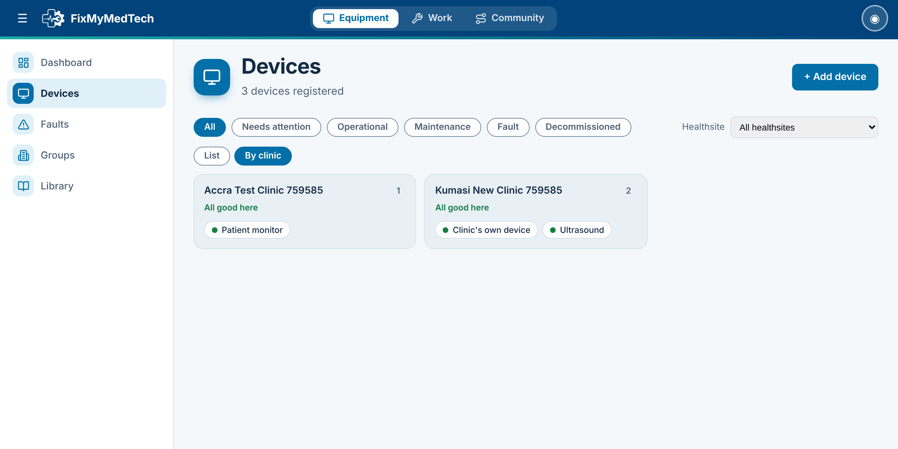
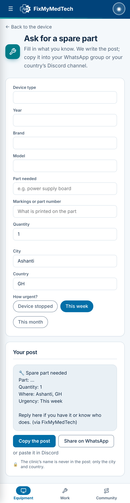

# Engineer workspace

**In the app:** Work → **Tasks** (the page **My Tasks**); Equipment → **Devices** → **By clinic**.

**Who this is for:** engineers and technicians whose welcome steps are done (Contributors).

**What you need before:** at least one clinic that named you (see [Invite a clinic](invite-clinic.md)), or a role in an organisation that maintains devices.

## Steps

### 1. Start your day on My Tasks

Open **Work → Tasks**. **My Tasks** answers "what should I do next?":

- **Open requests**: the [calls for an engineer](requests.md) you were told about, the most urgent first, and how many of your offers wait for an answer. **See all** opens **Requests**.
- **My community tasks**: the tasks you took on the [task board](community-work.md), with their points.
- **Repairs and services assigned to me**: the faults and maintenance logs assigned to you.

<figure markdown>
{ .phone loading=lazy }
<figcaption>My Tasks on a phone.</figcaption>
</figure>

### 2. See your devices by clinic

On **Devices**, switch between **List** and **By clinic**. **By clinic** shows one card per clinic, the devices that need someone first, and a line such as *2 need someone* or *All good here*. The dots use the same colours as the clinic's view: green working, orange in maintenance or service overdue, red fault, grey decommissioned.

**Needs attention** keeps only devices with a fault, in maintenance, or with a missed service. It works in both views.

{ .shot loading=lazy }

### 3. Ask for a spare part

From a device page (**Ask for a spare part**), or from an open fault, the app writes a post you can paste in a WhatsApp group or your country's Discord channel. It does not order anything.

1. The device type, brand, model and year, and the clinic's city and country, are filled in for you.
2. Add the **Part needed**, what is printed on it (**Markings or part number**), the **Quantity** and **How urgent?**: **Device stopped**, **This week** or **This month**.
3. The post updates as you type. Tap **Copy the post** or **Share on WhatsApp**.

The clinic's name is never in the post, only its city and country. Nothing is saved.

<figure markdown>
{ .phone loading=lazy }
<figcaption>The spare-part post, ready to copy.</figcaption>
</figure>

## What happens next

- An accepted offer, or a fault assigned to you, shows under **Repairs and services assigned to me**. Follow the steps in [Report a fault and get it repaired](report-fault.md).
- Each device you register counts for your **Mapper** achievement; see [How the community works](community-guide.md).

## If something goes wrong

- **My Tasks is empty.** No clinic has called and nothing is assigned to you. Invite the clinics you work with: [Invite a clinic](invite-clinic.md).
- **A clinic's devices are missing.** You see a clinic's devices once it confirmed you as a responsible engineer, your welcome steps are done and the clinic is active.
- **I don't see Ask for a spare part.** It shows to engineers, not to clinic accounts.
