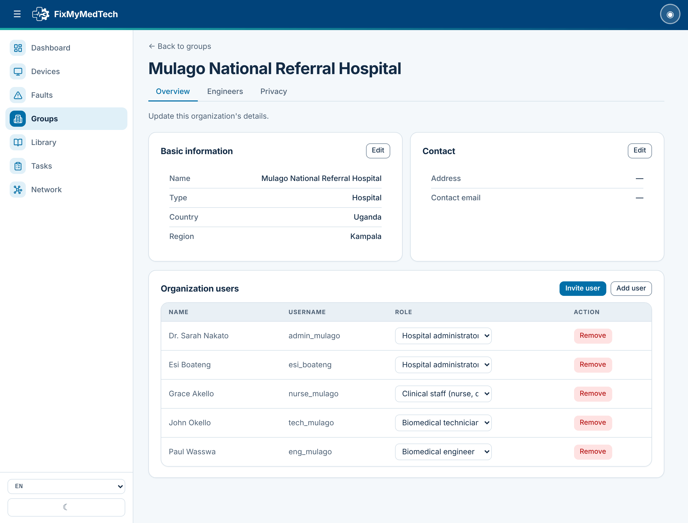
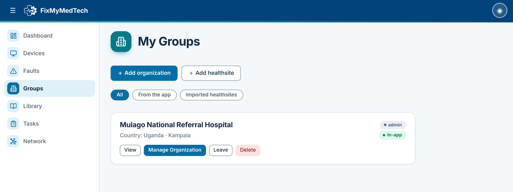

# Grupos, miembros y roles

**En la aplicación:** Equipamiento → **Grupos**.

**Para quién es:** administradores de clínica que añaden a su personal; cualquier persona que pertenece a una clínica o a una organización de mantenimiento.

**Qué necesitas antes:** para añadir o quitar personas, debes ser administrador (**Administrador del hospital**) de la organización.

Los **Grupos** son las organizaciones a las que perteneces: clínicas y hospitales (**healthsites**) y las organizaciones que mantienen dispositivos. **Mis Grupos** las lista con tu rol.

## Los roles

| Rol en la aplicación | Quién | Qué permite |
| --- | --- | --- |
| **Administrador del hospital** | Responsables de clínicas u hospitales | Todo para la organización: añadir personas, aprobar reparaciones, registrar dispositivos, editar la clínica |
| **Técnico biomédico** | Técnicos | Que se les asignen reparaciones y servicios, actualizar las fotos y ubicaciones de los dispositivos |
| **Ingeniero biomédico** | Ingenieros del personal | Que se les asignen reparaciones y servicios |
| **Personal clínico (enfermero/a, médico)** | Enfermeros, médicos | Ver los dispositivos de la clínica, reportar fallas, llamar a un ingeniero |

Ser **ingeniero responsable** de una clínica es otra cosa: se establece en la pestaña **Ingenieros** de la clínica, no con un rol. Mira [Configura tu clínica](clinic-setup.md).

## Pasos

### Añade a alguien a tu clínica

1. Abre **Grupos** y luego **Gestionar organización** en tu clínica.
2. En **Usuarios de la organización**:
    - **Invitar usuario**: escribe su correo y elige el rol. Recibe un correo con un enlace para elegir su contraseña. Sirve para personas que aún no tienen cuenta.
    - **Añadir usuario**: busca un perfil de FixMyMedTech existente por nombre o nombre de usuario y toca **Añadir**.
3. Para cambiar el rol de alguien, elige otro rol en su fila. Para sacarlo, toca **Eliminar**.

{ .shot loading=lazy }

### Únete a una organización que ya está en FixMyMedTech

1. Abre **Grupos** → **＋ Añadir healthsite**. Busca cerca de ti.
2. Los centros marcados como *Ya importado* se pueden seleccionar: envías una solicitud para unirte, con el rol que quieres.
3. Un administrador de allí debe aprobarla. Hasta entonces aparece como **Solicitado**. **Cancelar solicitud** la retira.

Los administradores encuentran las solicitudes de ingreso en la página de su organización y pueden **Aprobar** o **Rechazar**.

### Edita tu clínica

En la página de la clínica, **Resumen** → **Editar** junto a **Información básica** o **Contacto**. Las otras pestañas son **Ingenieros** (ingenieros responsables) y **Privacidad** (lo que muestran los perfiles de los ingenieros; mira [Cuida los dispositivos de tu clínica](clinic-devices.md#who-can-see-your-devices)).

{ .shot loading=lazy }

## Qué pasa después

Las personas que añades ven de inmediato los dispositivos de tu clínica. Las personas añadidas por su clínica no necesitan los pasos de bienvenida de los ingenieros.

## Si algo sale mal

- **Una clínica que creé desde Grupos no puede registrar dispositivos.** Una clínica creada con **＋ Añadir organización**, sin invitación, espera su charla de la clínica, como una clínica que se registra sola. Mira [Anfitrión de charlas](talk-host.md).
- **"Only admins can invite users."** (mensaje en inglés) Pide a un administrador de la organización.
- **"User is already an organization member."** (mensaje en inglés) La persona ya está dentro; cambia mejor su rol.
- **La persona invitada no recibió el correo.** Mira [No me llegó el correo](faq.md#i-didnt-get-the-email).
