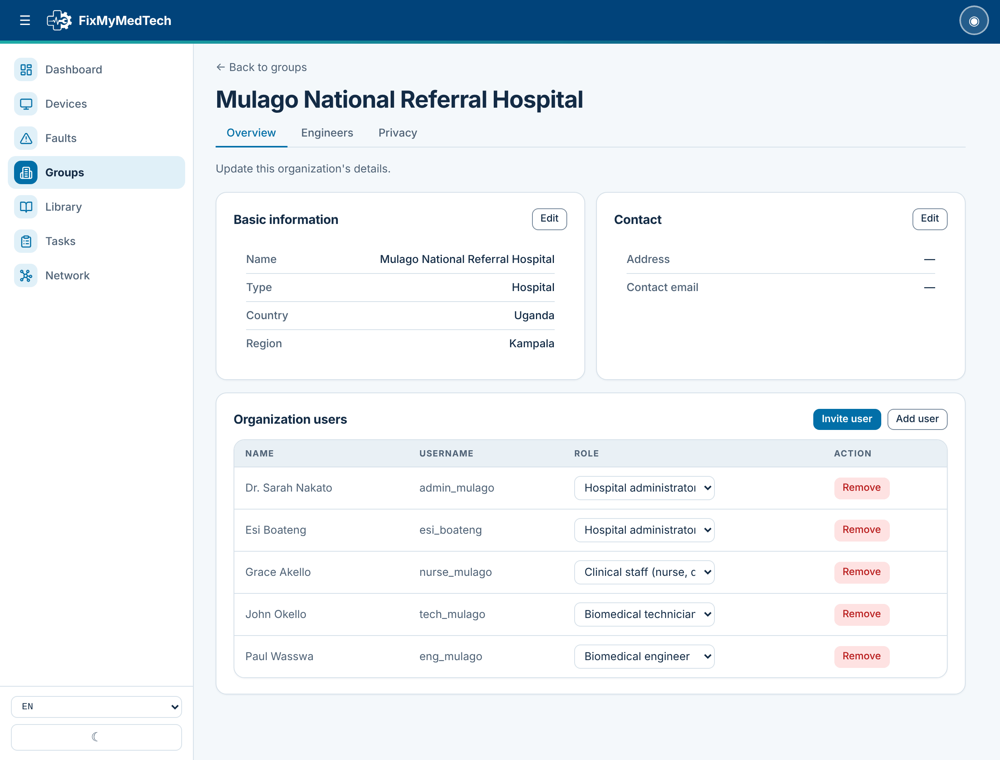
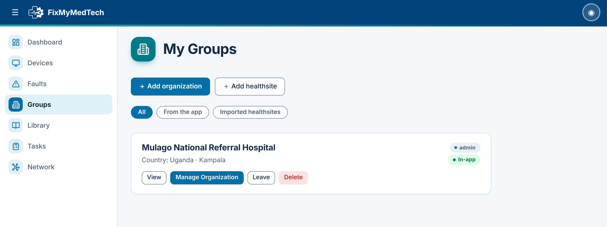

# Groupes, membres et rôles

**Dans l'application :** Équipements → **Groupes**.

**Pour qui :** les administrateurs de clinique qui ajoutent leur personnel ; toute personne qui fait partie d'une clinique ou d'une organisation de maintenance.

**Ce qu'il vous faut avant :** pour ajouter ou retirer des personnes, vous devez être administrateur (**Administrateur hospitalier**) de l'organisation.

Les **Groupes** sont les organisations auxquelles vous appartenez : cliniques et hôpitaux (**healthsites**) et organisations qui entretiennent des appareils. **Mes Groupes** les liste avec votre rôle.

## Les rôles

| Rôle dans l'application | Qui | Ce qu'il permet |
| --- | --- | --- |
| **Administrateur hospitalier** | Responsables de clinique ou d'hôpital | Tout pour l'organisation : ajouter des personnes, approuver les réparations, enregistrer des appareils, modifier la clinique |
| **Technicien biomédical** | Techniciens | Recevoir des réparations et des entretiens, mettre à jour les photos et les emplacements des appareils |
| **Ingénieur biomédical** | Ingénieurs du personnel | Recevoir des réparations et des entretiens |
| **Personnel clinique (infirmier, médecin)** | Infirmiers, médecins | Voir les appareils de la clinique, signaler des pannes, appeler un ingénieur |

Être **ingénieur responsable** d'une clinique est autre chose : cela se règle dans l'onglet **Ingénieurs** de la clinique, pas avec un rôle. Voir [Configurer votre clinique](clinic-setup.md).

## Étapes

### Ajouter quelqu'un à votre clinique

1. Ouvrez **Groupes**, puis **Gérer l'organisation** sur votre clinique.
2. Sous **Utilisateurs de l'organisation** :
    - **Inviter un utilisateur** : tapez son e-mail et choisissez le rôle. La personne reçoit un e-mail avec un lien pour choisir son mot de passe. Cela marche pour les personnes qui n'ont pas encore de compte.
    - **Ajouter un utilisateur** : cherchez un profil FixMyMedTech existant par nom ou nom d'utilisateur, puis **Ajouter**.
3. Pour changer le rôle de quelqu'un, choisissez un autre rôle sur sa ligne. Pour le retirer, touchez **Supprimer**.

{ .shot loading=lazy }

### Rejoindre une organisation déjà sur FixMyMedTech

1. Ouvrez **Groupes** → **＋ Ajouter un healthsite**. Cherchez près de chez vous.
2. Les établissements marqués *Déjà importé* peuvent être choisis : vous envoyez une demande pour les rejoindre, avec le rôle que vous voulez.
3. Un administrateur de l'organisation doit l'approuver. D'ici là, elle apparaît comme **Demandé**. **Annuler la demande** la retire.

Les administrateurs trouvent les demandes d'adhésion sur la page de leur organisation et peuvent les **Approuver** ou les **Refuser**.

### Modifier votre clinique

Sur la page de la clinique, **Aperçu** → **Modifier** à côté de **Informations de base** ou **Contact**. Les autres onglets sont **Ingénieurs** (ingénieurs responsables) et **Confidentialité** (ce que montrent les profils d'ingénieurs ; voir [Suivre les appareils de votre clinique](clinic-devices.md#who-can-see-your-devices)).

{ .shot loading=lazy }

## Et ensuite

Les personnes que vous ajoutez voient tout de suite les appareils de votre clinique. Les personnes ajoutées par leur clinique n'ont pas besoin des étapes d'accueil des ingénieurs.

## En cas de problème

- **Une clinique que j'ai créée depuis Groupes ne peut pas enregistrer d'appareils.** Une clinique créée avec **＋ Ajouter une organisation**, sans invitation, attend sa rencontre clinique, comme une clinique qui s'inscrit seule. Voir [Animation des rencontres](talk-host.md).
- **« Only admins can invite users. »** (message en anglais) Demandez à un administrateur de l'organisation.
- **« User is already an organization member. »** (message en anglais) La personne est déjà dans l'organisation ; changez plutôt son rôle.
- **La personne invitée n'a pas reçu l'e-mail.** Voir [Je n'ai pas reçu l'e-mail](faq.md#i-didnt-get-the-email).
