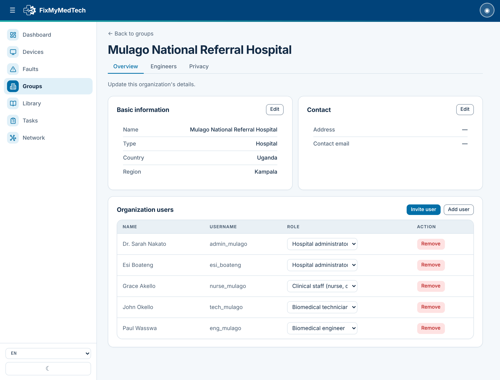
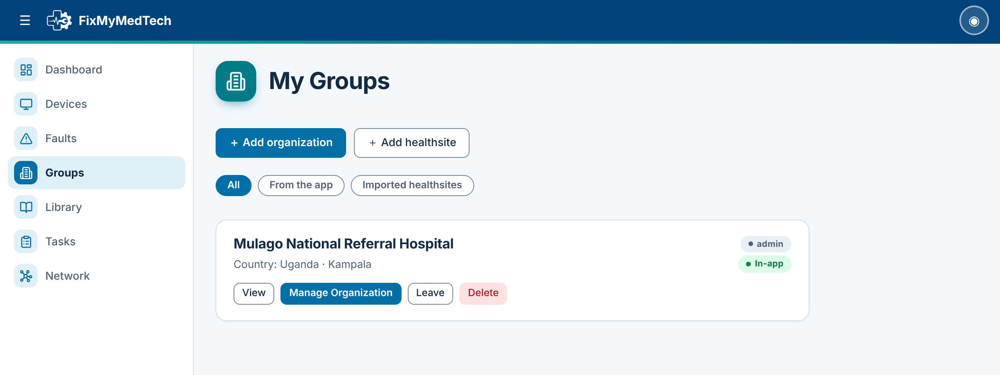

# Groups, members and roles

**In the app:** Equipment → **Groups**.

**Who this is for:** clinic administrators who add their staff; anyone who belongs to a clinic or a maintenance organisation.

**What you need before:** to add or remove people, you must be an administrator (**Hospital administrator**) of the organisation.

**Groups** are the organisations you belong to: clinics and hospitals (**healthsites**) and the organisations that maintain devices. **My Groups** lists them with your role.

## The roles

| Role in the app | Who | What it allows |
| --- | --- | --- |
| **Hospital administrator** | Clinic or hospital managers | Everything for the organisation: add people, approve repairs, register devices, edit the clinic |
| **Biomedical technician** | Technicians | Be assigned repairs and services, update device photos and locations |
| **Biomedical engineer** | Engineers on the staff | Be assigned repairs and services |
| **Clinical staff (nurse, doctor)** | Nurses, doctors | See the clinic's devices, report faults, call an engineer |

Being a **responsible engineer** of a clinic is something else: it is set in the clinic's **Engineers** tab, not with a role. See [Set up your clinic](clinic-setup.md).

## Steps

### Add someone to your clinic

1. Open **Groups**, then **Manage Organization** on your clinic.
2. Under **Organization users**:
    - **Invite user**: type their email and choose the role. They get an email with a link to choose their password. Works for people who have no account yet.
    - **Add user**: search an existing FixMyMedTech profile by name or username, then **Add**.
3. To change someone's role, pick another role in their row. To take them out, tap **Remove**.

{ .shot loading=lazy }

### Join an organisation that is already on FixMyMedTech

1. Open **Groups** → **＋ Add healthsite**. Search near you.
2. Facilities marked *Already imported* can be selected: you send a request to join, with the role you want.
3. An administrator there must approve it. Until then it shows as **Requested**. **Cancel request** withdraws it.

Administrators find join requests on their organisation's page and **Approve** or **Reject** them.

### Edit your clinic

On the clinic's page, **Overview** → **Edit** next to **Basic information** or **Contact**. The other tabs are **Engineers** (responsible engineers) and **Privacy** (what engineer profiles show; see [Look after your clinic's devices](clinic-devices.md#who-can-see-your-devices)).

{ .shot loading=lazy }

## What happens next

The people you add see your clinic's devices at once. People added by their clinic do not need the engineers' welcome steps.

## If something goes wrong

- **A clinic I created from Groups can't register devices.** A clinic created with **＋ Add organization**, without an invitation, waits for its clinic talk, like a clinic that signs up alone. See [Talk host](talk-host.md).
- **"Only admins can invite users."** Ask an administrator of the organisation.
- **"User is already an organization member."** They are already in; change their role instead.
- **The invited person got no email.** See [I didn't get the email](faq.md#i-didnt-get-the-email).
