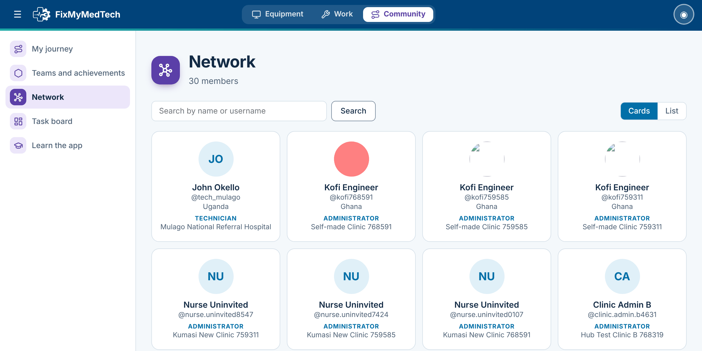
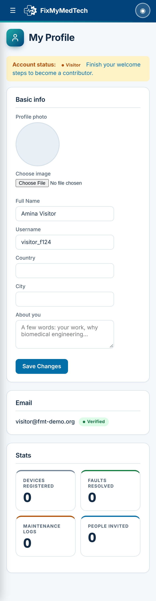

# Red y perfil

**En la aplicación:** Comunidad → **Red** (cuentas de clínica: **Red** en el menú único). Tu perfil: el avatar redondo de arriba a la derecha → **Perfil**.

**Para quién es:** todas las personas con una cuenta.

**Qué necesitas antes:** nada.

## Pasos

### Encuentra personas en la Red

1. Abre **Red**. Muestra a las personas de FixMyMedTech: nombre, nombre de usuario, país, rol y organización.
2. Escribe en **Buscar** para encontrar a alguien por su nombre. Cambia entre **Tarjetas** y **Lista**.
3. Toca una persona para abrir su perfil: nombre, nombre de usuario, país, sus organizaciones y los dispositivos que registró.

{ .shot loading=lazy }

### Mantén tu perfil al día

1. Abre el menú del avatar → **Perfil** (**Mi Perfil**).
2. **Estado de la cuenta** muestra **Visitante** o **Colaborador**.
3. En **Información básica**: tu **Foto de perfil** (**Elegir imagen**), **Nombre completo**, **Nombre de usuario**, **País**, **Ciudad** y **Sobre ti**. Toca **Guardar cambios**.
4. ¿Correo **No verificado**? Toca **Enviar correo de verificación** y abre el enlace que recibes.

Tu foto de perfil, tu país, tu ciudad y tu "sobre ti" también son dos de tus pasos de bienvenida.

<figure markdown>
{ .phone loading=lazy }
<figcaption>Mi Perfil.</figcaption>
</figure>

## Qué pasa después

- Las clínicas y los ingenieros ven tu foto y tu nombre cuando trabajan contigo.
- Tu ciudad decide qué solicitudes de reparación "Cerca" te llegan.
- Los perfiles de los ingenieros listan los dispositivos que registraron (salvo que la clínica lo oculte: mira [Quién puede ver tus dispositivos](clinic-devices.md#who-can-see-your-devices)).

## Si algo sale mal

- **Mi foto no se ve.** Usa una imagen JPG o PNG e inténtalo de nuevo; las fotos grandes se comprimen.
- **El correo de verificación no llega.** Mira [No me llegó el correo](faq.md#i-didnt-get-the-email).
