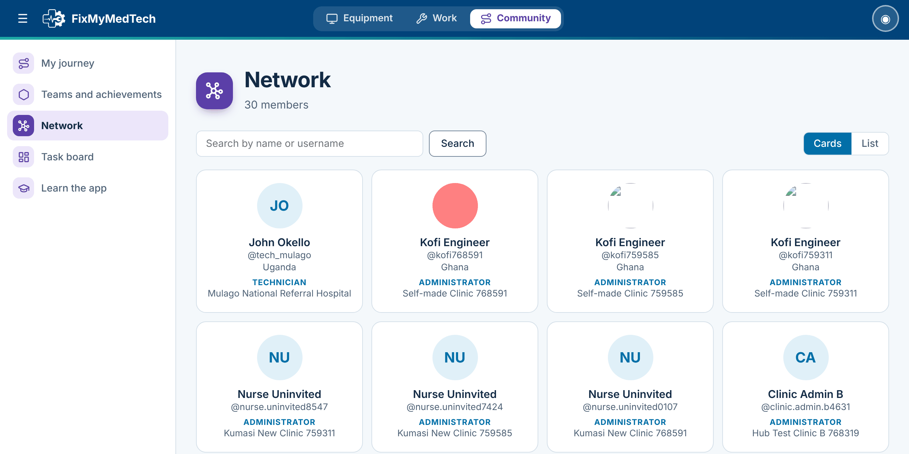
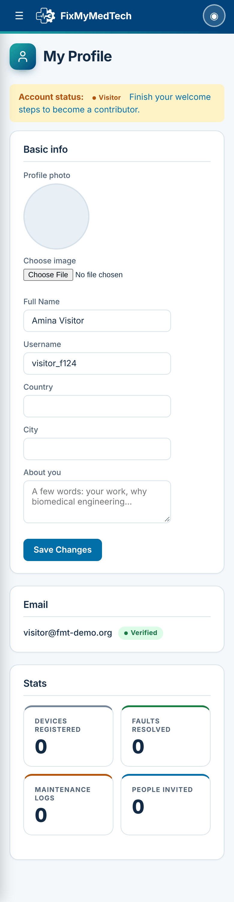

# Réseau et profil

**Dans l'application :** Communauté → **Réseau** (comptes clinique : **Réseau** dans le menu unique). Votre profil : l'avatar rond en haut à droite → **Profil**.

**Pour qui :** toute personne qui a un compte.

**Ce qu'il vous faut avant :** rien.

## Étapes

### Trouver des personnes dans le Réseau

1. Ouvrez **Réseau**. Il montre les personnes sur FixMyMedTech : nom, nom d'utilisateur, pays, rôle et organisation.
2. Tapez dans **Rechercher** pour trouver quelqu'un par son nom. Passez de **Cartes** à **Liste**.
3. Touchez une personne pour ouvrir son profil : nom, nom d'utilisateur, pays, ses organisations et les appareils qu'elle a enregistrés.

{ .shot loading=lazy }

### Garder votre profil à jour

1. Ouvrez le menu de l'avatar → **Profil** (**Mon Profil**).
2. **Statut du compte** affiche **Visiteur** ou **Contributeur**.
3. Sous **Informations de base** : votre **Photo de profil** (**Choisir une image**), **Nom complet**, **Nom d'utilisateur**, **Pays**, **Ville** et **À propos de vous**. Touchez **Enregistrer**.
4. E-mail **Non vérifié** ? Touchez **Envoyer l'e-mail de vérification** et ouvrez le lien que vous recevez.

Votre photo de profil, votre pays, votre ville et votre « à propos de vous » comptent aussi pour deux de vos étapes d'accueil.

<figure markdown>
{ .phone loading=lazy }
<figcaption>Mon Profil.</figcaption>
</figure>

## Et ensuite

- Les cliniques et les ingénieurs voient votre photo et votre nom quand vous travaillez ensemble.
- Votre ville décide quelles demandes de réparation « À proximité » vous parviennent.
- Les profils des ingénieurs listent les appareils qu'ils ont enregistrés (sauf si la clinique le masque : voir [Qui peut voir vos appareils](clinic-devices.md#who-can-see-your-devices)).

## En cas de problème

- **Ma photo ne s'affiche pas.** Utilisez une image JPG ou PNG et réessayez ; les grandes photos sont compressées.
- **L'e-mail de vérification n'arrive pas.** Voir [Je n'ai pas reçu l'e-mail](faq.md#i-didnt-get-the-email).
