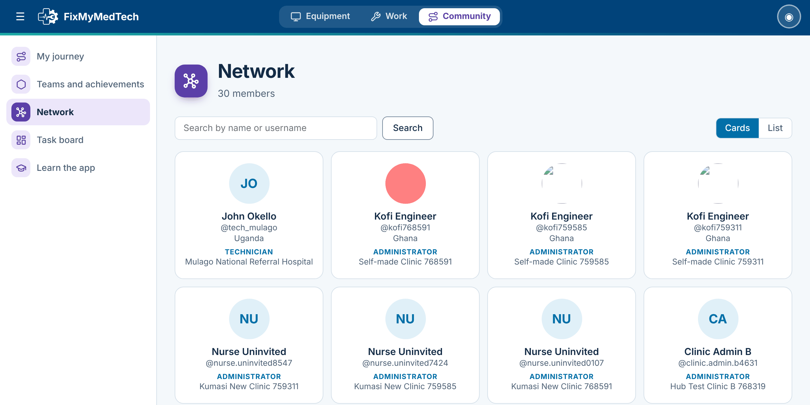
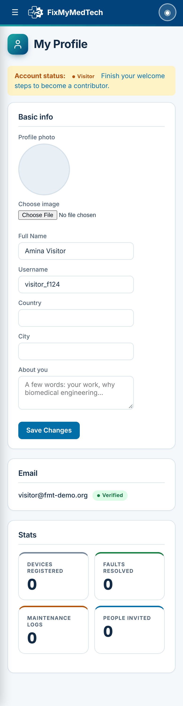

# Network and your profile

**In the app:** Community → **Network** (clinic accounts: **Network** in the single menu). Your profile: the round avatar at the top right → **Profile**.

**Who this is for:** everyone with an account.

**What you need before:** nothing.

## Steps

### Find people in the Network

1. Open **Network**. It shows the people on FixMyMedTech: name, username, country, role and organisation.
2. Type in **Search** to find someone by name. Switch between **Cards** and **List**.
3. Tap a person to open their profile: name, username, country, their organisations and the devices they registered.

{ .shot loading=lazy }

### Keep your profile up to date

1. Open the avatar menu → **Profile** (**My Profile**).
2. **Account status** shows **Visitor** or **Contributor**.
3. Under **Basic info**: your **Profile photo** (**Choose image**), **Full Name**, **Username**, **Country**, **City** and **About you**. Tap **Save Changes**.
4. Email **Not verified**? Tap **Send verification email** and open the link you receive.

Your profile photo, country, city and "about you" are also two of your welcome steps.

<figure markdown>
{ .phone loading=lazy }
<figcaption>My Profile.</figcaption>
</figure>

## What happens next

- Clinics and engineers see your photo and your name when you work together.
- Your city decides which "Nearby" repair requests reach you.
- Engineers' profiles list the devices they registered (unless the clinic hides it: see [Who can see your devices](clinic-devices.md#who-can-see-your-devices)).

## If something goes wrong

- **My photo doesn't show.** Use a JPG or PNG image and try again; large photos are compressed.
- **The verification email doesn't arrive.** See [I didn't get the email](faq.md#i-didnt-get-the-email).
