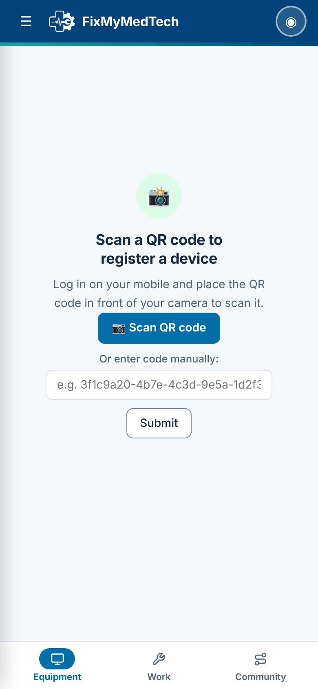
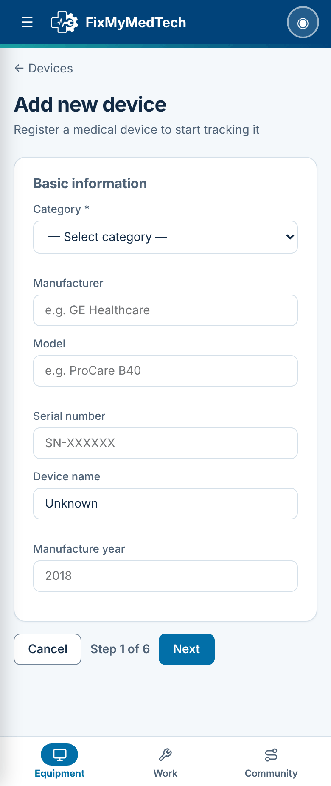

# Registrar un dispositivo

**En la aplicación:** Equipamiento → **Dispositivos** → **+ Añadir dispositivo**, o **Inicio** → **Escanear un código QR**.

**Para quién es:** ingenieros nombrados por una clínica y administradores de clínica.

**Qué necesitas antes:**

- Una **etiqueta QR** de FixMyMedTech en el dispositivo y un teléfono con cámara.
- El derecho a registrar dispositivos de la clínica. Lo tienes cuando:
    - eres uno de los administradores de la clínica, **o** la clínica te nombró uno de sus **ingenieros responsables** y tus pasos de bienvenida están hechos;
    - **y** la clínica está activa (una clínica que se registró sin invitación espera su charla de la clínica).

## Pasos

1. Toca **+ Añadir dispositivo** (en **Dispositivos**) o **Escanear un código QR** (en **Inicio**).
2. Toca **📷 Escanear QR** y apunta la cámara a la etiqueta.
    - ¿No tienes cámara? Escribe el código impreso bajo el código QR, después de **O ingrese el código manualmente:**, y toca **Enviar**.
3. **Paso 1 de 6: Información básica.** Elige la **Categoría** (obligatoria). Añade el **Fabricante**, el **Modelo**, el **Número de serie**, el **Nombre del dispositivo** y el **Año de fabricación**. Toca **Siguiente**.
4. **Paso 2: Foto** (opcional). **Tomar una foto** o **Elegir una imagen**.
5. **Paso 3: Ubicación.** Toca **Capturar ubicación actual**. Elige el **Centro de salud** (solo aparecen las clínicas en las que puedes registrar) y escribe la **Ubicación en el centro de salud**, por ejemplo *UCI / Cama 4*. Revisa la **Organización responsable**: la organización que mantiene el dispositivo.
6. **Paso 4: Adquisición y mantenimiento** (opcional). **Comprado**, **Donado** o **Alquilado**, la fecha, el **Estado**, las fechas del último y del próximo mantenimiento.
7. **Paso 5: Notas.** Lo que debería saber el próximo ingeniero.
8. **Paso 6: Buscar en iFixit** (opcional). Busca por fabricante y modelo, marca los manuales que quieres adjuntar.
9. Toca **Registrar dispositivo**.

<figure markdown>
{ .phone loading=lazy }
<figcaption>Escanea la etiqueta, o escribe su código.</figcaption>
</figure>
<figure markdown>
{ .phone loading=lazy }
<figcaption>Paso 1 de 6: Información básica.</figcaption>
</figure>

??? note "Ver el vídeo (en inglés, grabado con una versión anterior de la aplicación)"
    <video src="../videos/register-device-en.mp4" controls playsinline preload="none" style="width:100%;max-width:360px;border-radius:12px;display:block;margin:0 auto;"></video>

## Qué pasa después

- El dispositivo tiene su propia página, unida a su etiqueta QR. Cualquiera que escanee la etiqueta ve su página pública.
- El dispositivo cuenta para tu logro **Cartógrafo** (dispositivos registrados).
- Desde la página del dispositivo, tú y la clínica pueden reportar fallas, llamar a un ingeniero y anotar el mantenimiento.

## Si algo sale mal

- **"Aún no puedes registrar un equipo."** La página dice por qué para cada clínica: *"te nombró; completa tus pasos de bienvenida"*, *"respondió "ahora no"; puede confirmarte más tarde"*, *"esperando su charla de clínica"* o *"no te ha nombrado"*. Mira [¿Por qué no puedo registrar un dispositivo?](faq.md#why-cant-i-register-a-device)
- **"Dispositivo ya registrado."** Esta etiqueta ya está en uso. Toca **Ver dispositivo →**, o **← Escanear otro**.
- **Rechaza el código.** Comprueba que escribiste el código completo impreso bajo el código QR.
- **Mi clínica no está en la lista de Centro de salud.** Solo puedes elegir clínicas en las que tienes permiso para registrar.

<small>Foto del dispositivo en el vídeo: [concentrador de oxígeno Philips Respironics](https://commons.wikimedia.org/wiki/File:Philips_Respironics_Oxygen_Concentrator._Photo_taken_by_me_on_April_24th,_2012.jpg) de i_am_jim, Wikimedia Commons, [CC BY-SA 3.0](https://creativecommons.org/licenses/by-sa/3.0/).</small>
