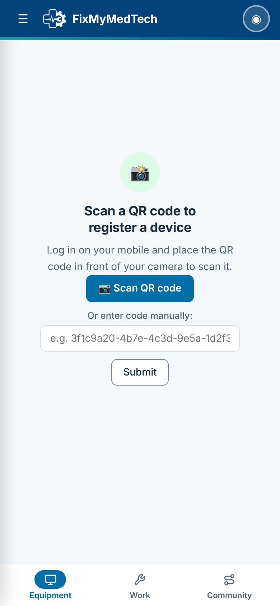
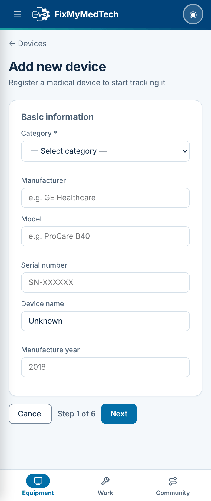

# Enregistrer un appareil

**Dans l'application :** Équipements → **Appareils** → **+ Ajouter un appareil**, ou **Accueil** → **Scanner un code QR**.

**Pour qui :** les ingénieurs nommés par une clinique, et les administrateurs de clinique.

**Ce qu'il vous faut avant :**

- Une **étiquette QR** FixMyMedTech sur l'appareil, et un téléphone avec appareil photo.
- Le droit d'enregistrer des appareils pour la clinique. Vous l'avez quand :
    - vous êtes l'un des administrateurs de la clinique, **ou** la clinique vous a nommé l'un de ses **ingénieurs responsables** et vos étapes d'accueil sont terminées ;
    - **et** la clinique est active (une clinique inscrite sans invitation attend sa rencontre clinique).

## Étapes

1. Touchez **+ Ajouter un appareil** (dans **Appareils**) ou **Scanner un code QR** (dans **Accueil**).
2. Touchez **📷 Scanner le QR code** et visez l'étiquette avec l'appareil photo.
    - Pas d'appareil photo ? Tapez le code imprimé sous le code QR, après **Ou entrez le code manuellement:**, et touchez **Envoyer**.
3. **Étape 1 sur 6 : Informations de base.** Choisissez la **Catégorie** (obligatoire). Ajoutez le **Fabricant**, le **Modèle**, le **Numéro de série**, le **Nom de l'appareil** et l'**Année de fabrication**. Touchez **Suivant**.
4. **Étape 2 : Photo** (facultatif). **Prendre une photo** ou **Choisir une image**.
5. **Étape 3 : Emplacement.** Touchez **Capturer l'emplacement actuel**. Choisissez l'**Établissement de santé** (seules les cliniques où vous pouvez enregistrer sont listées) et tapez l'**Emplacement dans la clinique**, par exemple *Soins intensifs / Lit 4*. Vérifiez l'**Organisation responsable** : l'organisation qui entretient l'appareil.
6. **Étape 4 : Acquisition & maintenance** (facultatif). **Acheté**, **Don** ou **Loué**, la date, le **Statut**, les dates de la dernière et de la prochaine maintenance.
7. **Étape 5 : Notes.** Ce que le prochain ingénieur doit savoir.
8. **Étape 6 : Chercher sur iFixit** (facultatif). Cherchez par fabricant et modèle, cochez les manuels à joindre.
9. Touchez **Enregistrer l'appareil**.

<figure markdown>
{ .phone loading=lazy }
<figcaption>Scannez l'étiquette, ou tapez son code.</figcaption>
</figure>
<figure markdown>
{ .phone loading=lazy }
<figcaption>Étape 1 sur 6 : Informations de base.</figcaption>
</figure>

??? note "Voir la vidéo (enregistrée sur une version précédente de l'application)"
    <video src="../videos/register-device-fr.mp4" controls playsinline preload="none" style="width:100%;max-width:360px;border-radius:12px;display:block;margin:0 auto;"></video>

## Et ensuite

- L'appareil a sa propre page, liée à son étiquette QR. Toute personne qui scanne l'étiquette voit sa page publique.
- L'appareil compte pour votre réussite **Cartographe** (appareils enregistrés).
- Depuis la page de l'appareil, vous et la clinique pouvez signaler des pannes, appeler un ingénieur et noter l'entretien.

## En cas de problème

- **« Vous ne pouvez pas encore enregistrer d'équipement. »** La page dit pourquoi pour chaque clinique : *« vous a nommé ; terminez vos étapes d'accueil »*, *« a répondu « pas maintenant » ; elle peut vous confirmer plus tard »*, *« en attente de sa rencontre clinique »* ou *« ne vous a pas nommé »*. Voir [Pourquoi je ne peux pas enregistrer d'appareil ?](faq.md#why-cant-i-register-a-device)
- **« Appareil déjà enregistré. »** Cette étiquette est déjà utilisée. Touchez **Voir l'appareil →**, ou **← Scanner un autre**.
- **Le code est refusé.** Vérifiez que vous avez tapé tout le code imprimé sous le code QR.
- **Ma clinique n'est pas dans la liste des établissements.** Vous ne pouvez choisir que les cliniques où vous avez le droit d'enregistrer.

<small>Photo de l'appareil dans la vidéo : [concentrateur d'oxygène Philips Respironics](https://commons.wikimedia.org/wiki/File:Philips_Respironics_Oxygen_Concentrator._Photo_taken_by_me_on_April_24th,_2012.jpg) par i_am_jim, Wikimedia Commons, [CC BY-SA 3.0](https://creativecommons.org/licenses/by-sa/3.0/).</small>
