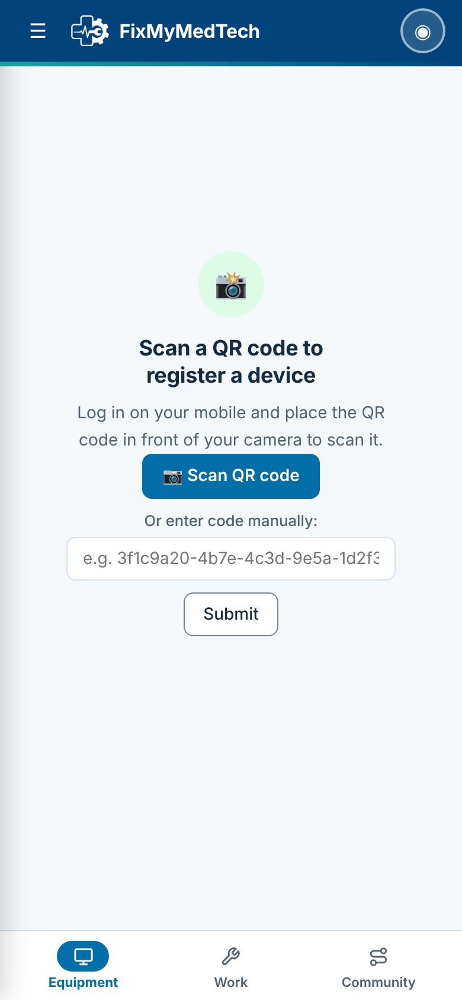
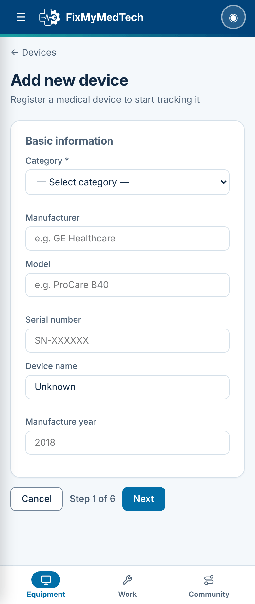

# Register a device

**In the app:** Equipment → **Devices** → **+ Add device**, or **Home** → **Scan a QR code**.

**Who this is for:** engineers named by a clinic, and clinic administrators.

**What you need before:**

- A FixMyMedTech **QR sticker** on the device, and a phone with a camera.
- The right to register devices for the clinic. You have it when:
    - you are one of the clinic's administrators, **or** the clinic named you one of its **responsible engineers** and your welcome steps are done;
    - **and** the clinic is active (a clinic that signed up without an invitation waits for its clinic talk).

## Steps

1. Tap **+ Add device** (on **Devices**) or **Scan a QR code** (on **Home**).
2. Tap **📷 Scan QR code** and point the camera at the sticker.
    - No camera? Type the code printed under the QR code, after **Or enter code manually:**, and tap **Submit**.
3. **Step 1 of 6: Basic information.** Choose the **Category** (required). Add the **Manufacturer**, **Model**, **Serial number**, **Device name** and **Manufacture year**. Tap **Next**.
4. **Step 2: Photo** (optional). **Take a photo** or **Choose an image**.
5. **Step 3: Location.** Tap **Capture current location**. Choose the **Healthsite** (only the clinics you may register for are listed) and type the **Location in the clinic**, for example *ICU / Bed 4*. Check the **Responsible organization**: the organisation that maintains the device.
6. **Step 4: Acquisition & maintenance** (optional). **Purchased**, **Donated** or **Leased**, the date, the **Status**, the last and next maintenance dates.
7. **Step 5: Notes.** What the next engineer should know.
8. **Step 6: Find on iFixit** (optional). Search by manufacturer and model, tick the manuals to attach.
9. Tap **Register device**.

<figure markdown>
{ .phone loading=lazy }
<figcaption>Scan the sticker, or type its code.</figcaption>
</figure>
<figure markdown>
{ .phone loading=lazy }
<figcaption>Step 1 of 6: Basic information.</figcaption>
</figure>

??? note "Watch the video (recorded on an earlier version of the app)"
    <video src="../videos/register-device-en.mp4" controls playsinline preload="none" style="width:100%;max-width:360px;border-radius:12px;display:block;margin:0 auto;"></video>

## What happens next

- The device has its own page, linked to its QR sticker. Anyone who scans the sticker sees its public page.
- The device counts for your **Mapper** achievement (devices registered).
- From the device page you and the clinic can report faults, call an engineer and log maintenance.

## If something goes wrong

- **"You can't register a device yet."** The page says why for each clinic: *"named you; finish your welcome steps"*, *"answered "not now"; it can confirm you later"*, *"waiting for its clinic talk"* or *"has not named you"*. See [Why can't I register a device?](faq.md#why-cant-i-register-a-device)
- **"Device already registered."** This sticker is already used. Tap **View device**, or **← Scan another**.
- **The code is refused.** Check you typed the whole code printed under the QR code.
- **My clinic is not in the Healthsite list.** You can only choose clinics where you are allowed to register.

<small>Device photo in the video: [Philips Respironics oxygen concentrator](https://commons.wikimedia.org/wiki/File:Philips_Respironics_Oxygen_Concentrator._Photo_taken_by_me_on_April_24th,_2012.jpg) by i_am_jim, Wikimedia Commons, [CC BY-SA 3.0](https://creativecommons.org/licenses/by-sa/3.0/).</small>
