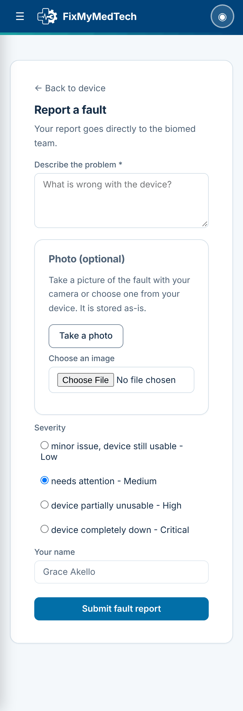
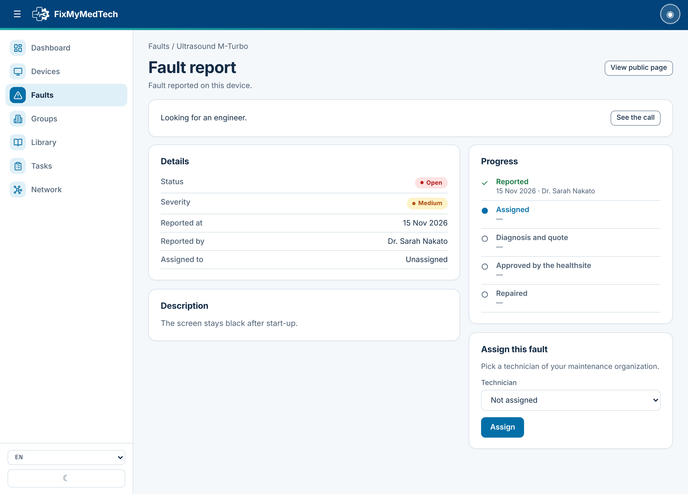

# Reportar una falla y conseguir que se repare

**En la aplicación:** escanea la etiqueta QR del dispositivo, o Equipamiento → **Dispositivos** → el dispositivo → **Reportar un problema**. La cola está en **Fallas**.

**Para quién es:** todas las personas de la clínica (para reportar), los administradores de la clínica (para aprobar) y los ingenieros o técnicos (para reparar).

**Qué necesitas antes:** una cuenta de FixMyMedTech (cualquier cuenta: debes haber iniciado sesión para reportar). El dispositivo está registrado y tiene su etiqueta QR.

Una falla pasa por cinco pasos. Cada paso lo hace una persona distinta y aparece en el **Avance** de la falla: *Reportada → Asignada → Diagnóstico y cotización → Aprobada por el centro de salud → Reparada*.

## Pasos

1. **Reportar (cualquier persona con sesión iniciada).** Escanea la etiqueta y toca **⚠ Reportar falla** (en la página del dispositivo dentro de la aplicación: **Reportar un problema**). En **Describa el problema**, di qué falla. Añade una foto si puedes. Elige la **Gravedad**:
    - *Baja*: problema menor, el dispositivo aún funciona;
    - *Media*: necesita atención;
    - *Alta*: dispositivo parcialmente inutilizable;
    - *Crítica*: dispositivo completamente fuera de servicio.

    Toca **Enviar reporte de falla**. *Alta* y *Crítica* dejan el dispositivo fuera de servicio (estado *Falla*).
2. **Asignar (administrador de la organización de mantenimiento).** La falla aparece en **Fallas**. Ábrela, elige el **Técnico** en **Asignar esta falla** y toca **Asignar**. Si la clínica usó **Llamar a un ingeniero** y aceptó una oferta, este paso ya está hecho.
3. **Diagnosticar y cotizar (el técnico asignado).** Escribe el diagnóstico y un precio estimado. Toca **Enviar a aprobación**.
4. **Aprobar (administrador de la clínica donde está el dispositivo).** Lee el diagnóstico y el precio. Toca **Aprobar**, o **Rechazar** con un comentario: vuelve al técnico. Un dispositivo sin centro de salud lo aprueba el administrador de la organización de mantenimiento.
5. **Reparar (el técnico).** En el lugar, toca **Ya comencé la reparación** (opcional). Cuando esté arreglado, escribe lo que se hizo y el precio final, y toca **Cerrar la falla**.

<figure markdown>
{ .phone loading=lazy }
<figcaption>Reportar una falla desde el teléfono.</figcaption>
</figure>

{ .shot loading=lazy }

??? note "Ver el vídeo (en inglés, grabado con una versión anterior de la aplicación)"
    <video src="../videos/report-fault-en.mp4" controls playsinline preload="none" style="width:100%;max-width:360px;border-radius:12px;display:block;margin:0 auto;"></video>

## Qué pasa después

- Después de cada paso, la siguiente persona encuentra la falla en **Fallas** (la cola de las organizaciones para las que mantiene) o en **Tareas** (**Reparaciones y servicios asignados a mí**).
- El dispositivo vuelve a *Operativo* cuando no queda otra falla grave abierta en él.
- Si la falla vino de **Llamar a un ingeniero**, al final se le pregunta a la clínica **¿Funciona ahora?**. Mira [Llamar a un ingeniero](call-engineer.md).
- Cualquiera que tenga la etiqueta QR puede seguir la falla en la página pública del dispositivo (**Ver página pública**).

## Si algo sale mal

- **Me lleva a la página de inicio de sesión.** Reportar requiere una cuenta. Pide al administrador de tu clínica que te añada (**Grupos**), o crea una.
- **No hay nadie asignado.** El administrador de la organización de mantenimiento asigna las fallas. ¿No hay administrador, o nadie responde? Usa [Llamar a un ingeniero](call-engineer.md).
- **No veo Asignar, Aprobar ni Cerrar.** Cada paso solo se muestra a la persona que puede hacerlo.
- **Se rechazó la reparación.** El técnico ve el comentario, escribe un nuevo diagnóstico y lo envía otra vez.

<small>Foto del dispositivo en el vídeo: [concentrador de oxígeno Philips Respironics](https://commons.wikimedia.org/wiki/File:Philips_Respironics_Oxygen_Concentrator._Photo_taken_by_me_on_April_24th,_2012.jpg) de i_am_jim, Wikimedia Commons, [CC BY-SA 3.0](https://creativecommons.org/licenses/by-sa/3.0/).</small>
