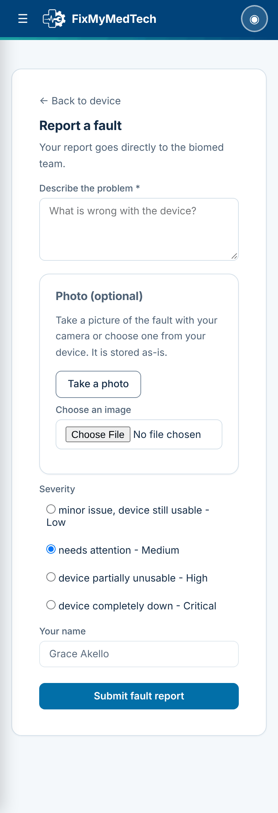
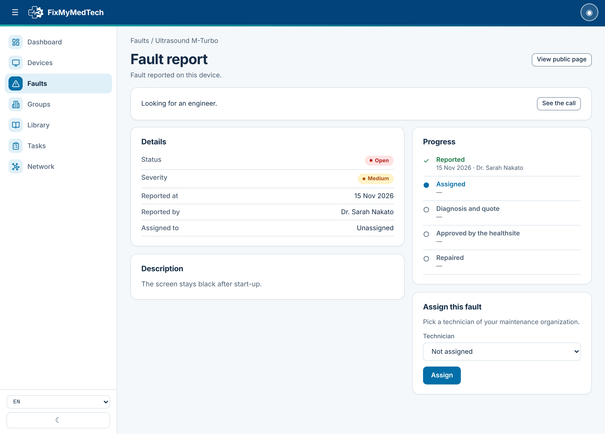

# Signaler une panne et la faire réparer

**Dans l'application :** scannez l'étiquette QR de l'appareil, ou Équipements → **Appareils** → l'appareil → **Signaler un problème**. La file d'attente est dans **Pannes**.

**Pour qui :** tout le personnel de la clinique (pour signaler), les administrateurs de la clinique (pour approuver) et les ingénieurs ou techniciens (pour réparer).

**Ce qu'il vous faut avant :** un compte FixMyMedTech (n'importe lequel : il faut être connecté pour signaler). L'appareil est enregistré et porte son étiquette QR.

Une panne passe par cinq étapes. Chaque étape est faite par une personne différente et apparaît dans la **progression** de la panne : *Signalée → Assignée → Diagnostic et devis → Approuvée par l'établissement de santé → Réparée*.

## Étapes

1. **Signaler (toute personne connectée).** Scannez l'étiquette et touchez **⚠ Signaler un problème** (sur la page de l'appareil dans l'application : **Signaler un problème**). Sous **Décrivez le problème**, dites ce qui ne va pas. Ajoutez une photo si possible. Choisissez la **Gravité** :
    - *Faible* : problème mineur, appareil encore utilisable ;
    - *Moyenne* : nécessite attention ;
    - *Élevée* : appareil partiellement inutilisable ;
    - *Critique* : appareil complètement hors service.

    Touchez **Envoyer le signalement**. *Élevée* et *Critique* mettent l'appareil hors service (statut *En panne*).
2. **Assigner (administrateur de l'organisation de maintenance).** La panne apparaît dans **Pannes**. Ouvrez-la, choisissez le **Technicien** sous **Assigner cette panne**, touchez **Assigner**. Si la clinique a utilisé **Appeler un ingénieur** et accepté une offre, cette étape est déjà faite.
3. **Diagnostic et devis (le technicien assigné).** Il écrit le **Diagnostic** et un **Prix estimé**, puis touche **Envoyer pour approbation**.
4. **Approuver (administrateur de la clinique où se trouve l'appareil).** Il lit le diagnostic et le prix, puis touche **Approuver**, ou **Rejeter** avec un commentaire : la panne revient au technicien. Un appareil sans établissement de santé est approuvé par l'administrateur de l'organisation de maintenance.
5. **Réparer (le technicien).** Sur place, il touche **J'ai commencé la réparation** (facultatif). Une fois l'appareil réparé, il note ce qui a été fait et le prix final, et touche **Clôturer la panne**.

<figure markdown>
{ .phone loading=lazy }
<figcaption>Signaler une panne depuis un téléphone.</figcaption>
</figure>

{ .shot loading=lazy }

??? note "Voir la vidéo (enregistrée sur une version précédente de l'application)"
    <video src="../videos/report-fault-fr.mp4" controls playsinline preload="none" style="width:100%;max-width:360px;border-radius:12px;display:block;margin:0 auto;"></video>

## Et ensuite

- Après chaque étape, la personne suivante trouve la panne dans **Pannes** (la file des organisations qu'elle entretient) ou dans **Tâches** (**Réparations et entretiens qui me sont confiés**).
- L'appareil redevient *Opérationnel* dès qu'aucune autre panne grave n'est ouverte.
- Si la panne vient d'**Appeler un ingénieur**, la clinique répond à la fin à **Ça marche maintenant ?**. Voir [Appeler un ingénieur](call-engineer.md).
- Toute personne qui a l'étiquette QR peut suivre la panne sur la page publique de l'appareil (**Voir la page publique**).

## En cas de problème

- **On m'envoie sur la page de connexion.** Signaler demande un compte. Demandez à l'administrateur de votre clinique de vous ajouter (**Groupes**), ou créez un compte.
- **Personne n'est assigné.** C'est l'administrateur de l'organisation de maintenance qui assigne les pannes. Pas d'administrateur, ou pas de réponse ? Utilisez [Appeler un ingénieur](call-engineer.md).
- **Je ne vois pas Assigner, Approuver ou Clôturer.** Chaque étape n'apparaît qu'à la personne qui a le droit de la faire.
- **La réparation a été rejetée.** Le technicien voit le commentaire, écrit un nouveau diagnostic et le renvoie.

<small>Photo de l'appareil dans la vidéo : [concentrateur d'oxygène Philips Respironics](https://commons.wikimedia.org/wiki/File:Philips_Respironics_Oxygen_Concentrator._Photo_taken_by_me_on_April_24th,_2012.jpg) par i_am_jim, Wikimedia Commons, [CC BY-SA 3.0](https://creativecommons.org/licenses/by-sa/3.0/).</small>
