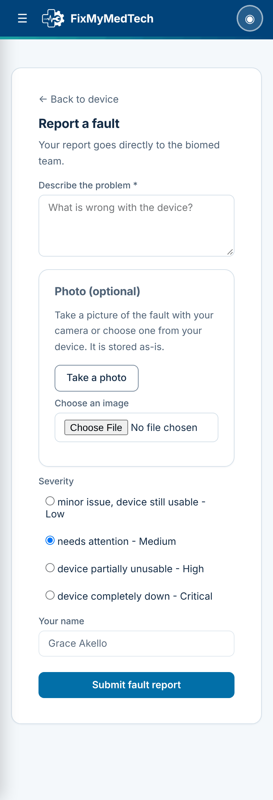
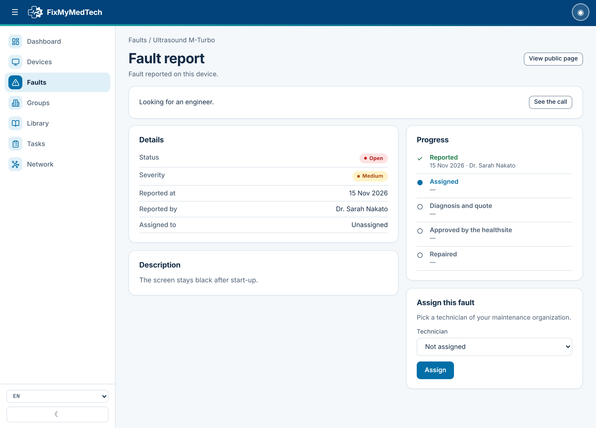

# Report a fault and get it repaired

**In the app:** scan the device's QR sticker, or Equipment → **Devices** → the device → **Report a problem**. The queue is in **Faults**.

**Who this is for:** everyone at the clinic (to report), the clinic administrators (to approve) and the engineers or technicians (to repair).

**What you need before:** a FixMyMedTech account (any account: you must be signed in to report). The device is registered and has its QR sticker.

A fault goes through five steps. Each step is done by a different person and shows on the fault's **Progress**: *Reported → Assigned → Diagnosis and quote → Approved by the healthsite → Repaired*.

## Steps

1. **Report (anyone signed in).** Scan the sticker and tap **⚠ Report fault** (on the device page in the app: **Report a problem**). Under **Describe the problem**, say what is wrong. Add a photo if you can. Choose the **Severity**:
    - *Low*: minor issue, device still usable;
    - *Medium*: needs attention;
    - *High*: device partially unusable;
    - *Critical*: device completely down.

    Tap **Submit fault report**. *High* and *Critical* put the device out of service (status *Fault*).
2. **Assign (administrator of the maintenance organisation).** The fault appears in **Faults**. Open it, choose the **Technician** under **Assign this fault**, tap **Assign**. If the clinic used **Call an engineer** and accepted an offer, this step is done for you.
3. **Diagnose and quote (the assigned technician).** Write the diagnosis and an estimated price. Tap **Send for approval**.
4. **Approve (administrator of the clinic where the device is).** Read the diagnosis and the price. Tap **Approve**, or **Reject** with a comment: it goes back to the technician. A device without a healthsite is approved by the maintenance organisation's administrator.
5. **Repair (the technician).** On site, tap **I have started the repair** (optional). Once fixed, write what was done and the final price, tap **Close the fault**.

<figure markdown>
{ .phone loading=lazy }
<figcaption>Report a fault from a phone.</figcaption>
</figure>

{ .shot loading=lazy }

??? note "Watch the video (recorded on an earlier version of the app)"
    <video src="../videos/report-fault-en.mp4" controls playsinline preload="none" style="width:100%;max-width:360px;border-radius:12px;display:block;margin:0 auto;"></video>

## What happens next

- After each step, the next person finds the fault in **Faults** (the queue of the organisations they maintain for) or in **Tasks** (**Repairs and services assigned to me**).
- The device goes back to *Operational* once no other serious fault is open on it.
- If the fault came from **Call an engineer**, the clinic is asked **Does it work now?** at the end. See [Call an engineer](call-engineer.md).
- Anyone with the QR sticker can follow the fault on the device's public page (**View public page**).

## If something goes wrong

- **I am sent to the sign-in page.** Reporting needs an account. Ask your clinic administrator to add you (**Groups**), or create one.
- **Nobody is assigned.** The maintenance organisation's administrator assigns faults. No administrator, or nobody answering? Use [Call an engineer](call-engineer.md).
- **I don't see Assign, Approve or Close.** Each step only shows to the person allowed to do it.
- **The repair was rejected.** The technician sees the comment, writes a new diagnosis and sends it again.

<small>Device photo in the video: [Philips Respironics oxygen concentrator](https://commons.wikimedia.org/wiki/File:Philips_Respironics_Oxygen_Concentrator._Photo_taken_by_me_on_April_24th,_2012.jpg) by i_am_jim, Wikimedia Commons, [CC BY-SA 3.0](https://creativecommons.org/licenses/by-sa/3.0/).</small>
