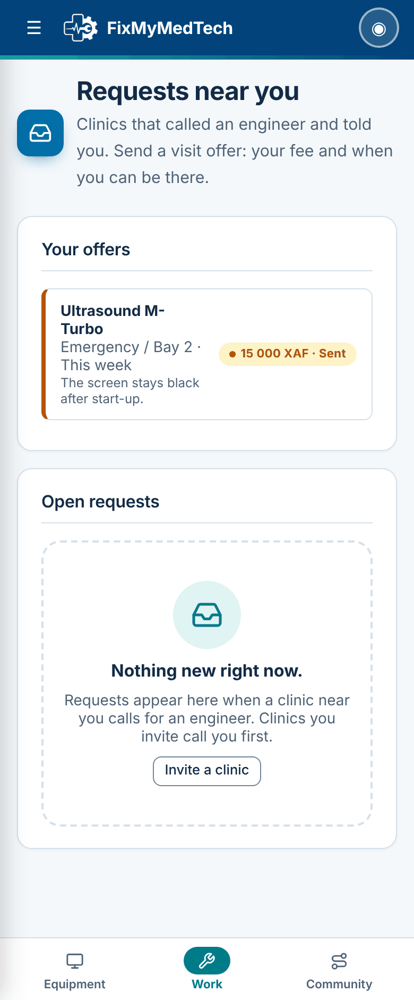
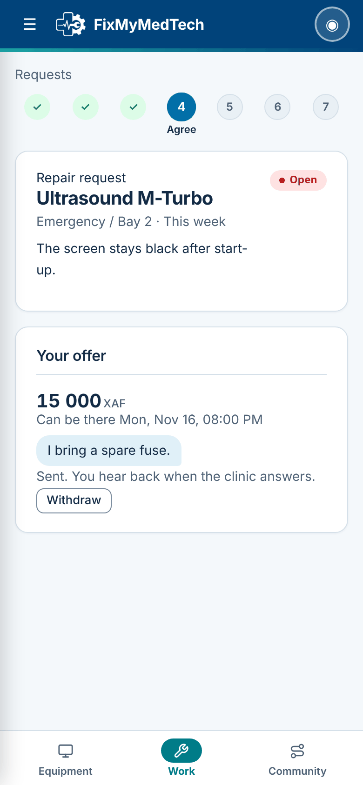

# Solicitudes y ofertas

**En la aplicación:** Trabajo → **Solicitudes** (también **Solicitudes abiertas** en **Tareas**).

**Para quién es:** ingenieros y técnicos que responden a las llamadas de las clínicas.

**Qué necesitas antes:** tus pasos de bienvenida están hechos (solo los Colaboradores envían ofertas). Solo ves una solicitud si te avisaron de ella.

## Por qué ves una solicitud

Cuando una clínica toca **Llamar a un ingeniero**, la aplicación avisa a los ingenieros en este orden. Una etiqueta en cada solicitud dice por qué la ves:

| Etiqueta | Por qué |
| --- | --- |
| **Tu clínica** | Eres uno de los ingenieros responsables de la clínica, o técnico de la organización que mantiene el dispositivo |
| **Lo registraste** | Registraste este dispositivo |
| **Cerca** | La llamada se amplió a los Colaboradores cuya ciudad coincide con la de la clínica (después de 20 minutos para **El equipo se paró**, 4 horas para **Esta semana**) |

## Pasos

1. Abre **Solicitudes**. **Solicitudes abiertas** lista las llamadas de las que te avisaron; **Tus ofertas** lista lo que enviaste.
2. Abre una solicitud. Lee qué pasa, la urgencia y el dispositivo.
3. Envía una oferta: tu **Tarifa de visita** (en la moneda local, por ejemplo XAF) y **Puedo llegar** (fecha y hora, dentro de las próximas dos semanas). Añade una **Nota** si hace falta (*"Traigo un fusible de repuesto"*). Toca **Enviar oferta**.
    - ¿No es para ti? Toca **No es para mí**.
4. Espera a la clínica. Puede **Aceptar**, o pedir una vez una tarifa menor: entonces aceptas o rechazas su precio.
5. ¿Cambiaste de idea antes de que responda la clínica? Toca **Retirar**.

Una oferta cubre la visita y el diagnóstico. La reparación en sí se cotiza después del diagnóstico, en la página de la falla.

<figure markdown>
{ .phone loading=lazy }
<figcaption>Solicitudes cerca de ti.</figcaption>
</figure>
<figure markdown>
{ .phone loading=lazy }
<figcaption>Tu oferta, esperando a la clínica.</figcaption>
</figure>

## Qué pasa después

- **Aceptada**: la falla se te asigna y las demás ofertas se cierran. Ve a diagnosticar y luego sigue [Reportar una falla y conseguir que se repare](report-fault.md) (diagnóstico y cotización, aprobación, reparación).
- Al final la clínica responde **¿Funciona ahora?** y valora la reparación. Si todavía no funciona, la reparación vuelve a ti.
- **Se eligió otra oferta**: no hay nada que hacer.

El pago se acuerda entre tú y la clínica, fuera de la aplicación.

## Si algo sale mal

- **"Completa tus pasos de bienvenida para enviar ofertas."** No tienes hechos los tres pasos de bienvenida.
- **"Arrival must be within the next two weeks."** (mensaje en inglés) Elige una fecha más cercana.
- **"Esta solicitud ya no está abierta."** La clínica aceptó otra oferta o dejó de buscar.
- **Nunca me llegan solicitudes.** Rellena tu ciudad en tu perfil: las solicitudes "Cerca" la usan. Y pide a tus clínicas que te nombren ingeniero responsable.
