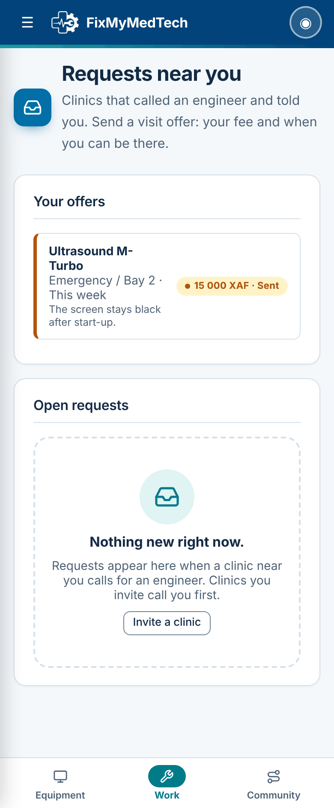
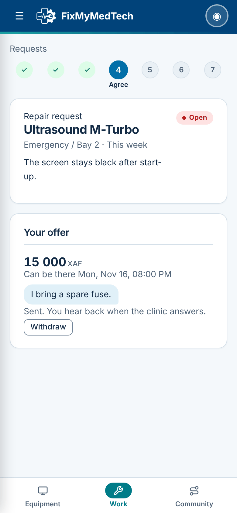

# Demandes et offres

**Dans l'application :** Travail → **Demandes** (aussi **Demandes ouvertes** dans **Tâches**).

**Pour qui :** les ingénieurs et techniciens qui répondent aux appels des cliniques.

**Ce qu'il vous faut avant :** vos étapes d'accueil sont terminées (seuls les Contributeurs envoient des offres). Vous ne voyez une demande que si vous en avez été prévenu.

## Pourquoi vous voyez une demande

Quand une clinique touche **Appeler un ingénieur**, l'application prévient les ingénieurs dans cet ordre. Une étiquette sur chaque demande dit pourquoi vous la voyez :

| Étiquette | Pourquoi |
| --- | --- |
| **Votre clinique** | Vous êtes l'un des ingénieurs responsables de la clinique, ou technicien de l'organisation qui entretient l'appareil |
| **Vous l'avez enregistré** | Vous avez enregistré cet appareil |
| **À proximité** | L'appel s'est élargi aux Contributeurs dont la ville est celle de la clinique (après 20 minutes pour **L'appareil est à l'arrêt**, 4 heures pour **Cette semaine**) |

## Étapes

1. Ouvrez **Demandes**. **Demandes ouvertes** liste les appels dont vous avez été prévenu ; **Vos offres** liste ce que vous avez envoyé.
2. Ouvrez une demande. Lisez ce qui se passe, l'urgence et l'appareil.
3. Envoyez une offre : votre **Prix de la visite** (dans la monnaie locale, par exemple XAF) et **Je peux venir** (date et heure, dans les deux prochaines semaines). Ajoutez une **Note** si utile (*« J'apporte un fusible de rechange »*). Touchez **Envoyer l'offre**.
    - Pas pour vous ? Touchez **Pas pour moi**.
4. Attendez la clinique. Elle peut **Accepter**, ou demander une fois un prix plus bas : vous acceptez alors son prix ou vous le refusez.
5. Vous avez changé d'avis avant la réponse de la clinique ? Touchez **Retirer**.

Une offre couvre le déplacement et le diagnostic. La réparation elle-même est chiffrée après le diagnostic, sur la page de la panne.

<figure markdown>
{ .phone loading=lazy }
<figcaption>Demandes près de chez vous.</figcaption>
</figure>
<figure markdown>
{ .phone loading=lazy }
<figcaption>Votre offre, en attente de la clinique.</figcaption>
</figure>

## Et ensuite

- **Acceptée** : la panne vous est assignée et les autres offres se ferment. Allez diagnostiquer, puis suivez [Signaler une panne et la faire réparer](report-fault.md) (diagnostic et devis, approbation, réparation).
- À la fin, la clinique répond à **Ça marche maintenant ?** et note la réparation. Si ça ne marche toujours pas, la réparation vous revient.
- **Une autre offre a été choisie** : rien à faire.

Le paiement se décide entre vous et la clinique, en dehors de l'application.

## En cas de problème

- **« Terminez vos étapes d'accueil pour envoyer des offres. »** Vos trois étapes d'accueil ne sont pas toutes terminées.
- **« Arrival must be within the next two weeks. »** (message en anglais) Choisissez une date plus proche.
- **« Cette demande n'est plus ouverte. »** La clinique a accepté une autre offre ou a arrêté de chercher.
- **Je ne reçois jamais de demandes.** Renseignez votre ville sur votre profil : les demandes « À proximité » l'utilisent. Et demandez à vos cliniques de vous nommer ingénieur responsable.
