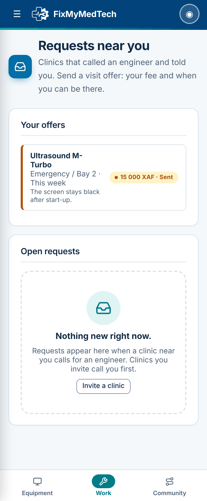
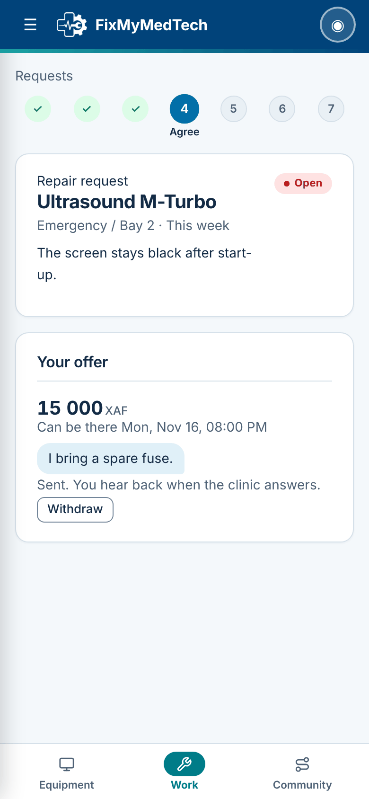

# Requests and offers

**In the app:** Work → **Requests** (also **Open requests** on **Tasks**).

**Who this is for:** engineers and technicians who answer clinics' calls.

**What you need before:** your welcome steps are done (only Contributors send offers). You see a request only when you were told about it.

## Why you see a request

When a clinic taps **Call an engineer**, the app tells engineers in this order. A label on each request says why you see it:

| Label | Why |
| --- | --- |
| **Your clinic** | You are one of the clinic's responsible engineers, or a technician of the organisation that maintains the device |
| **You registered it** | You registered this device |
| **Nearby** | The call widened to Contributors whose city matches the clinic's (after 20 minutes for **Device stopped**, 4 hours for **This week**) |

## Steps

1. Open **Requests**. **Open requests** lists the calls you were told about; **Your offers** lists what you sent.
2. Open a request. Read what is happening, the urgency and the device.
3. Send an offer: your **Visit fee** (in the local currency, for example XAF) and **I can be there** (date and time, within the next two weeks). Add a **Note** if useful (*"I bring a spare fuse"*). Tap **Send offer**.
    - Not for you? Tap **Not for me**.
4. Wait for the clinic. It can **Accept**, or ask once for a lower fee: you then accept or decline its price.
5. Changed your mind before the clinic answers? Tap **Withdraw**.

An offer covers coming and diagnosing. The repair itself is quoted after the diagnosis, on the fault page.

<figure markdown>
{ .phone loading=lazy }
<figcaption>Requests near you.</figcaption>
</figure>
<figure markdown>
{ .phone loading=lazy }
<figcaption>Your offer, waiting for the clinic.</figcaption>
</figure>

## What happens next

- **Accepted**: the fault is assigned to you and the other offers close. Go and diagnose, then follow [Report a fault and get it repaired](report-fault.md) (diagnosis and quote, approval, repair).
- At the end the clinic answers **Does it work now?** and rates the repair. If it still doesn't work, the repair comes back to you.
- **Another offer was chosen**: nothing to do.

Payment is agreed between you and the clinic, outside the app.

## If something goes wrong

- **"Finish your welcome steps to send offers."** Your three welcome steps are not all done.
- **"Arrival must be within the next two weeks."** Choose an earlier date.
- **"This request is no longer open."** The clinic accepted another offer or stopped looking.
- **I never get requests.** Fill in your city on your profile: "Nearby" requests use it. And ask your clinics to name you as a responsible engineer.
