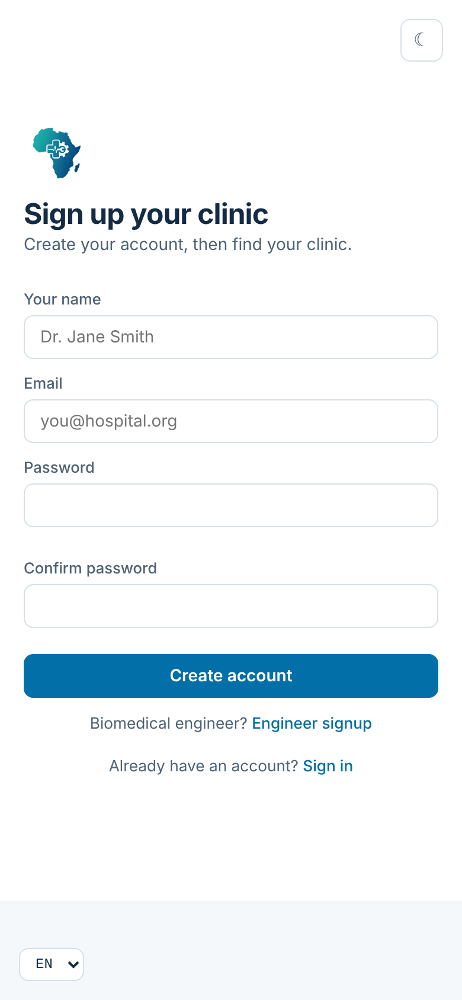
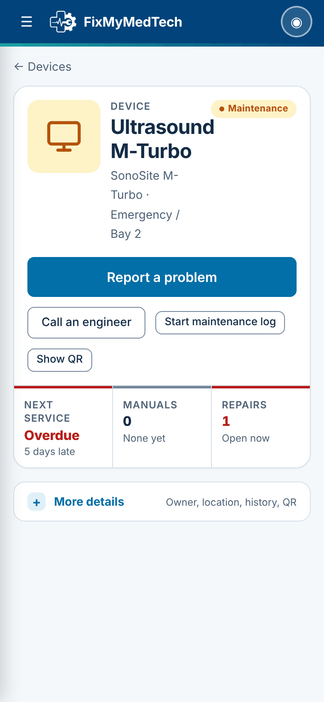

# Trabajo en una clínica

**En la aplicación:** un solo menú: **Panel**, **Dispositivos**, **Fallas**, **Grupos**, **Biblioteca**, **Tareas**, **Red**.

**Para quién es:** administradores de clínica, enfermeros, médicos y técnicos de la clínica.

**Qué necesitas:** un teléfono o un ordenador, y un correo electrónico. Nada que instalar.

## 1. Consigue tu cuenta { #1-get-your-account }

Hay tres maneras de entrar. Elige la tuya.

=== "Un ingeniero invitó a mi clínica"

    1. Abre el correo *"{engineer} invita a tu clínica a FixMyMedTech"* y toca el enlace.
    2. Escribe tu nombre y una contraseña (8 caracteres o más). Toca **Crear la cuenta de la clínica**.
    3. Sigue con [Configura tu clínica](#2-set-up-your-clinic).

    Una clínica invitada queda activa al instante: no hace falta la charla de la clínica.

=== "Sin invitación"

    1. Abre **platform.fixmymedtech.org/clinic/signup** (la página de registro para clínicas).
    2. Rellena **Tu nombre**, tu correo y una contraseña. Toca **Crear cuenta**.
    3. Sigue con [Configura tu clínica](#2-set-up-your-clinic).

    Una clínica sin invitación espera su **charla de la clínica** antes de que se puedan registrar dispositivos (paso 3 más abajo).

=== "Mi clínica me añadió"

    El administrador de tu clínica te añade desde **Grupos**. Recibes un correo con un enlace para elegir tu contraseña. Luego inicia sesión: las páginas de tu clínica ya están abiertas. Pasa al [paso 4](#4-find-your-devices).

{ .phone loading=lazy }

## 2. Configura tu clínica { #2-set-up-your-clinic }

**Configura tu clínica** tiene tres pasos.

1. **Busca tu clínica.** Toca **Usar mi ubicación**, o escribe tu ciudad y toca **Buscar**. La lista muestra los centros de salud de healthsites.io, del más cercano al más lejano. Toca **Es mi clínica**.
    - ¿No está en la lista? Toca **Crear mi clínica**, rellena el nombre, el país, la región, la dirección y el tipo, y toca **Crear la clínica**.
2. **Perfil de la clínica.** Revisa los datos y toca **OK**. Puedes cambiarlos más tarde en la página de la clínica.
3. **Ingenieros** (clínicas invitadas) o **Charla de la clínica** (las demás): mira más abajo.

{ .phone loading=lazy }

!!! warning "Esta clínica ya tiene un administrador"
    Si alguien ya gestiona tu clínica en FixMyMedTech, pídele que te añada (**Grupos → Gestionar organización → Invitar usuario**).

## 3. Nombra a tus ingenieros, o reserva tu charla de la clínica

**Si te invitó un ingeniero**, la aplicación pregunta: *"¿Confirmas que {engineer} puede registrar equipos en nombre de {clinic}?"*

- **Sí**: pasa a ser uno de tus **ingenieros responsables**. Puede registrar tus dispositivos y ver sus páginas privadas.
- **Ahora no**: no se le abre nada. Puedes confirmarlo más tarde desde la pestaña **Ingenieros**.

Puedes añadir más ingenieros: escribe su correo, elige **Externo** o **Interno (personal)**, toca **Añadir ingeniero**. Una persona nueva recibe un correo y debe terminar tres pasos de bienvenida antes de poder registrar dispositivos.

**Si nadie te invitó**, toca **Reservar la charla**: una llamada corta con la comunidad sobre cómo trabajan juntos clínicas e ingenieros. Después de la charla, un anfitrión desbloquea tu clínica. Hasta entonces, **nadie puede registrar dispositivos para tu clínica, ni siquiera sus propios administradores.**

Toca **Ir a mi clínica** para terminar.

{ .shot loading=lazy }

## 4. Encuentra tus dispositivos { #4-find-your-devices }

- **Panel** se abre con **Te necesita hoy**: fallas abiertas, servicios atrasados y próximos. Detalles en [Cuida los dispositivos de tu clínica](clinic-devices.md).
- **Dispositivos** lista todos los dispositivos. **Requiere atención** deja solo los que tienen un problema.

Los dispositivos suelen registrarlos tus ingenieros. Tus administradores también pueden registrarlos: mira [Registrar un dispositivo](register-device.md).

## 5. Pega una etiqueta QR en cada dispositivo

Cada dispositivo tiene una etiqueta QR. Al escanearla con la cámara de cualquier teléfono se abre la página pública del dispositivo, donde se reportan las fallas.

- Tu ingeniero suele traer etiquetas impresas y registra cada dispositivo escaneando su etiqueta.
- Para imprimir una tú mismo: abre el dispositivo, toca **Mostrar QR** y luego **Imprimir** o **Descargar PNG**.

## 6. Reporta tu primera falla

1. Escanea la etiqueta del dispositivo (o abre el dispositivo en **Dispositivos**).
2. Toca **Reportar un problema** (en la página pública: **⚠ Reportar falla**). Debes haber iniciado sesión.
3. Describe el problema, añade una foto si puedes, elige la **Gravedad** y toca **Enviar reporte de falla**.

Todos los pasos: [Reportar una falla y conseguir que se repare](report-fault.md).

## 7. Llama a un ingeniero

En la página del dispositivo, toca **Llamar a un ingeniero**, di qué pasa y qué tan urgente es. Primero se avisa a tus ingenieros y luego a los ingenieros de tu ciudad. Responden con una tarifa de visita y una hora; tú aceptas una.

Todos los pasos: [Llamar a un ingeniero](call-engineer.md).

<figure markdown>
{ .phone loading=lazy }
<figcaption>La página del dispositivo: reportar un problema, llamar a un ingeniero, mostrar el QR.</figcaption>
</figure>

## Si algo sale mal

- **"Esta clínica ya tiene un administrador en FixMyMedTech."** Pídele a esa persona que te añada desde **Grupos**.
- **Los ingenieros no pueden registrar nuestros dispositivos.** Mira la pestaña **Ingenieros**: cada ingeniero muestra **Puede registrar**, **Esperando pasos de bienvenida**, **Esperando la charla de la clínica** o **Ahora no**. Mira [Preguntas y problemas](faq.md#my-clinic-is-waiting-for-its-clinic-talk).
- **No me llegó el correo.** Mira [Preguntas y problemas](faq.md#i-didnt-get-the-email).
