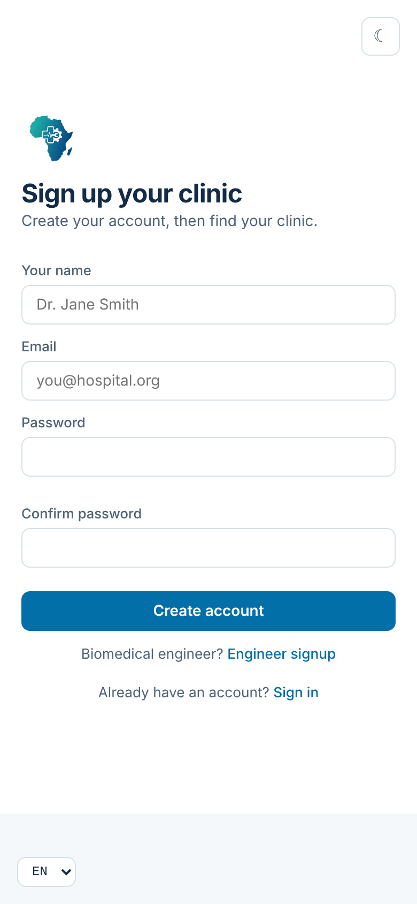
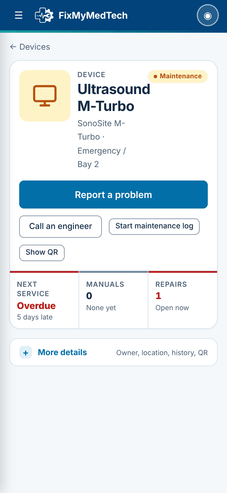

# Je travaille dans une clinique

**Dans l'application :** un seul menu : **Tableau de bord**, **Appareils**, **Pannes**, **Groupes**, **Bibliothèque**, **Tâches**, **Réseau**.

**Pour qui :** administrateurs de clinique, infirmiers, médecins et techniciens de clinique.

**Ce qu'il vous faut :** un téléphone ou un ordinateur, et une adresse e-mail. Rien à installer.

## 1. Obtenir votre compte { #1-get-your-account }

Il y a trois façons d'entrer. Choisissez la vôtre.

=== "Un ingénieur a invité ma clinique"

    1. Ouvrez l'e-mail *« {ingénieur} invite votre clinique sur FixMyMedTech »* et touchez le lien.
    2. Saisissez votre nom et un mot de passe (8 caractères ou plus). Touchez **Créer le compte de la clinique**.
    3. Passez à [Configurer votre clinique](#2-set-up-your-clinic).

    Une clinique invitée est active tout de suite : pas besoin de rencontre clinique.

=== "Sans invitation"

    1. Ouvrez **platform.fixmymedtech.org/clinic/signup** (la page d'inscription des cliniques).
    2. Remplissez **Votre nom**, votre e-mail et un mot de passe. Touchez **Créer le compte**.
    3. Passez à [Configurer votre clinique](#2-set-up-your-clinic).

    Une clinique sans invitation attend sa **rencontre clinique** avant que l'on puisse enregistrer ses appareils (étape 3 ci-dessous).

=== "Ma clinique m'a ajouté"

    L'administrateur de votre clinique vous ajoute depuis **Groupes**. Vous recevez un e-mail avec un lien pour choisir votre mot de passe. Connectez-vous ensuite : les pages de votre clinique sont déjà ouvertes. Passez à [l'étape 4](#4-find-your-devices).

{ .phone loading=lazy }

## 2. Configurer votre clinique { #2-set-up-your-clinic }

**Configurez votre clinique** se fait en trois étapes.

1. **Trouvez votre clinique.** Touchez **Utiliser ma position**, ou tapez votre ville et touchez **Rechercher**. La liste montre les établissements de santé de healthsites.io, du plus proche au plus éloigné. Touchez **C'est ma clinique**.
    - Pas dans la liste ? Touchez **Créer ma clinique**, remplissez le nom, le pays, la région, l'adresse et le type, puis touchez **Créer la clinique**.
2. **Profil de la clinique.** Vérifiez les informations et touchez **OK**. Vous pourrez les modifier plus tard sur la page de la clinique.
3. **Ingénieurs** (cliniques invitées) ou **Rencontre clinique** (les autres) : voir ci-dessous.

{ .phone loading=lazy }

!!! warning "Cette clinique a déjà un administrateur"
    Si quelqu'un gère déjà votre clinique sur FixMyMedTech, demandez-lui de vous ajouter (**Groupes → Gérer l'organisation → Inviter un utilisateur**).

## 3. Nommer vos ingénieurs, ou réserver votre rencontre clinique

**Si un ingénieur vous a invité**, l'application demande : *« Confirmez-vous que {ingénieur} peut enregistrer des équipements au nom de {clinique} ? »*

- **Oui** : il devient l'un de vos **ingénieurs responsables**. Il peut enregistrer vos appareils et voir leurs pages privées.
- **Pas maintenant** : rien ne s'ouvre pour lui. Vous pourrez le confirmer plus tard depuis l'onglet **Ingénieurs**.

Vous pouvez ajouter d'autres ingénieurs : tapez leur e-mail, choisissez **Externe** ou **Interne (personnel)**, touchez **Ajouter l'ingénieur**. Une personne nouvelle reçoit un e-mail et doit terminer trois étapes d'accueil avant de pouvoir enregistrer des appareils.

**Si personne ne vous a invité**, touchez **Réserver la rencontre** : un court appel avec la communauté sur la collaboration entre cliniques et ingénieurs. Après la rencontre, un animateur débloque votre clinique. D'ici là, **personne ne peut enregistrer d'appareils pour votre clinique, pas même ses administrateurs.**

Touchez **Aller à ma clinique** pour terminer.

{ .shot loading=lazy }

## 4. Retrouver vos appareils { #4-find-your-devices }

- **Tableau de bord** s'ouvre sur **À traiter aujourd'hui** : pannes ouvertes, entretiens manqués et à venir. Détails dans [Suivre les appareils de votre clinique](clinic-devices.md).
- **Appareils** liste tous les appareils. **À traiter** ne garde que ceux qui ont un problème.

Les appareils sont en général enregistrés par vos ingénieurs. Vos administrateurs peuvent aussi le faire : voir [Enregistrer un appareil](register-device.md).

## 5. Coller une étiquette QR sur chaque appareil

Chaque appareil a une étiquette QR. La scanner avec l'appareil photo de n'importe quel téléphone ouvre la page publique de l'appareil, d'où l'on signale une panne.

- Votre ingénieur apporte en général des étiquettes imprimées et enregistre chaque appareil en scannant son étiquette.
- Pour en imprimer une vous-même : ouvrez l'appareil, touchez **Afficher le QR**, puis **Imprimer** ou **Télécharger PNG**.

## 6. Signaler votre première panne

1. Scannez l'étiquette de l'appareil (ou ouvrez l'appareil dans **Appareils**).
2. Touchez **Signaler un problème** (sur la page publique : **⚠ Signaler un problème**). Vous devez être connecté.
3. Décrivez le problème, ajoutez une photo si possible, choisissez la **Gravité**, touchez **Envoyer le signalement**.

Toutes les étapes : [Signaler une panne et la faire réparer](report-fault.md).

## 7. Appeler un ingénieur

Sur la page de l'appareil, touchez **Appeler un ingénieur**, dites ce qui se passe et si c'est urgent. Vos ingénieurs sont prévenus en premier, puis les ingénieurs de votre ville. Ils répondent avec un prix de visite et une heure ; vous en acceptez un.

Toutes les étapes : [Appeler un ingénieur](call-engineer.md).

<figure markdown>
{ .phone loading=lazy }
<figcaption>La page de l'appareil : signaler un problème, appeler un ingénieur, afficher le QR.</figcaption>
</figure>

## En cas de problème

- **« Cette clinique a déjà un administrateur sur FixMyMedTech. »** Demandez à cette personne de vous ajouter depuis **Groupes**.
- **Les ingénieurs ne peuvent pas enregistrer nos appareils.** Regardez l'onglet **Ingénieurs** : chaque ingénieur affiche **Peut enregistrer**, **En attente des étapes d'accueil**, **En attente de la rencontre clinique** ou **Pas maintenant**. Voir [Questions et problèmes](faq.md#my-clinic-is-waiting-for-its-clinic-talk).
- **Je n'ai pas reçu l'e-mail.** Voir [Questions et problèmes](faq.md#i-didnt-get-the-email).
