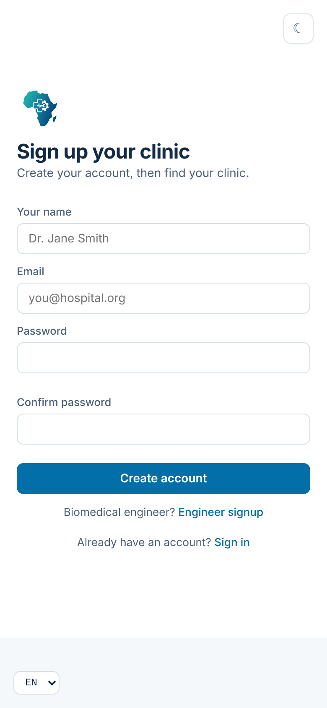
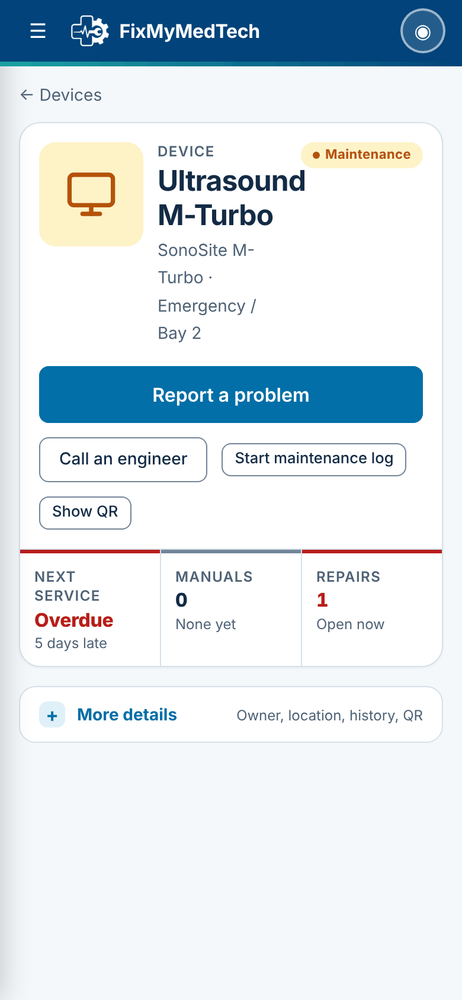

# I work in a clinic

**In the app:** one menu: **Dashboard**, **Devices**, **Faults**, **Groups**, **Library**, **Tasks**, **Network**.

**Who this is for:** clinic administrators, nurses, doctors and clinic technicians.

**What you need:** a phone or a computer, and an email address. Nothing to install.

## 1. Get your account

There are three ways in. Pick yours.

=== "An engineer invited my clinic"

    1. Open the email *"{engineer} invites your clinic to FixMyMedTech"* and tap the link.
    2. Type your name and a password (8 characters or more). Tap **Create the clinic account**.
    3. Go on to [Set up your clinic](#2-set-up-your-clinic).

    An invited clinic is active at once: no clinic talk is needed.

=== "No invitation"

    1. Open **platform.fixmymedtech.org/clinic/signup** (the sign-up page for clinics).
    2. Fill in **Your name**, your email and a password. Tap **Create account**.
    3. Go on to [Set up your clinic](#2-set-up-your-clinic).

    A clinic without an invitation waits for its **clinic talk** before devices can be registered (step 3 below).

=== "My clinic added me"

    Your clinic administrator adds you from **Groups**. You get an email with a link to choose your password. Then sign in: your clinic's pages are already open. Skip to [step 4](#4-find-your-devices).

{ .phone loading=lazy }

## 2. Set up your clinic

**Set up your clinic** has three steps.

1. **Find your clinic.** Tap **Use my location**, or type your city and tap **Search**. The list shows the health facilities of healthsites.io, nearest first. Tap **This is my clinic**.
    - Not in the list? Tap **Create my clinic**, fill in the name, country, region, address and type, and tap **Create the clinic**.
2. **Clinic profile.** Check the details and tap **OK**. You can change them later on the clinic page.
3. **Engineers** (invited clinics) or **Clinic talk** (the others): see below.

{ .phone loading=lazy }

!!! warning "This clinic already has an administrator"
    If someone already manages your clinic on FixMyMedTech, ask them to add you (**Groups → Manage Organization → Invite user**).

## 3. Name your engineers, or book your clinic talk

**If an engineer invited you**, the app asks: *"Do you confirm that {engineer} can register devices in the name of {clinic}?"*

- **Yes**: they become one of your **responsible engineers**. They can register your devices and see their private pages.
- **Not now**: nothing opens for them. You can confirm them later from the **Engineers** tab.

You can add more engineers: type their email, choose **External** or **Internal (staff)**, tap **Add engineer**. Someone new gets an email and must finish three welcome steps before they can register devices.

**If nobody invited you**, tap **Book the clinic talk**: a short call with the community about how clinics and engineers work together. After the talk, a host unlocks your clinic. Until then, **nobody can register devices for your clinic, its own administrators included.**

Tap **Go to my clinic** to finish.

{ .shot loading=lazy }

## 4. Find your devices

- **Dashboard** opens with **Needs you today**: open faults, missed and coming services. Details in [Look after your clinic's devices](clinic-devices.md).
- **Devices** lists every device. **Needs attention** keeps only the ones with a problem.

Devices are usually registered by your engineers. Your administrators can register them too: see [Register a device](register-device.md).

## 5. Put a QR sticker on each device

Each device has a QR sticker. Scanning it with any phone camera opens the device's public page, where people report a fault.

- Your engineer usually brings printed stickers and registers each device by scanning its sticker.
- To print one yourself: open the device, tap **Show QR**, then **Print** or **Download PNG**.

## 6. Report your first fault

1. Scan the device's sticker (or open the device in **Devices**).
2. Tap **Report a problem** (on the public page: **⚠ Report fault**). You need to be signed in.
3. Describe the problem, add a photo if you can, choose the **Severity**, tap **Submit fault report**.

Full steps: [Report a fault and get it repaired](report-fault.md).

## 7. Call an engineer

On the device page, tap **Call an engineer**, say what is happening and how urgent it is. Your engineers are told first, then engineers in your city. They answer with a visit fee and a time; you accept one.

Full steps: [Call an engineer](call-engineer.md).

<figure markdown>
{ .phone loading=lazy }
<figcaption>The device page: report a problem, call an engineer, show the QR.</figcaption>
</figure>

## If something goes wrong

- **"This clinic already has an administrator on FixMyMedTech."** Ask that person to add you from **Groups**.
- **Engineers can't register our devices.** Check the **Engineers** tab: each engineer shows **Can register**, **Waiting for welcome steps**, **Waiting for clinic talk** or **Not now**. See [Questions and problems](faq.md#my-clinic-is-waiting-for-its-clinic-talk).
- **I didn't get the email.** See [Questions and problems](faq.md#i-didnt-get-the-email).
