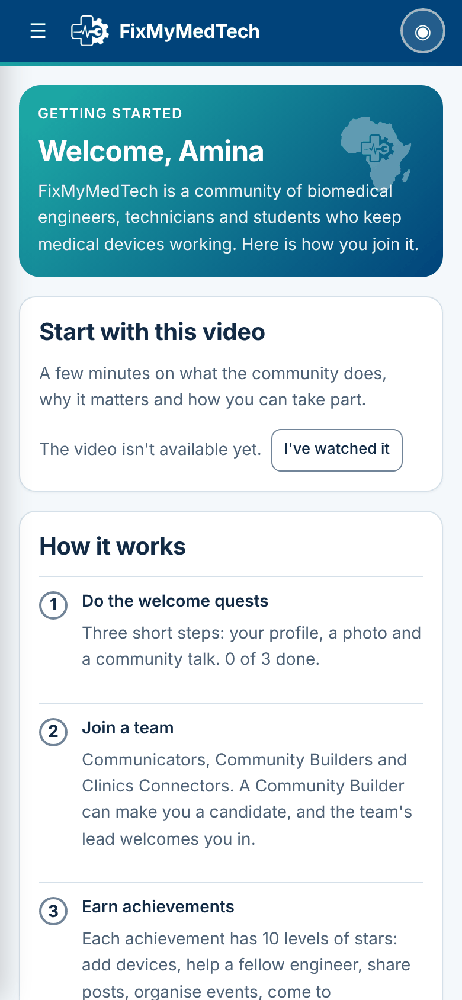
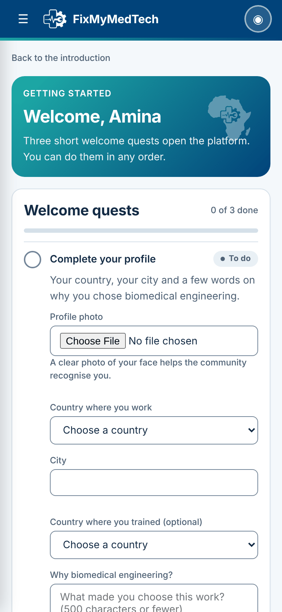

# Soy ingeniero

**En la aplicación:** primero **Primeros pasos**; luego los tres mundos: Equipamiento Trabajo Comunidad.

**Para quién es:** ingenieros y técnicos biomédicos, estudiantes de ingeniería biomédica.

**Qué necesitas:** un teléfono con cámara (para escanear las etiquetas QR), un correo electrónico, una foto de tu cara.

## 1. Únete

1. Abre **platform.fixmymedtech.org/join** (en la página de inicio de sesión: **Crear una cuenta**).
2. Rellena **Únete a la comunidad**: tu nombre, correo, contraseña, el país donde trabajas, tu ciudad, quién eres y por qué quieres unirte. Marca que un miembro de la comunidad puede contactarte.
3. Toca **Unirme a la comunidad**.

¿Te invitó una clínica? Abre el enlace del correo *"{clinic} te invita a cuidar sus equipos"* y toca **Crear mi cuenta**.

Ahora eres **Visitante**. Solo ves **Primeros pasos** y **Biblioteca**.

## 2. Haz tus tres pasos de bienvenida

**Primeros pasos** se abre con una breve introducción. Toca **Empezar las misiones de bienvenida**.

1. **Completa tu perfil**: tu país, tu ciudad y unas palabras sobre por qué elegiste la ingeniería biomédica.
2. **Añade una foto**: una foto clara de tu cara. Queda hecho en cuanto la subes.
3. **Asiste a una charla de la comunidad**: reserva una videollamada corta (**Reservar una charla**). El anfitrión marca este paso después de la llamada. ¿No hay enlace de reserva? Un anfitrión te contactará.

Puedes hacerlos en cualquier orden. Unirte al Discord y la pregunta sobre redes sociales son extras opcionales.

<figure markdown>
{ .phone loading=lazy }
<figcaption>Primeros pasos: la introducción.</figcaption>
</figure>
<figure markdown>
{ .phone loading=lazy }
<figcaption>Las tres misiones de bienvenida.</figcaption>
</figure>

Cuando termina el tercer paso ves *"¡Bienvenido/a a la comunidad!"*. Eres **Colaborador**: se abren los tres mundos y **Primeros pasos** desaparece.

## 3. Encuentra tu camino en los tres mundos

| Mundo | Qué haces ahí |
| --- | --- |
| Equipamiento | Los dispositivos que cuidas: **Panel**, **Dispositivos**, **Fallas**, **Grupos**, **Biblioteca** |
| Trabajo | Tu día: **Tareas**, **Solicitudes**, **Invitar a una clínica** |
| Comunidad | **Mi recorrido**, **Equipos y logros**, **Red**, **Tablero de tareas** |

Más en [Cómo está organizada la aplicación](three-worlds.md).

## 4. Invita a una clínica

1. Ve a **Trabajo → Invitar a una clínica**.
2. Escribe el **Correo de contacto de la clínica** y, si quieres, un mensaje. Toca **Enviar invitación**.
3. Síguela en **Invitaciones enviadas**: **Enviada** → **Cuenta creada** → **Clínica configurada** → **Confirmado** (o **Ahora no**).

La clínica debe **confirmarte**. Durante su configuración se le pregunta *"¿Confirmas que {you} puede registrar equipos en nombre de {clinic}?"*. Si responde **Ahora no**, todavía puede confirmarte más tarde desde su pestaña **Ingenieros**. Hasta que te confirme, no puedes registrar sus dispositivos.

{ .shot loading=lazy }

Detalles: [Invitar a una clínica](invite-clinic.md).

## 5. Registra un dispositivo para una clínica

Puedes registrar dispositivos para una clínica cuando:

- la clínica te nombró uno de sus **ingenieros responsables** (te confirmó o te añadió), y
- tus pasos de bienvenida están hechos, y
- la clínica está activa (una clínica que se registró sin invitación espera su charla de la clínica).

**Tus clínicas**, en **Invitar a una clínica**, muestra cada clínica con **Puede registrar**, **Esperando pasos de bienvenida**, **Esperando la charla de la clínica** o **Ahora no**.

Después escanea la etiqueta QR del dispositivo y completa los seis pasos: [Registrar un dispositivo](register-device.md).

## 6. Responde a las solicitudes de reparación

Cuando una clínica toca **Llamar a un ingeniero**, primero se avisa a los ingenieros que nombró, luego a quien registró el dispositivo y después a los Colaboradores de la ciudad de la clínica.

1. **Trabajo → Solicitudes** lista las solicitudes de las que te avisaron.
2. Abre una, indica tu **tarifa de visita** y cuándo puedes llegar, y toca **Enviar oferta**. O toca **No es para mí**.
3. Si la clínica acepta, la falla se te asigna: diagnostica, consigue la aprobación y repara.

Detalles: [Solicitudes y ofertas](requests.md) y [Reportar una falla y conseguir que se repare](report-fault.md).

## 7. Planifica tu día con Tareas

**Trabajo → Tareas** (la página se llama **Mis Tareas**) muestra:

- **Solicitudes abiertas** cerca de ti, las más urgentes primero;
- **Mis tareas comunitarias**, tomadas en el tablero de tareas;
- **Reparaciones y servicios asignados a mí**.

En **Dispositivos**, cambia a **Por clínica** para ver tus dispositivos agrupados por clínica. Mira [Espacio del ingeniero](engineer-workspace.md).

## 8. Crece con la comunidad

- **Mi recorrido**: tus equipos, tus logros y tus cuentas.
- **Equipos y logros**: el mapa de los tres equipos y los cinco logros.
- **Tablero de tareas**: pequeños trabajos (encontrar un manual, verificar una clínica) que dan puntos.

Mira [Cómo funciona la comunidad](community-guide.md).

## Si algo sale mal

- **Todas las páginas me devuelven a Primeros pasos.** Tus pasos de bienvenida no están todos hechos. Mira [Preguntas y problemas](faq.md#i-dont-see-the-work-tab).
- **"Aún no puedes registrar un equipo."** Mira [¿Por qué no puedo registrar un dispositivo?](faq.md#why-cant-i-register-a-device)
- **No hay enlace de reserva para la charla.** Un anfitrión te contacta por correo. Revisa tu carpeta de spam.
