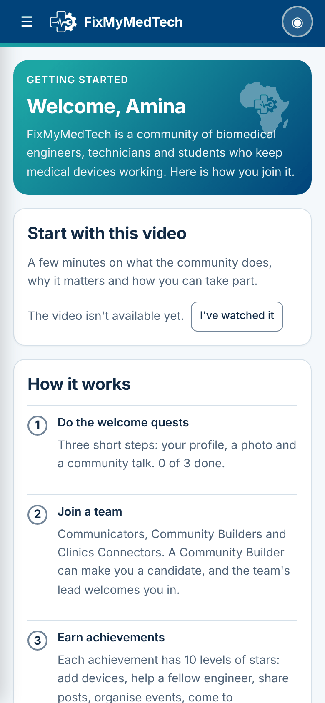
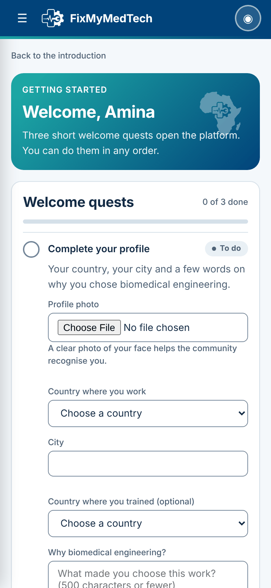
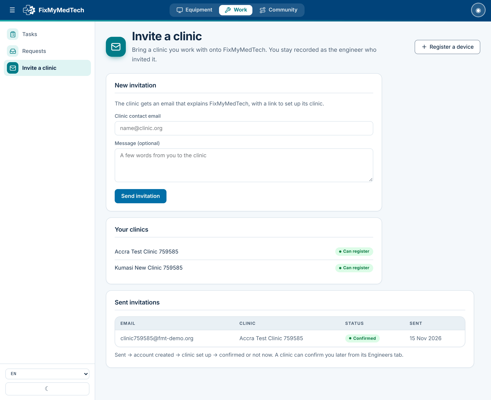

# Je suis ingénieur

**Dans l'application :** d'abord **Premiers pas** ; ensuite les trois mondes : Équipements Travail Communauté.

**Pour qui :** ingénieurs et techniciens biomédicaux, étudiants en génie biomédical.

**Ce qu'il vous faut :** un téléphone avec appareil photo (pour scanner les étiquettes QR), une adresse e-mail, une photo de votre visage.

## 1. S'inscrire

1. Ouvrez **platform.fixmymedtech.org/join** (sur la page de connexion : **Créer un compte**).
2. Remplissez **Rejoindre la communauté** : votre nom, e-mail, mot de passe, le pays où vous travaillez, votre ville, qui vous êtes, pourquoi vous voulez nous rejoindre. Acceptez qu'un membre de la communauté vous contacte.
3. Touchez **Rejoindre la communauté**.

Invité par une clinique ? Ouvrez le lien de l'e-mail *« {clinique} vous invite à entretenir ses équipements »* et touchez plutôt **Créer mon compte**.

Vous êtes maintenant **Visiteur**. Vous ne voyez que **Premiers pas** et **Bibliothèque**.

## 2. Faire vos trois étapes d'accueil

**Premiers pas** s'ouvre sur une courte introduction. Touchez **Commencer les quêtes de bienvenue**.

1. **Complétez votre profil** : votre pays, votre ville et quelques mots sur votre choix du génie biomédical.
2. **Ajoutez une photo** : une photo nette de votre visage. Validé dès l'envoi.
3. **Assistez à une rencontre de la communauté** : réservez un court appel vidéo (**Réserver une rencontre**). L'animateur coche cette étape après l'appel. Pas de lien de réservation ? Un animateur vous contactera.

Faites-les dans l'ordre que vous voulez. Rejoindre le Discord et la question sur les réseaux sociaux sont facultatifs.

<figure markdown>
{ .phone loading=lazy }
<figcaption>Premiers pas : l'introduction.</figcaption>
</figure>
<figure markdown>
{ .phone loading=lazy }
<figcaption>Les trois quêtes de bienvenue.</figcaption>
</figure>

Quand la troisième étape est faite, vous voyez *« Bienvenue dans la communauté ! »*. Vous êtes **Contributeur** : les trois mondes s'ouvrent et **Premiers pas** disparaît.

## 3. Se repérer dans les trois mondes

| Monde | Ce que vous y faites |
| --- | --- |
| Équipements | Les appareils dont vous vous occupez : **Tableau de bord**, **Appareils**, **Pannes**, **Groupes**, **Bibliothèque** |
| Travail | Votre journée : **Tâches**, **Demandes**, **Inviter une clinique** |
| Communauté | **Mon parcours**, **Équipes et réussites**, **Réseau**, **Tableau des tâches** |

Plus de détails dans [Comment l'application est organisée](three-worlds.md).

## 4. Inviter une clinique

1. Allez dans **Travail → Inviter une clinique**.
2. Tapez l'**E-mail de contact de la clinique** et, si vous voulez, un message. Touchez **Envoyer l'invitation**.
3. Suivez-la sous **Invitations envoyées** : **Envoyée** → **Compte créé** → **Clinique configurée** → **Confirmé** (ou **Pas maintenant**).

La clinique doit **vous confirmer**. Pendant sa configuration, on lui demande *« Confirmez-vous que {vous} peut enregistrer des équipements au nom de {clinique} ? »*. Si elle répond **Pas maintenant**, elle peut encore vous confirmer plus tard depuis son onglet **Ingénieurs**. Tant qu'elle ne vous a pas confirmé, vous ne pouvez pas enregistrer ses appareils.

{ .shot loading=lazy }

Détails : [Inviter une clinique](invite-clinic.md) (en anglais).

## 5. Enregistrer un appareil pour une clinique

Vous pouvez enregistrer des appareils pour une clinique quand :

- la clinique vous a nommé l'un de ses **ingénieurs responsables** (elle vous a confirmé, ou ajouté), et
- vos étapes d'accueil sont terminées, et
- la clinique est active (une clinique inscrite sans invitation attend sa rencontre clinique).

**Vos cliniques**, sur **Inviter une clinique**, montre chaque clinique avec **Peut enregistrer**, **En attente des étapes d'accueil**, **En attente de la rencontre clinique** ou **Pas maintenant**.

Scannez ensuite l'étiquette QR de l'appareil et remplissez les six étapes : [Enregistrer un appareil](register-device.md).

## 6. Répondre aux demandes de réparation

Quand une clinique touche **Appeler un ingénieur**, les ingénieurs qu'elle a nommés sont prévenus en premier, puis celui qui a enregistré l'appareil, puis les contributeurs de la ville de la clinique.

1. **Travail → Demandes** liste les demandes dont vous avez été prévenu.
2. Ouvrez-en une, indiquez votre **prix de visite** et quand vous pouvez venir, touchez **Envoyer l'offre**. Ou touchez **Pas pour moi**.
3. Si la clinique accepte, la panne vous est assignée : diagnostic, approbation, réparation.

Détails : [Demandes et offres](requests.md) (en anglais) et [Signaler une panne et la faire réparer](report-fault.md).

## 7. Organiser votre journée avec Tâches

**Travail → Tâches** (la page s'appelle **Mes Tâches**) montre :

- les **Demandes ouvertes** près de chez vous, les plus urgentes d'abord ;
- **Mes tâches communautaires**, prises sur le tableau des tâches ;
- **Réparations et entretiens qui me sont confiés**.

Dans **Appareils**, choisissez **Par clinique** pour voir vos appareils regroupés par clinique. Voir [L'espace de l'ingénieur](engineer-workspace.md).

## 8. Grandir avec la communauté

- **Mon parcours** : vos équipes, vos réussites et vos chiffres.
- **Équipes et réussites** : la carte des trois équipes et des cinq réussites.
- **Tableau des tâches** : de petits travaux (trouver un manuel, vérifier une clinique) qui rapportent des points.

Voir [Comment fonctionne la communauté](community-guide.md) (en anglais).

## En cas de problème

- **Chaque page me ramène à Premiers pas.** Vos étapes d'accueil ne sont pas toutes faites. Voir [Questions et problèmes](faq.md#i-dont-see-the-work-tab).
- **« Vous ne pouvez pas encore enregistrer d'équipement. »** Voir [Pourquoi je ne peux pas enregistrer d'appareil ?](faq.md#why-cant-i-register-a-device)
- **Pas de lien de réservation pour la rencontre.** Un animateur vous contacte par e-mail. Regardez dans vos courriers indésirables.
