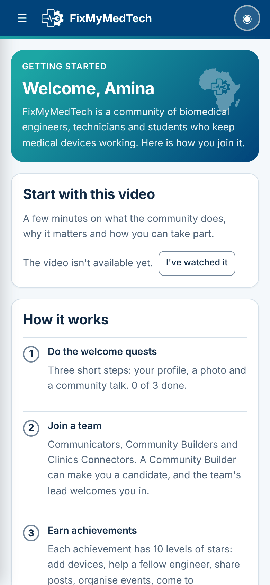
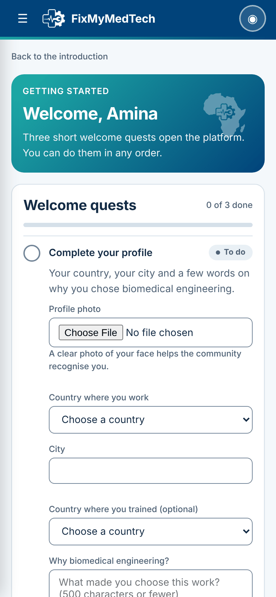

# I am an engineer

**In the app:** first **Getting started**; then all three worlds: Equipment Work Community.

**Who this is for:** biomedical engineers and technicians, students in biomedical engineering.

**What you need:** a phone with a camera (to scan QR stickers), an email address, a photo of your face.

## 1. Join

1. Open **platform.fixmymedtech.org/join** (on the sign-in page: **Create an account**).
2. Fill in **Join the community**: your name, email, password, the country where you work, your city, who you are, why you want to join. Tick that a community member may contact you.
3. Tap **Join the community**.

Invited by a clinic? Open the link in the email *"{clinic} invites you to look after its devices"* and tap **Create my account** instead.

You are now a **Visitor**. You see only **Getting started** and **Library**.

## 2. Do your three welcome steps

**Getting started** opens on a short introduction. Tap **Start the welcome quests**.

1. **Complete your profile**: your country, your city and a few words on why you chose biomedical engineering.
2. **Add a photo**: a clear photo of your face. Done as soon as it is uploaded.
3. **Attend a community talk**: book a short video call (**Book a talk**). The host ticks this step after the call. No booking link? A host will contact you.

You can do them in any order. Joining the Discord and the social media question are optional extras.

<figure markdown>
{ .phone loading=lazy }
<figcaption>Getting started: the introduction.</figcaption>
</figure>
<figure markdown>
{ .phone loading=lazy }
<figcaption>The three welcome quests.</figcaption>
</figure>

When the third step is done you see *"Welcome to the community!"*. You are a **Contributor**: the three worlds open and **Getting started** disappears.

## 3. Find your way in the three worlds

| World | What you do there |
| --- | --- |
| Equipment | The devices you look after: **Dashboard**, **Devices**, **Faults**, **Groups**, **Library** |
| Work | Your day: **Tasks**, **Requests**, **Invite a clinic** |
| Community | **My journey**, **Teams and achievements**, **Network**, **Task board** |

More in [How the app is organised](three-worlds.md).

## 4. Invite a clinic

1. Go to **Work → Invite a clinic**.
2. Type the **Clinic contact email** and, if you like, a message. Tap **Send invitation**.
3. Follow it under **Sent invitations**: **Sent** → **Account created** → **Clinic set up** → **Confirmed** (or **Not now**).

The clinic must **confirm you**. During its setup it is asked *"Do you confirm that {you} can register devices in the name of {clinic}?"*. If it answers **Not now**, it can still confirm you later from its **Engineers** tab. Until it confirms you, you cannot register its devices.

{ .shot loading=lazy }

Details: [Invite a clinic](invite-clinic.md).

## 5. Register a device for a clinic

You can register devices for a clinic when:

- the clinic named you one of its **responsible engineers** (it confirmed you, or added you), and
- your welcome steps are done, and
- the clinic is active (a clinic that signed up without an invitation waits for its clinic talk).

**Your clinics**, on **Invite a clinic**, shows each clinic with **Can register**, **Waiting for welcome steps**, **Waiting for clinic talk** or **Not now**.

Then scan the device's QR sticker and fill in the six steps: [Register a device](register-device.md).

## 6. Answer repair requests

When a clinic taps **Call an engineer**, the engineers it named are told first, then the one who registered the device, then Contributors in the clinic's city.

1. **Work → Requests** lists the requests you were told about.
2. Open one, give your **visit fee** and when you can be there, tap **Send offer**. Or tap **Not for me**.
3. If the clinic accepts, the fault is assigned to you: diagnose, get approval, repair.

Details: [Requests and offers](requests.md) and [Report a fault and get it repaired](report-fault.md).

## 7. Plan your day with Tasks

**Work → Tasks** (the page is called **My Tasks**) shows:

- **Open requests** near you, the most urgent first;
- **My community tasks**, taken on the task board;
- **Repairs and services assigned to me**.

On **Devices**, switch to **By clinic** to see your devices grouped by clinic. See [Engineer workspace](engineer-workspace.md).

## 8. Grow with the community

- **My journey**: your teams, your achievements and your counts.
- **Teams and achievements**: the map of the three teams and five achievements.
- **Task board**: small jobs (find a manual, verify a clinic) worth points.

See [How the community works](community-guide.md).

## If something goes wrong

- **Every page brings me back to Getting started.** Your welcome steps are not all done. See [Questions and problems](faq.md#i-dont-see-the-work-tab).
- **"You can't register a device yet."** See [Why can't I register a device?](faq.md#why-cant-i-register-a-device)
- **No booking link for the talk.** A host contacts you by email. Check your spam folder.
