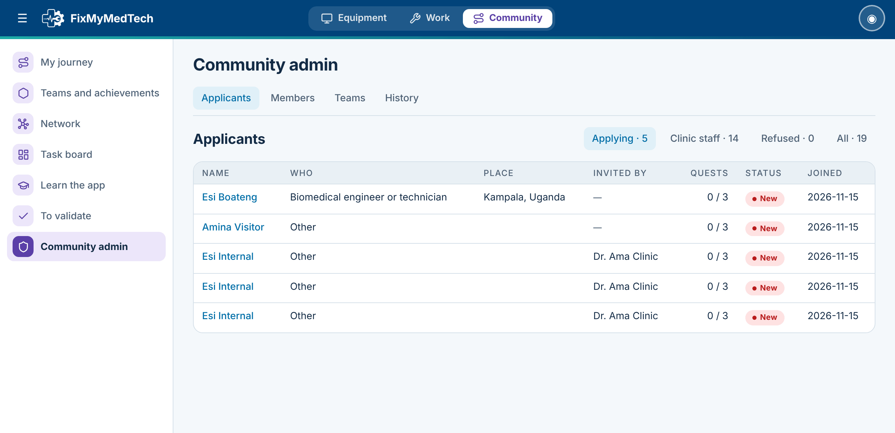

# Soy líder o anfitrión en la comunidad

**En la aplicación:** Trabajo → **Anfitrión de charlas**; Comunidad → **Por validar** y **Admin comunidad**.

**Para quién es:** anfitriones de charlas, miembros y líderes de los tres equipos, administradores de la comunidad.

**Qué necesitas antes:** tus pasos de bienvenida están hechos (eres **Colaborador**) y tienes un lugar en un equipo. Tus poderes de equipo se pausan después de seis meses sin ninguna actividad; cualquier acción en la aplicación los reactiva.

## Quién puede hacer qué

| Eres | Puedes |
| --- | --- |
| **Candidato** en un equipo | Nada extra todavía: estás en camino de entrar al equipo |
| **Miembro** o **Líder** de cualquier equipo | Validar reclamos de los logros de tu equipo (**Por validar**), ver la pestaña **Miembros** de **Admin comunidad**, reconocer logros de tu equipo |
| **Constructor de comunidad** (miembro o líder) | Además: confirmar charlas de la comunidad (**Anfitrión de charlas**), dar la bienvenida a los Visitantes y revisarlos (**Solicitantes**), hacer a cualquier persona **Candidato** de cualquier equipo |
| **Conector de clínicas** (miembro o líder) | Además: desbloquear clínicas después de su charla de la clínica (**Anfitrión de charlas**) |
| **Líder** de un equipo | Además: hacer **Miembros** de tu equipo a otras personas o quitarlas, editar la página de tu equipo, ver el **Historial** |
| **Superusuario** | Todo, incluido nombrar y quitar a los **Líderes** |

Nadie valida ni reconoce sus propios logros.

## Dirige una charla

**Trabajo → Anfitrión de charlas** tiene dos listas.

**Visitantes haciendo sus pasos de bienvenida** (Constructores de comunidad):

1. Reserva o realiza la charla de la comunidad con el Visitante (una videollamada corta).
2. Después de la llamada, búscalo en la lista y toca **Confirmar asistencia**.
3. Si su perfil y su foto también están hechos, pasa a ser Colaborador de inmediato.

**Clínicas esperando su charla** (Conectores de clínicas): clínicas que se registraron sin invitación.

1. Realiza la charla de la clínica con el contacto de la clínica (nombre y correo en la lista).
2. Toca **Charla hecha, desbloquear**. Desde ese momento los administradores de la clínica y sus ingenieros responsables pueden registrar sus dispositivos.

{ .shot loading=lazy }

Detalles: [Anfitrión de charlas](talk-host.md).

## Valida reclamos y revisa tareas

**Comunidad → Por validar** lista:

- **Reclamos por validar** de los logros de tu equipo, con la nota y la foto. Un **Líder** confirma solo; si no, **dos miembros del equipo** deben estar de acuerdo (**Estoy de acuerdo**). También puedes **Pedir más** o **Rechazar**.
- **Tareas por revisar** del tablero de tareas: **Está bien** da los puntos, **Devolver** devuelve la tarea.

{ .shot loading=lazy }

Detalles: [Por validar](validate.md).

## Gestiona equipos y solicitantes

**Comunidad → Admin comunidad** tiene cuatro pestañas: **Solicitantes**, **Miembros**, **Equipos** e **Historial**.

- **Solicitantes** (Constructores de comunidad): personas que hacen sus pasos de bienvenida. Abre una para ver sus respuestas y misiones, elige un **Anfitrión/a**, fija la fecha de la llamada y toca **Guardar**. Después de la llamada toca **La llamada se realizó**. Para rechazar, abre **Rechazar a este solicitante** y da un motivo (la persona lo ve); **Reabrir la solicitud** lo deshace.
- **Miembros**: busca personas por nombre, ciudad, equipo o país. Abre una para **Reconocer** un logro (cuántas veces, una nota) o **Añadir a un equipo** con un nivel que puedas dar (Candidato, Miembro; Líder para los superusuarios).
- **Equipos**: qué hace cada equipo, su título de LinkedIn y sus logros. El líder de un equipo ve **Editar este equipo** (textos en inglés, francés y español).
- **Historial**: cada cambio, quién lo hizo y por qué (líderes y superusuarios).

{ .shot loading=lazy }

## Admin de la comunidad y superusuarios

- **Nombrar a un líder**: **Miembros** → la persona → **Añadir a un equipo** → "Equipo · Líder" (solo superusuarios).
- Quitar a alguien de un equipo, o quitar un reconocimiento, pide un motivo, que queda en el historial.

## Si algo sale mal

- **No veo Anfitrión de charlas.** Aparece para los miembros y líderes de los Constructores de comunidad o de los Conectores de clínicas. Los candidatos no la ven.
- **No veo Por validar ni Admin comunidad.** Tienes que ser miembro o líder de un equipo y haber estado activo en los últimos seis meses.
- **"Reclamos por validar" dice "Únete a un equipo para validar sus logros."** No estás en el equipo que reconoce ese logro.
- **El Visitante todavía no ve la plataforma después de que confirmé la charla.** Su paso de perfil o de foto aún no está hecho. Ve su progreso en **Primeros pasos**.
