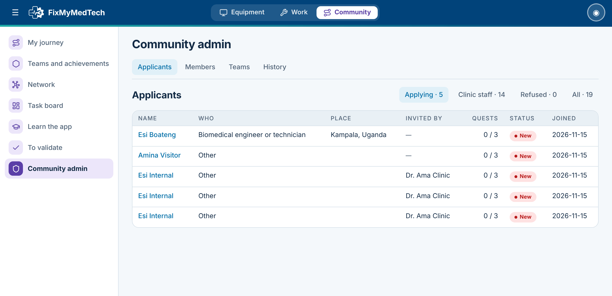

# J'anime ou je dirige dans la communauté

**Dans l'application :** Travail → **Animation des rencontres** ; Communauté → **À valider** et **Admin communauté**.

**Pour qui :** animateurs de rencontres, membres et responsables des trois équipes, administrateurs de la communauté.

**Ce qu'il vous faut avant :** vos étapes d'accueil sont terminées (vous êtes **Contributeur**) et vous avez une place dans une équipe. Vos pouvoirs d'équipe se mettent en pause après six mois sans activité ; n'importe quelle action dans l'application les relance.

## Qui peut faire quoi

| Vous êtes | Vous pouvez |
| --- | --- |
| **Candidat** dans une équipe | Rien de plus pour l'instant : vous êtes en route vers l'équipe |
| **Membre** ou **Responsable** d'une équipe | Valider les déclarations pour les réussites de votre équipe (**À valider**), voir l'onglet **Membres** d'**Admin communauté**, reconnaître les réussites de votre équipe |
| **Bâtisseur de communauté** (membre ou responsable) | En plus : confirmer les rencontres de la communauté (**Animation des rencontres**), accueillir et suivre les Visiteurs (**Candidats**), faire de n'importe qui un **Candidat** pour n'importe quelle équipe |
| **Connecteur de cliniques** (membre ou responsable) | En plus : débloquer les cliniques après leur rencontre clinique (**Animation des rencontres**) |
| **Responsable** d'une équipe | En plus : faire de quelqu'un un **Membre** de votre équipe ou l'en retirer, modifier la page de l'équipe, voir l'**Historique** |
| **Superutilisateur** | Tout, y compris nommer et retirer les **Responsables** |

Personne ne valide ni ne reconnaît ses propres réussites.

## Animer une rencontre

**Travail → Animation des rencontres** a deux listes.

**Visiteurs en cours d'étapes d'accueil** (Bâtisseurs de communauté) :

1. Réservez ou tenez la rencontre de la communauté avec le Visiteur (un court appel vidéo).
2. Après l'appel, trouvez-le dans la liste et touchez **Confirmer la présence**.
3. Si son profil et sa photo sont faits aussi, il devient Contributeur tout de suite.

**Cliniques en attente de leur rencontre clinique** (Connecteurs de cliniques) : les cliniques inscrites sans invitation.

1. Tenez la rencontre clinique avec le contact de la clinique (nom et e-mail dans la liste).
2. Touchez **Rencontre faite, débloquer**. À partir de là, les administrateurs de la clinique et ses ingénieurs responsables peuvent enregistrer ses appareils.

{ .shot loading=lazy }

Détails : [Talk host](talk-host.md) (en anglais).

## Valider les déclarations et vérifier les tâches

**Communauté → À valider** liste :

- les **Déclarations à valider** pour les réussites de votre équipe, avec la note et la photo. Un **Responsable** confirme seul (**Confirmer**) ; sinon **deux membres de l'équipe** doivent être d'accord (**Je suis d'accord**). Vous pouvez aussi **Demander plus** ou **Refuser**.
- les **Tâches à vérifier** du tableau des tâches : **C'est bon** donne les points, **Renvoyer** rend la tâche.

{ .shot loading=lazy }

Détails : [To validate](validate.md) (en anglais).

## Gérer les équipes et les candidats

**Communauté → Admin communauté** a quatre onglets : **Candidats**, **Membres**, **Équipes** et **Historique**.

- **Candidats** (Bâtisseurs de communauté) : les personnes qui font leurs étapes d'accueil. Ouvrez-en une pour voir ses réponses et ses quêtes, choisissez un **Hôte**, fixez la date de l'appel, touchez **Enregistrer**. Après l'appel, touchez **L'appel a eu lieu**. Pour refuser, ouvrez **Refuser ce candidat** et donnez une raison (la personne la voit) ; **Rouvrir la candidature** annule.
- **Membres** : cherchez des personnes par nom, ville, équipe ou pays. Ouvrez-en une pour **Reconnaître une réussite** (combien de fois, une note) ou **Ajouter à une équipe** au niveau que vous pouvez donner (Candidat, Membre ; Responsable pour les superutilisateurs).
- **Équipes** : ce que fait chaque équipe, son titre LinkedIn et ses réussites. Le responsable d'une équipe voit **Modifier cette équipe** (textes en anglais, français et espagnol).
- **Historique** : chaque changement, qui l'a fait et pourquoi (responsables et superutilisateurs).

{ .shot loading=lazy }

## Superutilisateurs

- **Nommer un responsable** : **Membres** → la personne → **Ajouter à une équipe** → « Équipe · Responsable » (superutilisateurs seulement).
- Retirer quelqu'un d'une équipe, ou retirer une reconnaissance, demande une raison, gardée dans l'historique.

## En cas de problème

- **Je ne vois pas Animation des rencontres.** Elle apparaît pour les membres et responsables des Bâtisseurs de communauté ou des Connecteurs de cliniques. Les candidats ne la voient pas.
- **Je ne vois pas À valider ni Admin communauté.** Il faut être membre ou responsable d'une équipe, et actif dans les six derniers mois.
- **« Déclarations à valider » dit « Rejoignez une équipe pour valider ses réussites. »** Vous n'êtes pas dans l'équipe qui reconnaît cette réussite.
- **Le Visiteur ne voit toujours pas la plateforme après ma confirmation.** Son étape profil ou photo n'est pas encore faite. Il voit sa progression sur **Premiers pas**.
