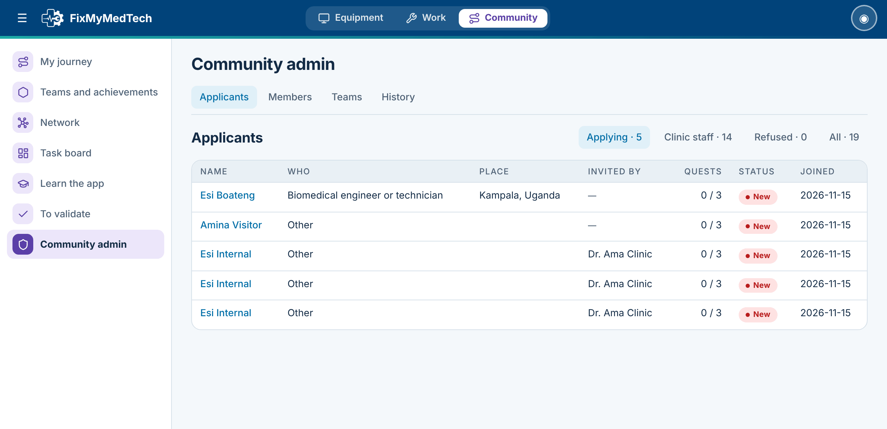

# I lead or host in the community

**In the app:** Work → **Talk host**; Community → **To validate** and **Community admin**.

**Who this is for:** talk hosts, members and leads of the three teams, community admins.

**What you need before:** your welcome steps are done (you are a **Contributor**) and you have a place in a team. Your team powers pause after six months without any activity; any action in the app restarts them.

## Who can do what

| You are | You can |
| --- | --- |
| **Candidate** in a team | Nothing extra yet: you are on your way into the team |
| **Member** or **Lead** of any team | Validate claims for your team's achievements (**To validate**), see the **Members** tab of **Community admin**, recognise achievements of your team |
| **Community Builder** (member or lead) | Also: confirm community talks (**Talk host**), welcome and review Visitors (**Applicants**), make anyone a **Candidate** for any team |
| **Clinics Connector** (member or lead) | Also: unlock clinics after their clinic talk (**Talk host**) |
| **Lead** of a team | Also: make people **Members** of your team or remove them, edit your team's page, see the **History** |
| **Superuser** | Everything, including naming and removing **Leads** |

Nobody validates or recognises their own achievements.

## Host a talk

**Work → Talk host** has two lists.

**Visitors doing their welcome steps** (Community Builders):

1. Book or hold the community talk with the Visitor (a short video call).
2. After the call, find them in the list and tap **Confirm talk attended**.
3. If their profile and photo are done too, they become a Contributor at once.

**Clinics waiting for their clinic talk** (Clinics Connectors): clinics that signed up without an invitation.

1. Hold the clinic talk with the clinic's contact (name and email in the list).
2. Tap **Talk done, unlock**. From now on the clinic's administrators and its responsible engineers can register its devices.

{ .shot loading=lazy }

Details: [Talk host](talk-host.md).

## Validate claims and check tasks

**Community → To validate** lists:

- **Claims to validate** for your team's achievements, with the note and the photo. A **Lead** confirms alone; otherwise **two team members** must agree (**I agree**). You can also **Ask for more** or **Decline**.
- **Tasks to check** from the task board: **Looks good** gives the points, **Send back** returns the task.

{ .shot loading=lazy }

Details: [To validate](validate.md).

## Manage teams and candidates

**Community → Community admin** has four tabs: **Applicants**, **Members**, **Teams** and **History**.

- **Applicants** (Community Builders): people doing their welcome steps. Open one to see their answers and quests, pick a **Host**, set the call date, tap **Save**. After the call tap **The call took place**. To refuse, open **Refuse this applicant** and give a reason (they see it); **Reopen the application** undoes it.
- **Members**: search people by name, city, team or country. Open one to **Recognise** an achievement (how many times, a note) or **Add to a team** at a level you are allowed to give (Candidate, Member; Lead for superusers).
- **Teams**: what each team does, its LinkedIn title and achievements. A team's lead sees **Edit this team** (texts in English, French and Spanish).
- **History**: every change, who did it and why (leads and superusers).

{ .shot loading=lazy }

## Community admin and superusers

- **Name a lead**: **Members** → the person → **Add to a team** → "Team · Lead" (superusers only).
- Removing someone from a team, or removing a recognition, asks for a reason, kept in the history.

## If something goes wrong

- **I don't see Talk host.** It shows for members and leads of the Community Builders or the Clinics Connectors. Candidates don't see it.
- **I don't see To validate or Community admin.** You need to be a member or lead of a team, and active in the last six months.
- **"Claims to validate" says "Join a team to validate its achievements."** You are not in the team that recognises that achievement.
- **The Visitor still doesn't see the platform after I confirmed the talk.** Their profile or photo step is not done yet. They see their progress on **Getting started**.
