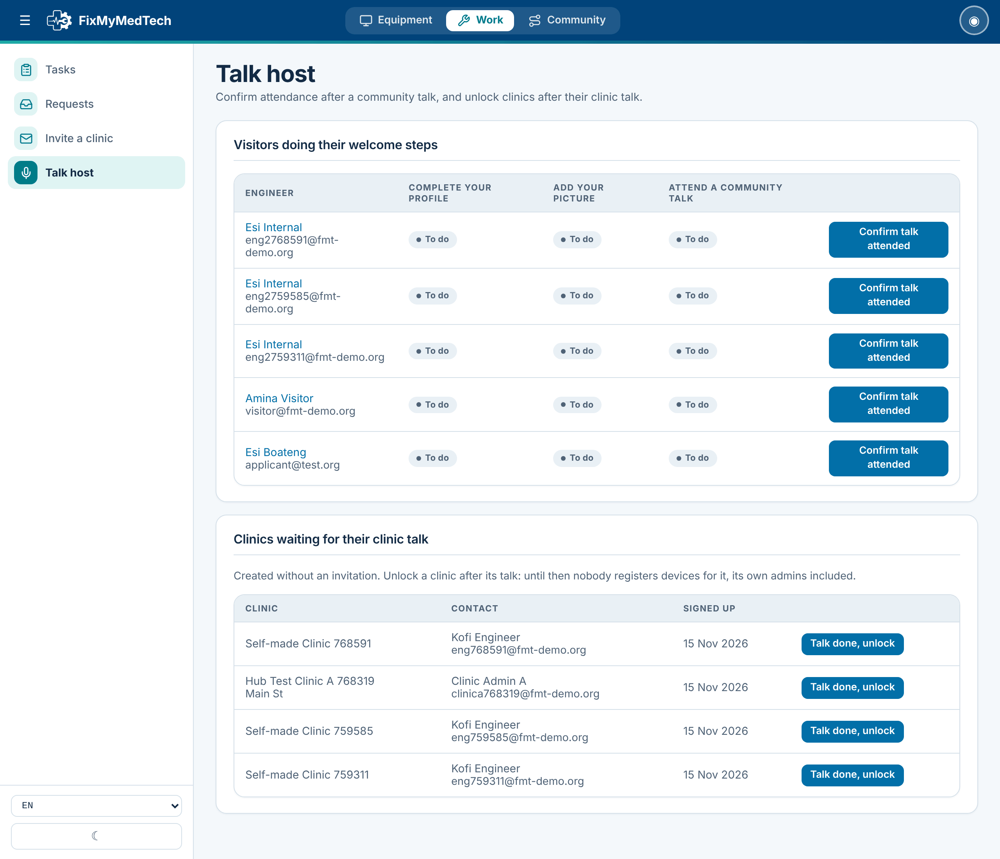

# Animation des rencontres

**Dans l'application :** Travail → **Animation des rencontres** (pour les comptes clinique : dans le menu unique).

**Pour qui :** les membres et responsables des **Bâtisseurs de communauté** (rencontres de la communauté) et des **Connecteurs de cliniques** (rencontres cliniques).

**Ce qu'il vous faut avant :** votre place dans l'une de ces deux équipes, et un outil d'appel vidéo pour tenir les rencontres.

Deux sortes de rencontres ouvrent des choses dans l'application :

| Rencontre | Avec qui | Ce qu'elle ouvre | Qui la confirme |
| --- | --- | --- | --- |
| **Rencontre de la communauté** | Un Visiteur (nouvel ingénieur) | Sa troisième étape d'accueil. Avec les deux autres faites, il devient Contributeur | Les Bâtisseurs de communauté |
| **Rencontre clinique** | Une clinique inscrite sans invitation | L'enregistrement d'appareils pour cette clinique (ses administrateurs et ses ingénieurs) | Les Connecteurs de cliniques |

## Étapes

### Confirmer une rencontre de la communauté

1. Tenez la rencontre : un court appel vidéo pour accueillir le Visiteur et expliquer comment fonctionne la communauté.
2. Ouvrez **Animation des rencontres**. Sous **Visiteurs en cours d'étapes d'accueil**, chaque ligne montre les trois étapes (**Complétez votre profil**, **Ajoutez votre photo**, **Participez à une rencontre de la communauté**) avec **Terminé** ou **À faire**.
3. Touchez **Confirmer la présence** sur sa ligne.

On peut aussi le faire depuis **Admin communauté → Candidats** avec **L'appel a eu lieu**.

### Débloquer une clinique

1. Tenez la rencontre clinique avec le contact indiqué sous **Cliniques en attente de leur rencontre clinique** (nom et e-mail).
2. Touchez **Rencontre faite, débloquer**.

{ .shot loading=lazy }

## Et ensuite

- **Visiteur** : si son profil et sa photo sont faits aussi, il est Contributeur tout de suite. À la prochaine page qu'il ouvre, il voit *« Bienvenue dans la communauté ! »*.
- **Clinique** : ses administrateurs et ses ingénieurs responsables confirmés peuvent maintenant enregistrer ses appareils.

## En cas de problème

- **Le Visiteur est toujours Visiteur.** Son profil (nom, pays, ville, quelques mots sur lui) ou sa photo manque.
- **Une clinique avec qui j'ai parlé n'est pas dans la liste.** Les cliniques invitées n'attendent jamais de rencontre : elles sont actives dès le départ. Une clinique n'est dans la liste que si elle s'est inscrite sans invitation, ou a été créée depuis **Groupes**.
- **Je ne vois pas Animation des rencontres.** Il faut être membre ou responsable (pas candidat) des Bâtisseurs de communauté ou des Connecteurs de cliniques.
